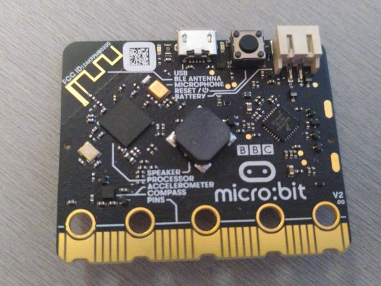
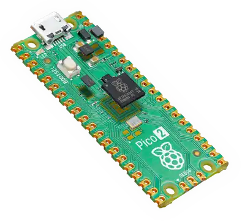
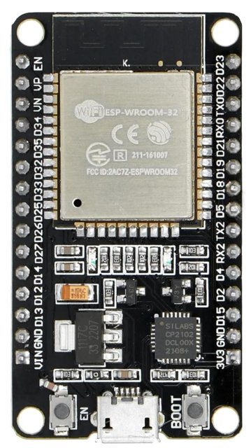

# Embedded Rust на русском: сборник книг

Сборник переводов и адаптаций книг о программировании микроконтроллеров на Rust. Здесь собраны курсы и учебники: от основ языка до проектов на конкретных платах — BBC micro:bit v2, Raspberry Pi Pico 2 (RP2350) и ESP32.

Тексты книг переведены на русский. Код, имена крейтов, команды и сообщения компилятора остаются на английском, как принято в экосистеме Rust.

> **Важно:** это учебные материалы, а не справочник. Мы стараемся сохранять точность, но ключевые детали сверяйте с [официальной документацией Rust](https://doc.rust-lang.org/) и [Embedded Rust Book](https://docs.rust-embedded.org/book/).

**Читать онлайн:** [r007.github.io/EmbeddedRust-Rus](https://r007.github.io/EmbeddedRust-Rus/)
**Исходный код:** [github.com/r007/EmbeddedRust-Rus](https://github.com/r007/EmbeddedRust-Rus)

## 🔌 Платы, которые используют книги

<table>
  <tr>
    <td align="center" width="33%"><br><b>BBC micro:bit v2</b><br>nRF52833 · LED-матрица 5×5, кнопки, датчики<br>Книга: <a href="https://r007.github.io/EmbeddedRust-Rus/discovery-mb2/">Discovery</a></td>
    <td align="center" width="33%"><br><b>Raspberry Pi Pico 2</b><br>RP2350 · GPIO, PWM, I²C, SPI, PIO<br>Книга: <a href="https://r007.github.io/EmbeddedRust-Rus/pico-pico/">impl Rust для RP2350</a></td>
    <td align="center" width="33%"><br><b>ESP32 DevKit</b><br>ESP32 · Wi-Fi, Bluetooth LE, ADC, PWM<br>Книги: <a href="https://r007.github.io/EmbeddedRust-Rus/esp32-book/">impl Rust для ESP32</a>, <a href="https://r007.github.io/EmbeddedRust-Rus/no-std-training/">no_std</a>, <a href="https://r007.github.io/EmbeddedRust-Rus/std-training/">std</a></td>
  </tr>
</table>

## 📖 С чего начать

Книги разделены на четыре категории. Если вы пришли из другого языка или ещё не знаете Rust, начните с основ, затем переходите к теории и практике на плате.

| Категория | Что внутри | Книги |
|-----------|------------|-------|
| 🟦 **Основы Rust** | Язык Rust перед работой с железом | [Практический курс Rust](https://r007.github.io/EmbeddedRust-Rus/rust-training/), [Comprehensive Rust 🦀](https://r007.github.io/EmbeddedRust-Rus/comprehensive-rust/) |
| 🟪 **Теория embedded** | Понятия и архитектура embedded-разработки на Rust | [Встраиваемый Rust](https://r007.github.io/EmbeddedRust-Rus/embedded-book/) |
| 🟩 **Практика на платах** | Проекты на конкретных микроконтроллерных платах | [Discovery (micro:bit v2)](https://r007.github.io/EmbeddedRust-Rus/discovery-mb2/), [impl Rust для RP2350](https://r007.github.io/EmbeddedRust-Rus/pico-pico/), [impl Rust для ESP32](https://r007.github.io/EmbeddedRust-Rus/esp32-book/) |
| 🟧 **Курсы** | Структурированные курсы с упражнениями | [Обучение Embedded Rust для ESP32 (no_std)](https://r007.github.io/EmbeddedRust-Rus/no-std-training/), [Embedded Rust на Espressif (std)](https://r007.github.io/EmbeddedRust-Rus/std-training/) |

## 📚 Книги

| Книга | Категория | Теги | Читать | Скачать |
|-------|-----------|------|--------|---------|
| Практический курс Rust | Основы Rust | `rust`, `embedded`, `async`, `курс` | [онлайн](https://r007.github.io/EmbeddedRust-Rus/rust-training/) | — |
| Comprehensive Rust 🦀 | Основы Rust | `rust`, `bare-metal`, `курс` | [онлайн](https://r007.github.io/EmbeddedRust-Rus/comprehensive-rust/) | [EPUB](https://r007.github.io/EmbeddedRust-Rus/comprehensive-rust/comprehensive-rust.epub), [упражнения (ZIP)](https://r007.github.io/EmbeddedRust-Rus/comprehensive-rust/comprehensive-rust-exercises.zip) |
| Встраиваемый Rust (The Embedded Rust Book) | Теория embedded | `embedded`, `bare-metal`, `no_std` | [онлайн](https://r007.github.io/EmbeddedRust-Rus/embedded-book/) | — |
| Учебник Discovery по Rust на BBC micro-bit v2 | Практика на платах | `micro:bit v2`, `embedded`, `для начинающих`, `gpio`, `uart`, `i2c`, `прерывания` | [онлайн](https://r007.github.io/EmbeddedRust-Rus/discovery-mb2/) | [EPUB](https://r007.github.io/EmbeddedRust-Rus/discovery-mb2/%D0%A3%D1%87%D0%B5%D0%B1%D0%BD%D0%B8%D0%BA%20Discovery%20%D0%BF%D0%BE%20Rust%20%D0%BD%D0%B0%20BBC%20micro-bit%20v2.epub) |
| impl Rust для RP2350 | Практика на платах | `rp2350`, `rp-hal`, `embassy`, `async`, `gpio`, `pwm`, `i2c`, `spi` | [онлайн](https://r007.github.io/EmbeddedRust-Rus/pico-pico/) | — |
| impl Rust для ESP32 | Практика на платах | `esp32`, `esp-hal`, `embassy`, `wifi`, `ble`, `adc`, `pwm`, `spi`, `i2c` | [онлайн](https://r007.github.io/EmbeddedRust-Rus/esp32-book/) | — |
| Обучение Embedded Rust для ESP32 | Курсы | `esp32`, `no_std`, `esp-hal`, `embassy`, `wifi`, `курс` | [онлайн](https://r007.github.io/EmbeddedRust-Rus/no-std-training/) | — |
| Embedded Rust на Espressif | Курсы | `esp32`, `std`, `esp-idf`, `wifi`, `i2c`, `курс` | [онлайн](https://r007.github.io/EmbeddedRust-Rus/std-training/) | — |

Ссылки на EPUB и архив с упражнениями появляются на сайте только для книг, где они собираются. Остальные книги доступны для чтения в браузере.

## 🏷️ Теги

Теги помогают найти книгу по платформе, библиотеке или теме. На [странице каталога](https://r007.github.io/EmbeddedRust-Rus/) по тегам можно фильтровать книги.

**Языки и подход:** `rust` · `embedded` · `bare-metal` · `no_std` · `std` · `async` · `курс` · `для начинающих`

**Платформы:** `micro:bit v2` · `rp2350` · `esp32`

**Библиотеки и фреймворки:** `esp-hal` · `esp-idf` · `rp-hal` · `embassy`

**Периферия и связь:** `gpio` · `pwm` · `adc` · `i2c` · `spi` · `uart` · `прерывания` · `wifi` · `ble`

## 💻 Локальный просмотр и сборка

Для сборки нужны [Rust](https://rustup.rs/) и [mdBook](https://rust-lang.github.io/mdBook/guide/installation.html). Часть книг использует дополнительные препроцессоры: `mdbook-mermaid`, `mdbook-epub`, а для Comprehensive Rust — `mdbook-i18n-helpers`, `mdbook-svgbob`, `mdbook-course` и `mdbook-exerciser`. Точный набор и версии описаны в [docker/Dockerfile](docker/Dockerfile) и [.github/workflows/pages.yml](.github/workflows/pages.yml).

```bash
git clone https://github.com/r007/EmbeddedRust-Rus.git
cd EmbeddedRust-Rus
cargo xtask serve      # собирает все книги и запускает сервер: http://localhost:3000
```

Контейнер для самостоятельного хостинга описан в [docker/README.md](docker/README.md).

## 🤝 Участие в проекте

Исправления опечаток, неточностей и перевода приветствуются. Порядок работы, глоссарий и правила для ссылок описаны в [CONTRIBUTING.md](CONTRIBUTING.md). Сообщить об уязвимости можно по правилам из [SECURITY.md](SECURITY.md).

## 🙏 Авторы и благодарности

Сборник основан на работе авторов оригинальных книг. Все они указаны в файлах лицензий и в метаданных каждой книги:

- **Tweede golf** — курс «Practical Rust Training», основа книги «Практический курс Rust»;
- **Google** (Martin Geisler и участники) — Comprehensive Rust;
- **James Munns** и участники Rust Embedded — The Embedded Rust Book и Discovery;
- **ImplFerris** — книги impl Rust для RP2350 и impl Rust для ESP32;
- **Jesse Braham**, **Sergio Gasquez** и **Anatol Ulrich** — курсы по no_std и std для Espressif.

Перевод всех книг выполнил **Сергей Монин**. Ссылки на английские оригиналы в сборнике намеренно заменены ссылками на этот репозиторий. Имена авторов и сведения о происхождении текста сохранены в лицензионных файлах и в метаданных книг.

## 📜 Лицензии

Каждая книга распространяется по лицензии, которую указал её автор. Файлы лицензий лежат в каталоге книги.

| Книга | Текст | Код и примеры |
|-------|-------|---------------|
| Практический курс Rust (`rust-training/`) | CC BY-SA 4.0 | CC BY-SA 4.0 (вместе с текстом) |
| Comprehensive Rust (`comprehensive-rust/`) | CC BY 4.0 | Apache-2.0 |
| Встраиваемый Rust (`embedded-book/`) | CC BY-SA 4.0 | MIT или Apache-2.0 |
| Discovery (`discovery-mb2/`) | CC BY 4.0 | MIT или Apache-2.0 |
| impl Rust для RP2350 (`pico-pico/`) | CC BY-SA 4.0 | MIT или Apache-2.0 |
| impl Rust для ESP32 (`esp32-book/`) | CC BY-SA 4.0 | MIT или Apache-2.0 |
| Обучение Embedded Rust для ESP32 (`no-std-training/`) | CC BY-SA 4.0 | MIT или Apache-2.0 |
| Embedded Rust на Espressif (`std-training/`) | CC BY-SA 4.0 | MIT или Apache-2.0 |

Скрипты сборки (`xtask/`), Docker-конфигурация, CI и обложки в `covers/` распространяются по лицензии [MIT](LICENSE). Названия языков, инструментов и библиотек (Rust, Cargo, Tokio, mdBook и другие) принадлежат их правообладателям. Для юридических формулировок приоритет имеет английский текст файлов лицензий.
