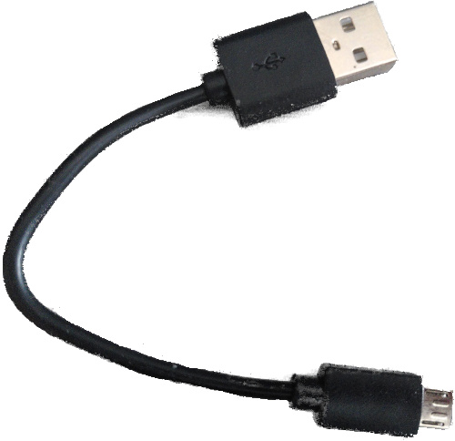

# Требования к оборудованию и знаниям

Главное требование к знаниям для чтения этой книги — знать *некоторый* Rust. Мне трудно точно определить, что такое «некоторый». Очень полезно быть знакомым с основами обобщённых типов (generics) и трейтов. Нужно уметь *пользоваться* замыканиями (closures). Также желательно знать идиомы текущей [редакции Rust].

[редакции Rust]: https://rust-lang-nursery.github.io/edition-guide/

Также для работы с материалом понадобится:

- Плата [Micro:Bit v2] (MB2).

  [micro:bit v2]: https://tech.microbit.org/hardware/

  Эту плату можно купить у множества поставщиков, включая Amazon и Ali Baba. Список поставщиков можно получить непосредственно у BBC, производителя MB2: [список][0].

  [0]: https://microbit.org/buy/

  

  
  

  Существует несколько версий платы `V2`. Материал написан для `V2.00`, но с любой платой `V2` всё должно работать нормально.

- Кабель micro-B USB (ничего особенного — такие, скорее всего, у вас есть). Он нужен, чтобы питать micro:bit, когда тот не работает от батареи, и чтобы обмениваться с ним данными. Убедитесь, что кабель поддерживает передачу данных: некоторые кабели рассчитаны только на зарядку.

  

  
  

  > **ПРИМЕЧАНИЕ** Некоторые наборы micro:bit комплектуются такими кабелями. Кабели от других мобильных устройств тоже подойдут, если они micro-B и умеют передавать данные.

  Официальный набор `micro:bit Go` включает и USB-кабель, и удобный аккумуляторный блок для питания MB2 без USB.

> **FAQ**: Погодите, зачем нужно именно это оборудование?

Так будет проще и мне, и вам.

Материал гораздо доступнее, если не нужно думать о различиях в оборудовании. Поверьте мне на слово.

> **FAQ**: Можно ли работать с этим материалом на другой отладочной плате?

Возможно. Это зависит в основном от двух вещей: от вашего предыдущего опыта работы с микроконтроллерами и от того, есть ли для вашей отладочной платы готовый крейт верхнего уровня. Вам, вероятно, понадобится хотя бы крейт HAL, как [`nrf52833-hal`], который используется здесь. Может оказаться удобнее плата с крейтом поддержки платы (BSP), как [`microbit-v2`], который используется здесь. Если вы планируете использовать другой микроконтроллер, поискать поддерживаемые крейты можно в [Awesome Embedded Rust] или просто в интернете.

[`microbit-v2`]: https://docs.rs/microbit-v2
[`nrf52833-hal`]: https://docs.rs/nrf52833-hal
[Awesome Embedded Rust]: https://github.com/rust-embedded/awesome-embedded-rust

На мой взгляд, с другой отладочной платой этот текст потеряет большую часть своей дружелюбности к новичкам и простоты изложения, так что вы предупреждены.

Если у вас другая плата на базе Arm и вы не считаете себя полным новичком, стоит рассмотреть шаблон проекта [quickstart].

[quickstart]: https://rust-embedded.github.io/cortex-m-quickstart/cortex_m_quickstart/
