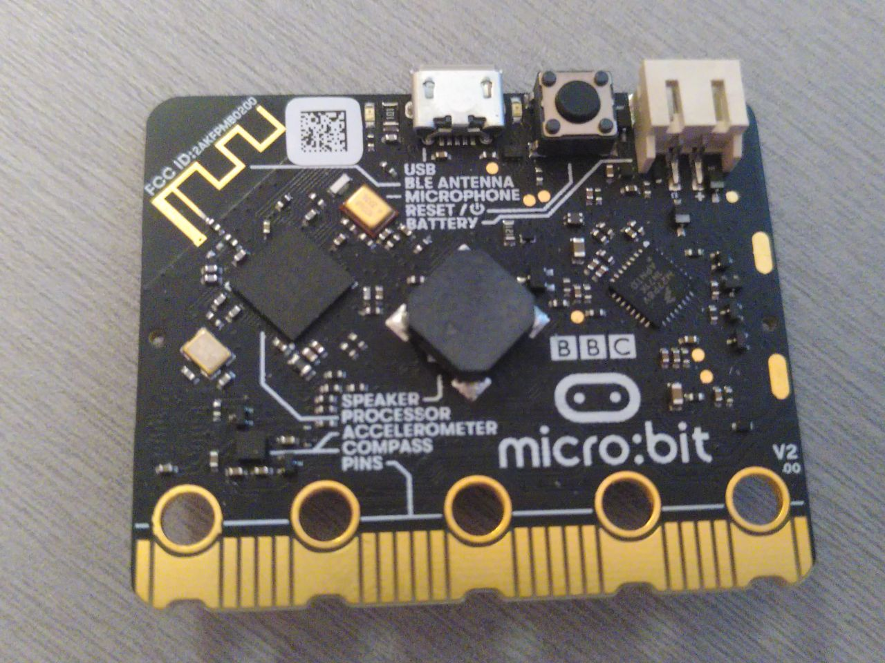

# Знакомство с оборудованием

Познакомимся с оборудованием, с которым будем работать.

## micro:bit

Вот некоторые из многочисленных компонентов платы:

- [Микроконтроллер].
- Несколько светодиодов (LED), самый заметный из которых — матрица светодиодов на обратной стороне.
- Две пользовательские кнопки и кнопка сброса (та, что рядом с USB-разъёмом).
- Один USB-разъём.
- Датчик, который одновременно является [магнитометром] и [акселерометром].

[Микроконтроллер]: https://en.wikipedia.org/wiki/Microcontroller
[акселерометром]: https://en.wikipedia.org/wiki/Accelerometer
[магнитометром]: https://en.wikipedia.org/wiki/Magnetometer

Из всех этих компонентов важнее всего микроконтроллер (его иногда сокращают до «MCU» от «microcontroller unit»), который является большим из двух чёрных квадратов на стороне платы с USB-разъёмом. MCU выполняет ваш код. Иногда можно встретить выражение «программирование платы», хотя на самом деле мы программируем MCU, установленный на плате.

Если вас интересует более подробное описание платы, загляните на [сайт micro:bit](https://tech.microbit.org/hardware/).

Раз MCU так важен, давайте внимательнее посмотрим на тот, что установлен на нашей плате.
