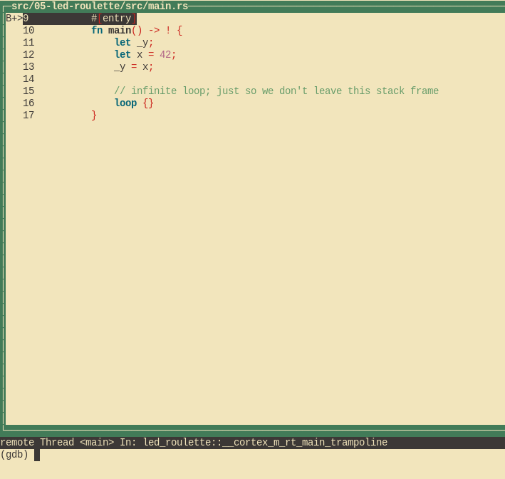
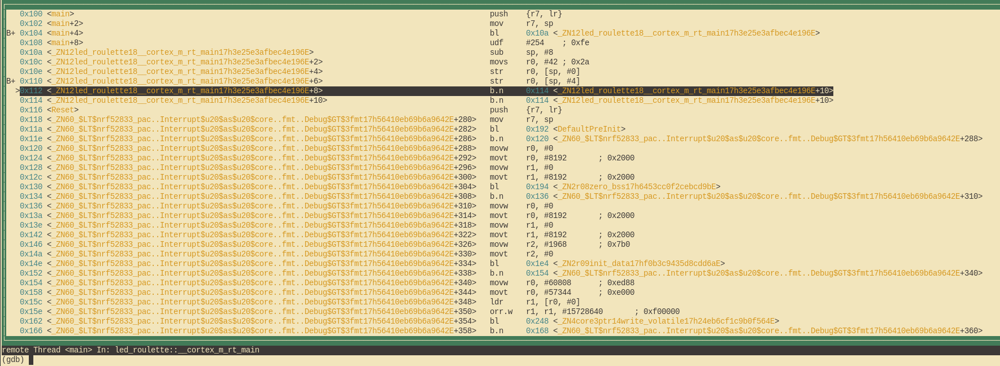

# Отладка

Разберёмся, как отлаживать нашу маленькую программу. В ней пока нет по-настоящему интересных ошибок, но для обучения отладке такая программа — лучший вариант.

## Как это вообще работает?

Прежде чем отлаживать программу, уделим минуту тому, чтобы понять, что здесь происходит. В предыдущей главе мы уже обсуждали назначение второго чипа на плате и то, как он общается с нашим компьютером, но как именно мы можем им воспользоваться?

Небольшая опция `default.gdb.enabled = true` в `Embed.toml` заставила `cargo embed` после прошивки открыть так называемый «GDB-стаб». Это сервер, к которому может подключиться наш GDB и отправлять ему команды вроде «поставь точку останова по адресу X». Сервер сам решает, как обработать команду. В случае GDB-стаба `cargo embed` передаёт команду по USB «отладочному зонду» на втором чипе. Именно этот чип общается с MCU вместо нас.

## Начинаем отладку!

`cargo-embed` работает в вашей текущей оболочке. Откройте новую оболочку и вернитесь в каталог проекта. Оказавшись там, сначала откройте бинарник в gdb:

```shell
$ gdb ../../../target/thumbv7em-none-eabihf/debug/examples/init
```

> **ПРИМЕЧАНИЕ** В зависимости от того, какой GDB вы установили, для запуска может понадобиться другая команда. Если забыли, какая именно, посмотрите [главу 3].

[главу 3]: ../03-setup/index.md#инструменты

Часть `../../..` в этой команде нужна, потому что каждый пример-проект входит в рабочее пространство (workspace), которое включает всю книгу. У него единый общий каталог `target`. Подробнее см. [в главе о рабочих пространствах книги по Rust].

> **ПРИМЕЧАНИЕ** Если `cargo-embed` выводит здесь много предупреждений, не беспокойтесь. На данный момент он не полностью реализует протокол GDB, поэтому может не распознать некоторые команды, которые ему отправляет GDB. Пока GDB не падает, всё в порядке.

[в главе о рабочих пространствах книги по Rust]: https://doc.rust-lang.org/book/ch14-03-cargo-workspaces.html#creating-a-workspace

Теперь нужно подключиться к GDB-стабу. По умолчанию он работает на `localhost:1337`, поэтому для подключения выполните:

```shell
(gdb) target remote :1337
Remote debugging using :1337
0x00000116 in nrf52833_pac::{{impl}}::fmt (self=0xd472e165, f=0x3c195ff7) at /home/nix/.cargo/registry/src/github.com-1ecc6299db9ec823/nrf52833-pac-0.9.0/src/lib.rs:157
157     #[derive(Copy, Clone, Debug)]
```

> **ПРИМЕЧАНИЕ** Пример в репозитории для этой главы может со временем меняться. Поэтому номера строк и другие детали исходного кода могут отличаться от показанных здесь и ниже.
>
> Если программа не останавливается после запуска и вы оказываетесь где-то глубже в программе, как показано ниже, попробуйте выполнить `monitor reset halt`, чтобы сбросить её. Это связано с [ошибкой](https://github.com/probe-rs/probe-rs/issues/3438)
> в `probe-rs`; подробности см. в [issue #27](https://github.com/rust-embedded/discovery-mb2/issues/27).
> ```shell
> (gdb) target remote :1337
> Remote debugging using :1337
> init::__cortex_m_rt_main () at mdbook/src/05-meet-your-software/examples/init.rs:19
> 19              asm::nop();
> (gdb) monitor reset halt
> Resetting and halting target
> Target halted
> ```

Далее нам нужно попасть в функцию `main` нашей программы. Для этого сначала поставим там точку останова, а затем продолжим выполнение программы, пока не дойдём до неё:

```
(gdb) break main
Breakpoint 1 at 0x104: file src/05-meet-your-software/examples/init.rs, line 9.
Note: automatically using hardware breakpoints for read-only addresses.
(gdb) continue
Continuing.

Breakpoint 1, init::__cortex_m_rt_main_trampoline () at src/05-meet-your-software/examples/init.rs:9
9       #[entry]
```

Точки останова позволяют остановить обычный ход выполнения программы. Команда `continue` позволяет программе работать свободно, *пока* она не дойдёт до точки останова. В данном случае — до функции `main`, потому что там стоит точка останова.

Обратите внимание, что GDB пишет «Breakpoint 1». Помните, что процессор может использовать ограниченное количество таких точек, поэтому полезно следить за этими сообщениями. Если точки закончатся, можно вывести все текущие командой `info break` и удалить ненужные командой `delete <breakpoint-num>`.

Для более удобной отладки будем использовать текстовый пользовательский интерфейс GDB (TUI). Чтобы включить этот режим, введите в оболочке GDB следующую команду:

```
(gdb) layout src
```

> **ПРИМЕЧАНИЕ** Извиняемся перед пользователями Windows: GDB из набора GNU Arm Embedded Toolchain не поддерживает этот режим TUI `:-(`.



Команда `break` в GDB работает не только с именами функций: можно ставить точку и на определённую строку. Чтобы остановиться на строке 13, достаточно написать:

```
(gdb) break 13
Breakpoint 2 at 0x110: file src/05-meet-your-software/examples/init.rs, line 13.
(gdb) continue
Continuing.

Breakpoint 2, init::__cortex_m_rt_main () at src/05-meet-your-software/examples/init.rs:13
(gdb)
```

В любой момент можно выйти из режима TUI командой:

```
(gdb) tui disable
```

Теперь мы «стоим» на инструкции `_y = x`; эта инструкция ещё не выполнена. Это значит, что `x` уже инициализирована, а `_y` может содержать что угодно. Посмотрим на `x` с помощью команды `print`:

```
(gdb) print x
$1 = 42
(gdb) print &x
$2 = (*mut i32) 0x20003fe8
(gdb)
```

Как и ожидалось, `x` содержит значение `42`. Команда `print &x` выводит адрес переменной `x`. Интересно здесь то, что вывод GDB показывает и тип ссылки: `*mut i32` — указатель на изменяемое значение `i32`.

Если хотим выполнять программу построчно, используем команду `next`. Перейдём к оператору `loop {}`:

```
(gdb) next
16          loop {}
```

Теперь `_y` должна быть инициализирована.

```
(gdb) print _y
$5 = 42
```

Вместо того чтобы выводить локальные переменные по одной, можно использовать команду `info locals`:

```
(gdb) info locals
x = 42
_y = 42
(gdb)
```

Если снова вызвать `next` на операторе `loop {}`, мы застрянем, потому что программа никогда не пройдёт дальше этого оператора. Поэтому переключимся на вид дизассемблера командой `layout asm` и будем двигаться по одной инструкции с помощью `stepi`. Вернуться к исходному коду Rust можно в любой момент командой `layout src`.

> **ПРИМЕЧАНИЕ** Если вы по ошибке вызвали `next` или `continue`, и GDB завис, выйти из этого состояния можно нажатием `Ctrl+C`.

```
(gdb) layout asm
```



Если вы не используете режим TUI, можно воспользоваться командой `disassemble /m`, чтобы дизассемблировать программу вокруг текущей строки.

```
(gdb) disassemble /m
Dump of assembler code for function _ZN12init18__cortex_m_rt_main17h3e25e3afbec4e196E:
10      fn main() -> ! {
   0x0000010a <+0>:     sub     sp, #8
   0x0000010c <+2>:     movs    r0, #42 ; 0x2a

11          let _y;
12          let x = 42;
   0x0000010e <+4>:     str     r0, [sp, #0]

13          _y = x;
   0x00000110 <+6>:     str     r0, [sp, #4]

14
15          // бесконечный цикл, чтобы не покидать этот стековый фрейм
16          loop {}
=> 0x00000112 <+8>:     b.n     0x114 <_ZN12init18__cortex_m_rt_main17h3e25e3afbec4e196E+10>
   0x00000114 <+10>:    b.n     0x114 <_ZN12init18__cortex_m_rt_main17h3e25e3afbec4e196E+10>

End of assembler dump.
```

Видите жирную стрелку `=>` слева? Она показывает инструкцию, которую процессор выполнит следующей.

Если вы не в режиме TUI, после каждой команды `stepi` GDB выводит оператор и номер строки инструкции, которую процессор выполнит следующей.

```
(gdb) stepi
16          loop {}
(gdb) stepi
16          loop {}
```

Напоследок ещё один приём, прежде чем перейдём к чему-то более интересному. Введите в GDB такие команды:

```
(gdb) monitor reset
(gdb) c
Continuing.

Breakpoint 1, init::__cortex_m_rt_main_trampoline () at src/05-meet-your-software/src/main.rs:9
9       #[entry]
(gdb)
```

Теперь мы снова в начале `main`!

`monitor reset` сбросит микроконтроллер и остановит его прямо в точке входа в программу. Следующая команда `continue` позволит программе работать свободно, пока она не дойдёт до функции `main`, на которой стоит точка останова.

Эта комбинация удобна, когда вы по ошибке пропустили часть программы, которую хотели посмотреть. Так легко откатить состояние программы к самому началу.

> **Мелкий шрифт**: команда `reset` не очищает и не трогает RAM. Эта память сохранит значения, оставшиеся от предыдущего запуска. Обычно это не проблема, если только поведение программы не зависит от значений *неинициализированных* переменных, а это и есть определение неопределённого поведения (Undefined Behavior, UB).

На этом сеанс отладки заканчиваем. Завершить его можно командой `quit`.

```
(gdb) quit
A debugging session is active.

        Inferior 1 [Remote target] will be detached.

Quit anyway? (y or n) y
Detaching from program: $PWD/target/thumbv7em-none-eabihf/debug/meet-your-software, Remote target
Ending remote debugging.
[Inferior 1 (Remote target) detached]
```

> **ПРИМЕЧАНИЕ** Если стандартный интерфейс командной строки GDB вам не по душе, посмотрите [gdb-dashboard]. Он использует Python, чтобы превратить командную строку GDB в панель, которая показывает регистры, исходный код, ассемблер и многое другое.

[gdb-dashboard]: https://github.com/cyrus-and/gdb-dashboard#gdb-dashboard

Если хотите узнать больше о возможностях GDB, загляните в раздел [Как пользоваться GDB](../appendix/2-how-to-use-gdb/).

Что дальше? Обещанный API высокого уровня.
