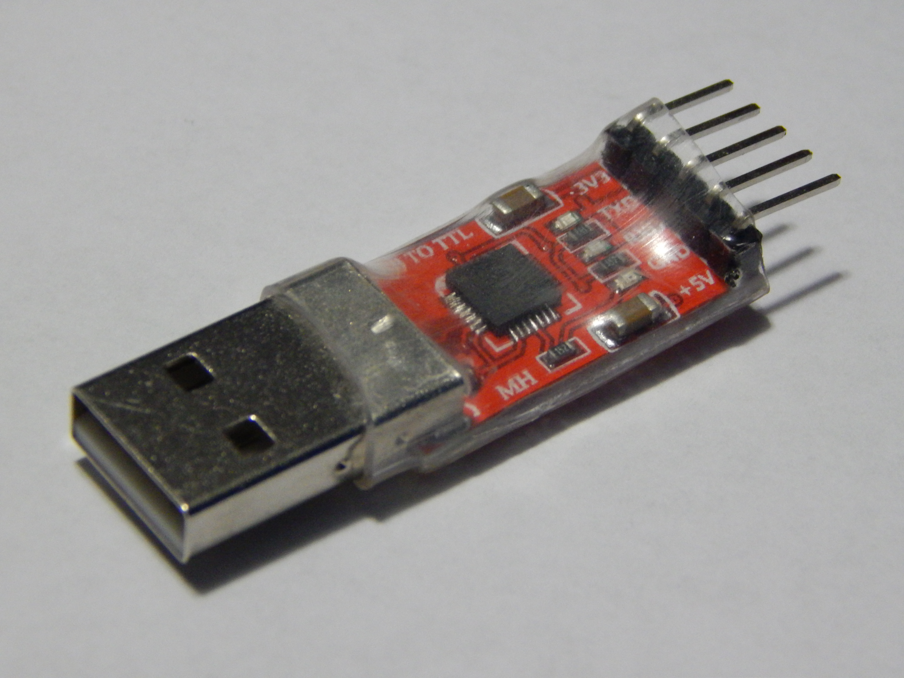

# Последовательный порт

Ближайший аналог универсального стандарта ввода-вывода для современных встраиваемых плат — «последовательный порт». Почти у каждого микроконтроллера есть возможность сделать несколько своих выводов последовательным портом, и почти на каждой плате с микроконтроллером эти выводы легко доступны. MB2 — не исключение.

В этой главе мы объясним, что вообще такое последовательный порт. Затем покажем, как настроить компьютер с «виртуальным последовательным портом» через USB и как использовать этот виртуальный порт с помощью «программы-терминала», чтобы общаться с последовательным портом MB2.

Так что же такое [последовательный порт]? Это способ, которым два устройства обмениваются данными по одному биту за раз (*последовательно*), используя по одной линии данных в каждом направлении (*полный дуплекс*) и общий провод земли. Последовательный порт появился как «RS-232»: подробности истории см. далее в этой главе. Однако у протокола, которым обмениваются по линиям передачи и приёма, насколько мне известно, нет официального названия — его просто называют «serial», а иногда «async serial» или «UART serial».

Важно уточнить: большинство каналов связи в современных компьютерах последовательные. USB («Universal Serial Bus») — последовательный канал; I2C, о котором мы поговорим позже, — тоже. Эта и следующая главы посвящены не общему понятию последовательной связи, а конкретной вещи, которая называется «последовательным портом» и имеет собственную реализацию и историю.

Связь через последовательный порт *асинхронная*: ни по одной из общих линий не передаётся тактовый сигнал. Вместо этого обе стороны должны договориться *до начала обмена*, примерно с какой скоростью будут передаваться данные по проводу. Периферийное устройство, которое называется универсальным асинхронным приёмопередатчиком (Universal Asynchronous Receiver/Transmitter, UART), выдаёт биты с заданной скоростью на выходной провод и отслеживает начало битов на входном.

Протокол последовательного порта работает с кадрами, каждый из которых несёт байт данных. Каждый кадр содержит один *стартовый* бит, от 5 до 9 битов полезных данных (передаются от младшего к старшему; современные приложения редко передают 9-битные байты; если в кадре 7 или меньше битов, до 8-битного байта он дополняется нулями слева) и от 1 до 2 *стоповых* битов. На схеме выше символ ASCII «E» передаётся с 8 битами данных и 1 стоповым битом.

Скорость протокола называется *скоростью в бодах* (baud rate), и её указывают в битах в секунду (bps). (Если вам кажется, что это звучит неправильно, — так и есть. «Бод» должен означать *символов* в секунду; символ должен соответствовать кадру; даже если считать «символом» отдельный бит данных, из-за остальной части протокола их передают не с такой скоростью. Это условность, и она не обязана быть логичной.) Исторически распространённые скорости UART — 9600, 19200 и 115200 bps, но в наше время нередко передают данные и на 921 600 bps.

При «обычной» конфигурации — 1 стартовый бит, 8 бит данных, 1 стоповый бит и скорости 921,6 Кбит/с — можно передавать и принимать 92,16 Кбайт в секунду: этого достаточно, чтобы передавать одноканальное несжатое аудио CD. На скорости 115 200 bps, которую мы будем использовать, можно передавать и принимать 11,52 Кбайт в секунду. Для большинства задач этого достаточно.

Мы будем косвенно использовать последовательный порт для обмена данными между MB2 и вашим компьютером. Возможно, вы спросите: почему бы не использовать для этого RTT, как раньше? RTT — протокол, предназначенный исключительно для отладки. Вы не найдёте устройств, которые бы общались друг с другом по RTT. А последовательная связь используется очень часто: например, некоторые GPS-приёмники передают принятые данные о местоположении по последовательному порту. Кроме того, RTT, как и многие отладочные протоколы, медленнее скоростей последовательной передачи.

У современных компьютеров обычно нет последовательного порта, а если он и есть, напряжение, которое он использует (+5 В у современного последовательного порта, ±12 В у древнего RS-232), выходит за пределы того, что принимает аппаратура MB2, и может её повредить. *Напрямую подключить компьютер к микроконтроллеру нельзя.*

<a href="https://en.wikipedia.org/wiki/File:UART_to_USB_adapter.jpg">

</a>

Зато *можно* купить недорогие USB←→serial преобразователи (обычно меньше 5 долларов США), которые поддерживают входы +3,3 В большинства современных плат с микроконтроллерами. Плата на картинке выше — один из распространённых вариантов, которым я регулярно пользуюсь. Мы будем общаться с последовательным портом MB2 через встроенный USB-порт MB2. Однако если хотите подключиться напрямую к аппаратному последовательному порту — на MB2 или на какой-либо другой плате, — лучший вариант — преобразователь.

Отдельный USB-канал на USB-порте MB2 можно использовать для связи со встроенным USB←→serial преобразователем MB2 (это правый путь на схеме выше). Такое преобразование USB и последовательного порта реализовано с помощью «[коммуникационного микроконтроллера]» MB2: он выставляет последовательный интерфейс для основного микроконтроллера и виртуальный USB-интерфейс последовательного порта для вашего компьютера. Компьютер видит виртуальный последовательный интерфейс через класс USB-устройств CDC-ACM («Communications Device Class — Abstract Control Model», ох уж эти названия). Микроконтроллер MB2 увидит ваш компьютер как устройство, подключённое к его аппаратному последовательному порту; ваш компьютер увидит последовательный порт MB2 как виртуальное последовательное устройство.

Теперь познакомимся с интерфейсом USB-последовательного порта, который предоставляет ваша ОС. Выберите путь:

- [Linux/UNIX](nix-tooling.md)
- [Windows](windows-tooling.md)

Для macOS смотрите документацию по Linux, хотя ваш опыт может немного отличаться.

[последовательный порт]: https://en.wikipedia.org/wiki/Serial_port
[коммуникационного микроконтроллера]: ../05-meet-your-software/flash-it.md
