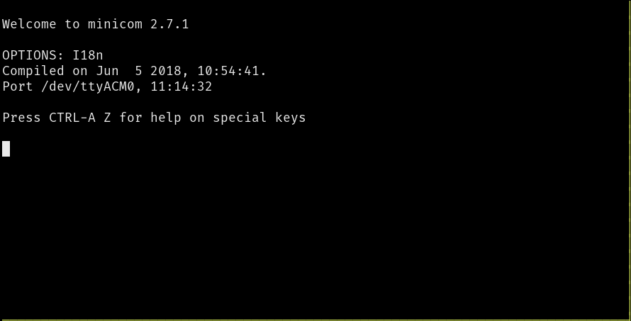

# Инструменты USB←→serial в Linux

Эмулируемое USB-устройство последовательного порта MB2 появляется в Linux, когда вы подключаете MB2 к USB-порту Linux-компьютера.

## Подключение платы MB2

Если подключить плату MB2 к компьютеру, в `/dev` должно появиться новое устройство TTY.

``` console
$ sudo dmesg -T | tail | grep -i tty
[63712.446286] cdc_acm 1-1.7:1.1: ttyACM0: USB ACM device
```

Это и есть USB←→serial устройство. В Linux оно называется `tty` (от «TeleTYpe», хотите верьте, хотите нет). Оно должно появиться как `ttyACM0` или, возможно, `ttyUSB0`. Если подключено больше устройств «ACM», номер будет больше. (В macOS последовательное устройство показывает `ls /dev/cu.usbmodem*`.)

Но что же такое `ttyACM0`? Конечно же, это файл! В Unix всё является файлом:

```
$ ls -l /dev/ttyACM0
crw-rw----+ 1 root plugdev 166, 0 Jan 21 11:56 /dev/ttyACM0
```

Обратите внимание: чтобы читать и писать в это устройство, нужно либо работать от `root` (не рекомендуется), либо быть членом группы, которая указана в выводе `ls` (обычно `plugdev` или `dialout`). Тогда данные можно отправить, просто записав их в этот файл:

``` console
$ echo 'Hello, world!' > /dev/ttyACM0
```

Каждый раз при выполнении этой команды оранжевый светодиод на MB2 рядом с USB-портом должен на мгновение мигнуть. Скорость передачи и другие параметры порта могут быть настроены не для последовательного порта MB2, но MB2 всё равно понимает, что ему что-то отправляют по последовательному каналу.

## minicom

Для взаимодействия с последовательным устройством с клавиатуры будем использовать программу `minicom`. Настройки возьмём по умолчанию для современного `minicom`: 115200 bps, 8 бит данных, один стоповый бит, без бита чётности, без управления потоком. (Скорость 115200 bps как раз подходит для MB2.)

``` console
$ minicom -D /dev/ttyACM0
```

Эта команда говорит `minicom` открыть последовательное устройство `/dev/ttyACM0`. Появится текстовый пользовательский интерфейс (TUI).

<p align="center">

</p>

Теперь можно отправлять данные с клавиатуры! Попробуйте что-нибудь напечатать. Обратите внимание: текстовый интерфейс *не* выводит обратно то, что вы печатаете. Однако если посмотреть на жёлтый светодиод сверху на MB2, вы заметите, что он мигает при каждом вводе.

## Команды `minicom`

`minicom` предоставляет команды через сочетания клавиш. В Linux они начинаются с `Ctrl+A`. (В macOS — с клавиши `Meta`.) Некоторые полезные команды:

- `Ctrl+A` + `Z`. Сводка команд Minicom
- `Ctrl+A` + `C`. Очистить экран
- `Ctrl+A` + `X`. Выйти и сбросить
- `Ctrl+A` + `Q`. Выйти без сброса

> **ПРИМЕЧАНИЕ** Пользователи Mac: в командах выше замените `Ctrl+A` на `Meta`.
