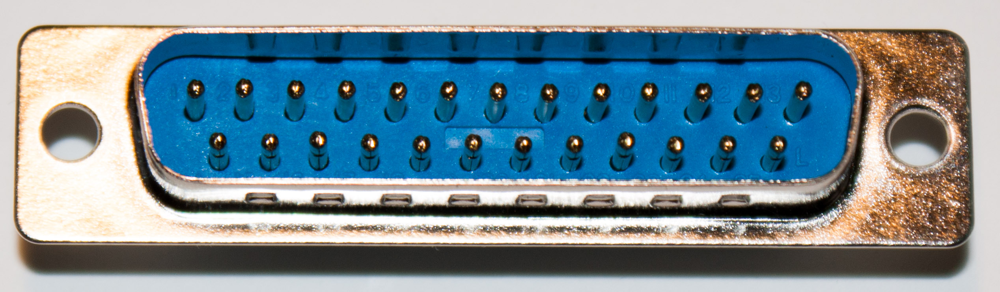
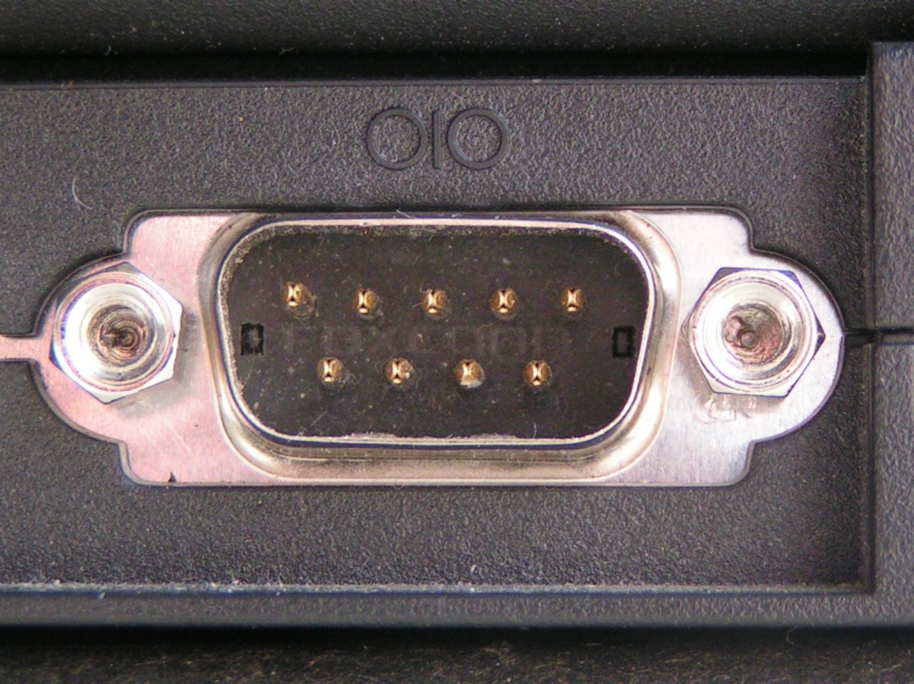

## RS-232

Это точно необязательный раздел, но знать эти вещи может быть полезно при разговорах о последовательных портах с коллегами.

Самые ранние стандартные последовательные порты, о которых мне известно, появились примерно в 1960 году, когда был принят стандарт [RS-232] (Revised Standard 232, «пересмотренный стандарт 232»; «непересмотренной» версии у этого стандарта, похоже, не было). Было бы интересно взглянуть на [стандарт RS-232]: если у вас завалялись 65 долларов США, которые вам не терпится отдать Ассоциации телекоммуникационной промышленности, — пожалуйста. (Отраслевые ассоциации почему-то совершенно не знают понятия «стыд». Вздох.)

RS-232 был способом подключить оборудование передачи данных (DCE; модем) к оконечному оборудованию данных (DTE; терминалу), используя всего один провод для передачи в каждом направлении: протокол передачи данных описан в другом месте этой главы. Скорость передачи можно было настраивать: обычно использовали скорость модема, если он был подключён, поэтому «стандартные» скорости RS-232 обычно совпадали и со «стандартными» скоростями модемов — 300, 600, 1200, 2400, 9600 bps и т. д.

RS-232 также поддерживал дополнительные провода для аппаратного «рукопожатия» (handshaking): каждая сторона могла сообщить, что сейчас не принимает данные, потому что занята, а также различные телефонные функции («Звонит ли телефон?», «Снять трубку» и т. д.). RS-232 использовал 25-контактный разъём типа «D»; уровни сигналов: -12 В для логической единицы и +12 В для логического нуля — старый стандарт телефонных компаний.

<a href="https://commons.wikimedia.org/wiki/File:DB-25_male.jpg">

</a>

Когда в дело вступили компьютеры, RS-232 стал неудобным. Большие компьютеры обычно подключали как DCE, чтобы общаться с терминалами, а микрокомпьютеры — как DTE, чтобы общаться с модемами.

IBM-PC AT популяризировал более компактную версию порта RS-232 с 9-контактным разъёмом (DE-9, часто называемым DB-9).

<a href="https://commons.wikimedia.org/wiki/File:Serial_port.jpg">

</a>

В итоге стало обычным убирать большую часть или все служебные провода последовательных портов, сводя интерфейс к трём проводам (передача — приём — земля). Также стало обычным использовать уровни сигналов 0 В/+5 В, а позже 0 В/+3,3 В, чтобы избежать «странных» напряжений и проблем с интерфейсом.

Microsoft намеренно разработала USB как стандарт на замену RS-232: с его громоздкой проводкой, разными разъёмами, напряжениями и скоростями передачи обычному пользователю было слишком сложно подключать устройства к ПК. Поскольку на момент появления USB большинство модемов ещё работали по RS-232, Microsoft разработала класс USB-устройств CDC-ACM специально для общения с адаптерами RS-232, которые использовались с этими модемами.

[RS-232]: https://en.wikipedia.org/wiki/RS-232
[стандарт RS-232]: https://store.accuristech.com/standards/tia-rs-232?product_id=2591953
