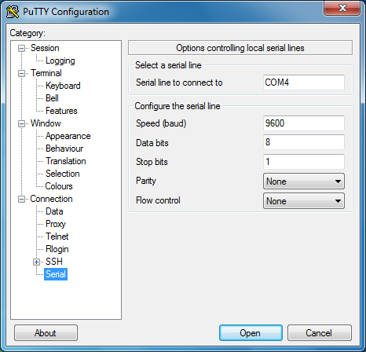
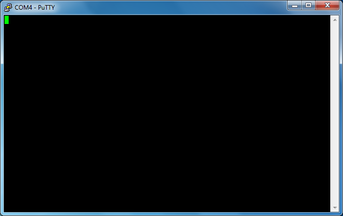

# Инструменты для Windows

Начните с того, что отключите MB2.

Перед тем как подключить MB2 обратно, выполните в терминале такую команду:

``` console
$ mode
```

Команда выведет список устройств, подключённых к компьютеру. Устройства, в названии которых есть `COM`, — последовательные. Именно с такими устройствами мы и будем работать. Запомните вывод `mode` по всем портам `COM` *до* того, как подключите последовательный модуль.

Теперь подключите MB2 и снова выполните команду `mode`. Если в списке появился новый порт `COM`, значит, именно он назначен для последовательной связи с MB2.

Теперь запустите `putty`. Откроется графическое окно.

<p align="center">

</p>

На начальном экране, где должна быть открыта категория «Session», выберите «Serial» в поле «Connection type». В поле «Serial line» введите порт `COM`, полученный на предыдущем шаге, например `COM3`.

Затем выберите в меню слева категорию «Connection/Serial». На этом экране убедитесь, что последовательный порт настроен так:

- «Speed (baud)»: 115200
- «Data bits»: 8
- «Stop bits»: 1
- «Parity»: None
- «Flow control»: None

Наконец, нажмите кнопку Open. Появится консоль:

<p align="center">

</p>

Если печатать в этой консоли, жёлтый светодиод сверху на MB2 будет мигать. Каждое нажатие клавиши должно заставлять светодиод мигнуть один раз. Обратите внимание: консоль не выводит обратно введённый текст, поэтому экран останется пустым.
