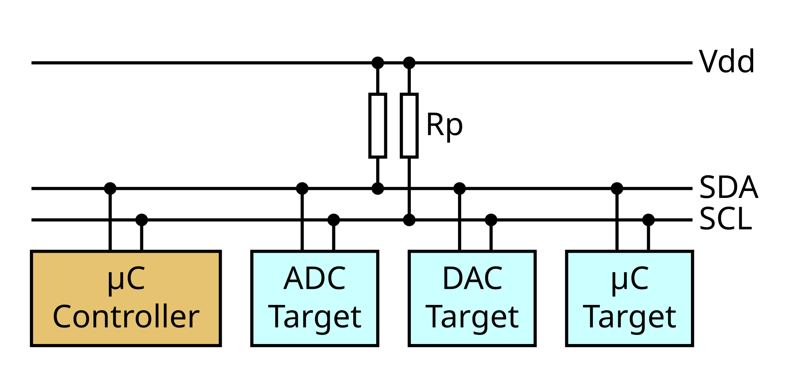

# I2C

Мы только что разобрали формат последовательной связи UART. UART широко используется, потому что он прост и существует почти вечно. (Помните, почему устройство в системе называется «tty» — от «TeleTYpe»? Ну вот.) Эта распространённость и простота делают его популярным выбором для простой связи.

Из-за аппаратных ограничений, связанных с соотношением длины линии и качества сигнала, а также из-за сложности точного декодирования, UART обычно ограничен примерно 115 200 бодами в идеальных условиях. Последовательный порт UART обладает и низкой пропускной способностью (11,5 КБ/с), и высокой задержкой (87 мкс на байт).

UART — это соединение «точка-точка»: к одному проводу нельзя подключить три и более устройств, а каждый провод требует выделенного аппаратного блока на каждом конце.

Хорошая новость (и одновременно плохая) в том, что во встраиваемых системах есть *множество* других аппаратно поддерживаемых протоколов последовательной связи, которые преодолевают эти ограничения. Некоторые из них широко используются в цифровых датчиках.

В плате micro:bit, которую мы используем, есть два датчика движения: акселерометр и магнитометр. Оба датчика упакованы в один компонент и доступны по шине I2C.

I2C произносится «ай-квадрат-си» и расшифровывается как Inter-Integrated Circuit («межмикросхемная связь»). I2C — это *синхронный* последовательный протокол для *шины*: он использует две линии для обмена данными, линию данных (SDA) и линию тактирования (SCL). Линия тактирования синхронизирует обмен. Синхронная последовательная связь может работать быстрее и надёжнее асинхронной. У устройств I2C есть *адреса на шине*: аппаратная реализация позволяет отправлять байты конкретному устройству, а остальные устройства на тех же проводах игнорируют такой обмен.

<a href="https://commons.wikimedia.org/wiki/File:I2C_controller-target.svg">

</a>

I2C использует модель *контроллер*/*target*: контроллер — это устройство, которое *начинает* обмен с target-устройством и управляет им. К одной шине одновременно может быть подключено несколько устройств, и каждое может работать либо как контроллер, либо как target. Контроллер обращается к конкретному target-устройству, сначала передавая на шину его адрес. Этот адрес может быть 7- или 10-битным. Как только контроллер начал обмен с target-устройством, никакое другое устройство, кроме контроллера и этого target, не может передавать данные по шине, пока контроллер не завершит обмен.

> **ПРИМЕЧАНИЕ** Пару «controller/target» раньше называли «master/slave» (ведущий/ведомый). Такое название вы ещё можете встретить в литературе или на надписях на платах. Официальные стандарты и новые документы теперь считают эту терминологию устаревшей, но её всё ещё использует руководство Nordic по нашему чипу nRF52833 и некоторые документы по встраиваемому Rust.

Линия тактирования определяет, как быстро можно обмениваться данными. Интерфейс I2C на MB2 может работать на скоростях 100, 250 или 400 Кбит/с. Другие устройства поддерживают и более высокие режимы.
