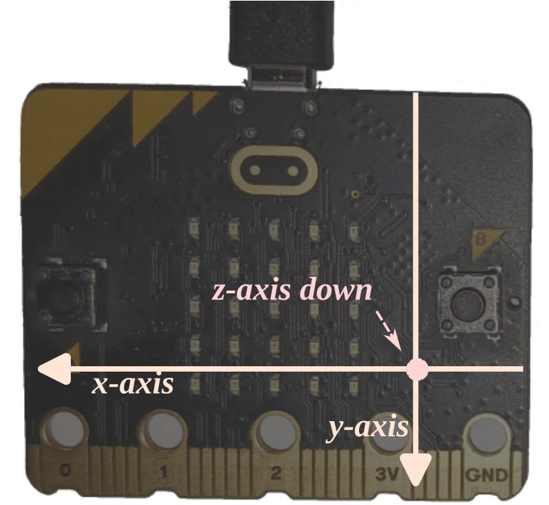

# LED-компас

В этом разделе мы реализуем компас на светодиодах MB2. Как и настоящие компасы, наш LED-компас должен каким-то образом показывать север. Для этого он будет зажигать один из внешних светодиодов; зажжённый светодиод должен указывать на север.

У магнитного поля есть и *величина*, измеряемая в гауссах или теслах, и *направление*. Магнитометр MB2 измеряет и величину, и направление внешнего магнитного поля, но возвращает *разложение* этого поля по *его осям*.

У магнитометра три связанные с ним оси. Когда плата лежит плоско, светодиодами вверх, а логотипом вперёд, оси X и Y задают плоскость пола. Ось X указывает на левый край платы. Ось Y указывает на нижний край платы (с разъёмом для карты). Ось Z направлена «в пол», то есть вниз: «вверх ногами», ведь чип установлен на обратной стороне. Это система координат «правой руки». Всё это немного запутано, потому что возвращаемые значения напряжённости поля — это компоненты вектора магнитного поля.

Вы уже должны уметь написать программу, которая непрерывно выводит данные магнитометра в консоль RTT, — см. [главу про I2C](../12-i2c/index.md). Напишите такую программу (`examples/show-mag.rs`), определите, где находится север в вашем месте, затем выровняйте MB2 по этому направлению и посмотрите, какие значения X и Y выдаёт датчик.

Теперь поверните плату на 90 градусов, оставляя её параллельно земле. Какие значения X, Y и Z вы видите на этот раз? Затем поверните её ещё на 90 градусов. Какие значения теперь?

> **ПРИМЕЧАНИЕ** Из двух MB2, которые у меня были под рукой на момент написания, один, похоже, имеет немного сломанный магнитометр: ось Z смещена так, что ею невозможно пользоваться. У производителя есть процедура самопроверки для обнаружения такой неисправности и процедура калибровки для её компенсации — это так называемая «жёсткая» магнитная погрешность (hard iron), которая обычно возникает, если MB2 однажды оказался в сильном магнитном поле. Однако крейт `lsm303agr` пока не поддерживает ни одну из этих процедур, да и для вводного руководства по встраиваемым системам это слишком много. Если у вас только один MB2 и он, кажется, не работает, можно просто перейти к [следующей главе]. Дешёвое оборудование — что поделаешь?

[следующей главе]: ../14-punch-o-meter/index.html

Магнитный север Земли — капризная вещь: в большинстве мест на Земле он отличается от географического севера, иногда довольно сильно. Он может заметно «уходить» в землю. И он со временем меняется. Не учитывая всё это, вы не получите очень точный компас, даже если магнитометр в вашем MB2 идеален (а он не идеален). С помощью калькулятора NOAA (США) <https://www.ngdc.noaa.gov/geomag/calculators/mobileDeclination.shtml> на мобильном устройстве можно получить хорошую оценку географического и магнитного севера; а в британском [калькуляторе BGS] можно указать широту, долготу и высоту, чтобы получить и склонение, и наклонение. В моём месте «склонение» (разница между географическим и магнитным севером) составляет около 15°; «наклонение» — поразительные 67° вниз, в землю.

[калькуляторе BGS]: http://www.geomag.bgs.ac.uk/data_service/models_compass/wmm_calc.html

> **ПРИМЕЧАНИЕ** Магнитометр LSM303AGR сам по себе не слишком точен. Производитель рекомендует сложную процедуру калибровки для поиска поправок к показаниям магнитометра. Подробнее, пример реализации калибровки и более красивую графику компаса можно найти в [приложении 3]: поскольку мы делаем с магнитометром довольно простые вещи, в этой главе им заниматься не будем.

[приложении 3]: ../appendix/3-mag-calibration/index.html
