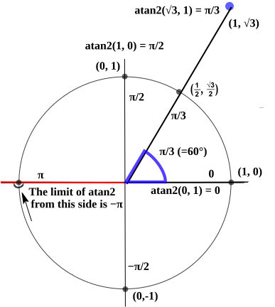

# Задание

Воспользуемся немного сложной математикой, чтобы получить точный угол, который магнитное поле образует с осями X и Y магнитометра. Это позволит определить, какой светодиод указывает на север.

Будем использовать функцию `atan2`. Она возвращает угол в диапазоне от `-PI` до `PI`. На схеме ниже показано, как измеряется этот угол:

<a href="https://commons.wikimedia.org/wiki/File:Atan2_60.svg">
<p align="center">

</p>
</a>

Хотя это и не показано явно, на этом графике ось X направлена вправо, а ось Y — вверх. Обратите внимание, что наша система координат повёрнута на 180° относительно этой.

Вот стартовый код (`templates/compass.rs`). `theta` в радианах уже вычислен. Нужно выбрать, какой светодиод включить, исходя из значения `theta`.

```rs
{{#include templates/compass.rs}}
```

Подсказки:

- Полный оборот составляет 360 градусов.
- `PI` радиан соответствуют 180 градусам.
- Если `theta` равен нулю, в каком направлении вы смотрите?
- Если `theta` очень близок к нулю, в каком направлении вы смотрите?
- Если `theta` продолжает расти, при каком значении нужно поменять направление?
