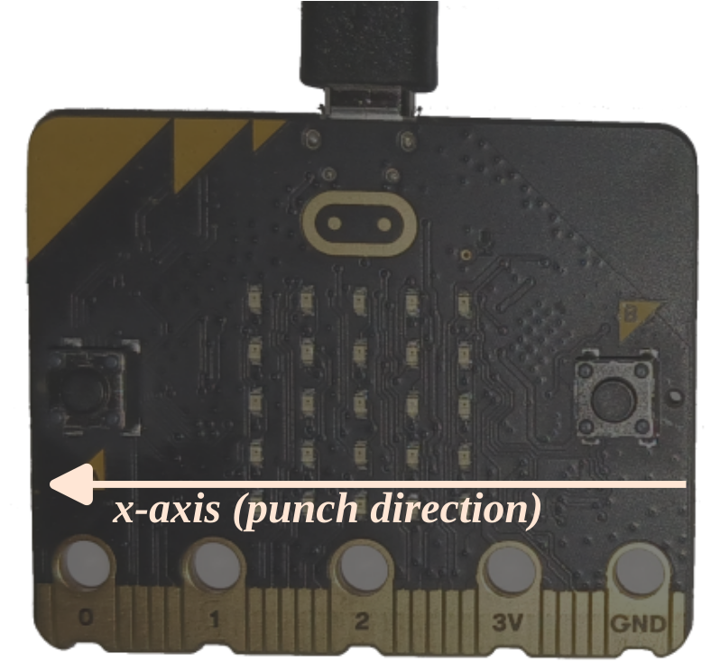

# Задание

Чтобы программа оставалась простой, будем считать, что вы бьёте, держа плату параллельно земле. Чтобы измерить силу удара, пришлось бы учитывать и ускорение по X, и по Y (а ось Z можно игнорировать, так как она отражает только гравитацию). Чтобы упростить задачу ещё больше, будем считать, что плату держат кнопкой B к себе, а кнопкой A — от себя, и бьют от себя. Значит, вы бьёте в положительном направлении оси X.

Вот что должен делать измеритель удара:

- По умолчанию приложение не «следит» за ускорением платы.
- Когда обнаружено значительное ускорение по X (то есть ускорение превышает некоторый порог), приложение должно начать новое измерение.
- В течение этого интервала измерения приложение должно отслеживать максимальное наблюдаемое ускорение.
- По окончании интервала приложение должно вывести максимальное наблюдаемое ускорение. Значение можно вывести с помощью макроса `rprintln!`.

Попробуйте и скажите мне, как сильно вы умеете бить `;-)`.

> **ПРИМЕЧАНИЕ** Для этой задачи должен пригодиться ещё один API, о котором мы пока не говорили: [`set_accel_scale`]. Он нужен, чтобы измерять большие значения g.
> 
> [`set_accel_scale`]: https://docs.rs/lsm303agr/1.1.0/lsm303agr/struct.Lsm303agr.html#method.set_accel_scale
