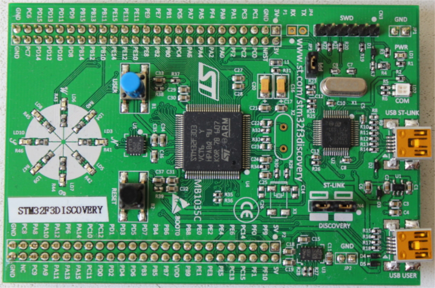

# Знакомство с оборудованием

Давайте познакомимся с оборудованием, с которым мы будем работать.

## STM32F3DISCOVERY («F3»)

Что есть на этой плате?

- Микроконтроллер [STM32F303VCT6](https://www.st.com/en/microcontrollers/stm32f303vc.html). Этот микроконтроллер содержит:
  - Одноядерный процессор ARM Cortex-M4F с аппаратной поддержкой операций с плавающей точкой одинарной точности и максимальной тактовой частотой 72 МГц.

  - 256 КиБ флеш-памяти. (1 КиБ = 1024 байта)

  - 48 КиБ ОЗУ.

  - Множество встроенной периферии, например таймеры, I2C, SPI и USART.

  - Контакты GPIO (универсальный ввод-вывод) и другие типы выводов, доступные через два ряда разъёмов вдоль платы.

  - Интерфейс Mini-USB, доступный через порт с надписью «USB USER».

- [Акселерометр](https://en.wikipedia.org/wiki/Accelerometer) в составе микросхемы [LSM303DLHC](https://www.st.com/en/mems-and-sensors/lsm303dlhc.html).

- [Магнитометр](https://en.wikipedia.org/wiki/Magnetometer) в составе микросхемы [LSM303DLHC](https://www.st.com/en/mems-and-sensors/lsm303dlhc.html).

- [Гироскоп](https://en.wikipedia.org/wiki/Gyroscope) в составе микросхемы [L3GD20](https://www.pololu.com/file/0J563/L3GD20.pdf).

- 8 пользовательских светодиодов, расположенных в форме компаса.

- Второй микроконтроллер: [STM32F103](https://www.st.com/en/microcontrollers/stm32f103cb.html). Он входит в состав встроенного программатора/отладчика и подключён к порту Mini-USB с надписью «USB ST-LINK».

Более подробный список возможностей и характеристик платы можно найти на сайте [STMicroelectronics](https://www.st.com/en/evaluation-tools/stm32f3discovery.html).

Важное предупреждение: будьте осторожны, если хотите подавать на плату внешние сигналы. Номинальное напряжение на выводах микроконтроллера STM32F303VCT6 составляет 3,3 В. Подробнее см. [раздел 6.2 «Absolute maximum ratings» в документации](https://www.st.com/resource/en/datasheet/stm32f303vc.pdf).
