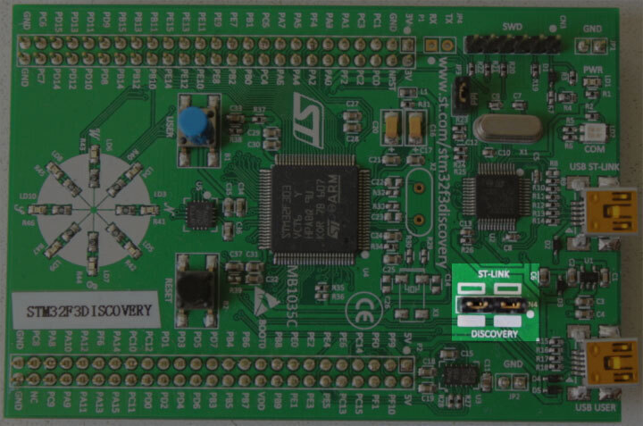

# Проверка установки

В этом разделе мы проверим, что нужные инструменты и драйверы установлены и настроены правильно.

Подключите ноутбук или ПК к отладочной плате с помощью кабеля Mini-USB. На отладочной плате есть два USB-разъёма; используйте тот, что подписан «USB ST-LINK» и находится в центре края платы.

Также проверьте, что разъём ST-LINK установлен. См. изображение ниже: разъём ST-LINK выделен.

<p align="center">

</p>

Теперь выполните следующую команду:

``` console
openocd -f interface/stlink.cfg -f target/stm32f3x.cfg
```

> **ПРИМЕЧАНИЕ**: Старые версии openocd, включая релиз 0.10.0 от 2017 года, не содержат нового (и предпочтительного) файла `interface/stlink.cfg`; вместо него может понадобиться использовать `interface/stlink-v2.cfg` или `interface/stlink-v2-1.cfg`.

Вы должны получить примерно следующий вывод, и программа должна продолжать работать в консоли, не возвращая приглашение:

``` text
Open On-Chip Debugger 0.10.0
Licensed under GNU GPL v2
For bug reports, read
        http://openocd.org/doc/doxygen/bugs.html
Info : auto-selecting first available session transport "hla_swd". To override use 'transport select <transport>'.
adapter speed: 1000 kHz
adapter_nsrst_delay: 100
Info : The selected transport took over low-level target control. The results might differ compared to plain JTAG/SWD
none separate
Info : Unable to match requested speed 1000 kHz, using 950 kHz
Info : Unable to match requested speed 1000 kHz, using 950 kHz
Info : clock speed 950 kHz
Info : STLINK v2 JTAG v27 API v2 SWIM v15 VID 0x0483 PID 0x374B
Info : using stlink api v2
Info : Target voltage: 2.919881
Info : stm32f3x.cpu: hardware has 6 breakpoints, 4 watchpoints
```

Содержимое может не совпадать в точности, но последняя строка о breakpoints и watchpoints должна присутствовать. Если она есть, завершите процесс OpenOCD и перейдите к [следующему разделу].

[следующему разделу]: ../../start/index.md

Если строки про «breakpoints» нет, попробуйте одну из следующих команд.

``` console
openocd -f interface/stlink-v2.cfg -f target/stm32f3x.cfg
```

``` console
openocd -f interface/stlink-v2-1.cfg -f target/stm32f3x.cfg
```

Если одна из этих команд работает, значит, у вас старая ревизия отладочной платы. Это не проблема, но запомните этот факт: позже вам понадобится немного иначе настроить некоторые вещи. Можете перейти к [следующему разделу].

Если ни одна из команд не работает от имени обычного пользователя, попробуйте запустить их с правами root (например, `sudo openocd ..`). Если с правами root команды работают, проверьте, что [правила udev] настроены правильно.

[правила udev]: linux.md#правила-udev

Если вы дошли до этого места и OpenOCD всё ещё не работает, пожалуйста, откройте [задачу (issue)] — мы вам поможем!

[задачу (issue)]: https://github.com/r007/EmbeddedRust-Rus/issues
