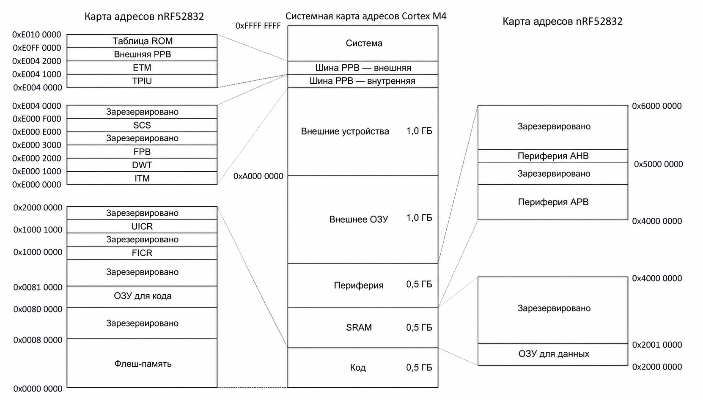
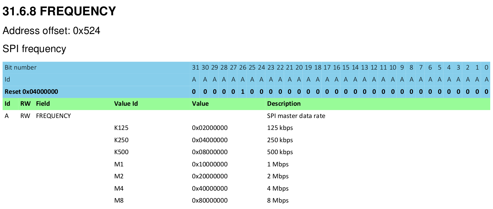

# Периферия

## Что такое периферия?

У большинства микроконтроллеров есть не только ЦПУ, ОЗУ или флеш-память. Они содержат участки кремния, которые используются для взаимодействия с системами за пределами микроконтроллера, а также для прямого и косвенного взаимодействия с окружающим миром через датчики, контроллеры моторов или пользовательские интерфейсы, такие как дисплей или клавиатура. Эти компоненты в совокупности называются периферией.

Периферия полезна тем, что позволяет разработчику переложить часть обработки на неё и не делать всё программно. Так же, как настольный разработчик переносит обработку графики на видеокарту, встраиваемый разработчик может переложить некоторые задачи на периферию, позволяя ЦПУ заниматься другими важными делами или вообще ничего не делать, чтобы сэкономить энергию.

Если посмотреть на основную плату старого домашнего компьютера 1970-х или 1980-х годов (да и настольные ПК недавнего прошлого не так уж далеки от сегодняшних встраиваемых систем), там можно увидеть:

* процессор;
* микросхему ОЗУ;
* микросхему ПЗУ;
* контроллер ввода-вывода.

Микросхемы ОЗУ и ПЗУ и контроллер ввода-вывода (периферия в этой системе) соединяются с процессором через набор параллельных дорожек, которые называются «шиной» (bus). По этой шине передаётся адресная информация, определяющая, с каким устройством на шине хочет связаться процессор, а также шина данных, по которой передаются собственно данные. В наших встраиваемых микроконтроллерах действуют те же принципы, просто всё упаковано в один кусок кремния.

Однако в отличие от видеокарт, которые обычно имеют программный API вроде Vulkan, Metal или OpenGL, периферия предоставляется нашему микроконтроллеру через аппаратный интерфейс, который отображается в участок памяти.

## Линейное адресное пространство и реальная память

На микроконтроллере запись данных по какому-либо произвольному адресу, например `0x4000_0000` или `0x0000_0000`, может быть совершенно допустимым действием.

В настольной системе доступ к памяти жёстко контролирует MMU (Memory Management Unit, блок управления памятью). У этого компонента две основные обязанности: контролировать права доступа к участкам памяти (не давая одному процессу читать или изменять память другого процесса) и переназначать сегменты физической памяти на диапазоны виртуальной памяти, которые используются в программах. У микроконтроллеров обычно нет MMU, и в программах используются только реальные физические адреса.

Хотя 32-битные микроконтроллеры имеют реальное и линейное адресное пространство от `0x0000_0000` до `0xFFFF_FFFF`, они обычно используют для реальной памяти лишь несколько сотен килобайт из этого диапазона. Остаётся значительная часть адресного пространства. В предыдущих главах мы говорили, что ОЗУ расположено по адресу `0x2000_0000`. Если наше ОЗУ имеет размер 64 КиБ (то есть максимальный адрес 0xFFFF), то адреса от `0x2000_0000` до `0x2000_FFFF` соответствуют нашему ОЗУ. Когда мы записываем значение в переменную, которая живёт по адресу `0x2000_1234`, внутри происходит следующее: некоторая логика определяет старшую часть адреса (в этом примере `0x2000`) и активирует ОЗУ, чтобы оно обработало младшую часть адреса (в данном случае `0x1234`). На Cortex-M флеш-ПЗУ также отображается, например, с адреса `0x0000_0000` до `0x0007_FFFF` (если у нас флеш-ПЗУ на 512 КиБ). Вместо того чтобы игнорировать всё свободное пространство между этими двумя областями, разработчики микроконтроллеров отобразили интерфейсы периферии на определённые адреса памяти. Получается примерно такая картина:

[Техническое описание Nordic nRF52832 (pdf)]

## Периферия, отображённая в память

На первый взгляд взаимодействие с этой периферией простое: записать правильные данные по правильному адресу. Например, отправка 32-битного слова через последовательный порт может выполняться так же прямо, как запись этого слова по определённому адресу памяти. Периферия последовательного порта затем берёт всё на себя и автоматически отправляет данные.

Настройка этой периферии работает похожим образом. Вместо вызова функции для настройки периферии открывается участок памяти, который служит аппаратным API. Запишите `0x8000_0000` в регистр конфигурации частоты SPI, и SPI-порт будет передавать данные со скоростью 8 Мбит/с. Запишите `0x0200_0000` в тот же адрес — и SPI-порт будет передавать данные со скоростью 125 Кбит/с. Такие регистры конфигурации выглядят примерно так:

[Техническое описание Nordic nRF52832 (pdf)]

Именно через этот интерфейс осуществляется взаимодействие с аппаратным обеспечением, на каком бы языке ни писали программу: на ассемблере, C или Rust.

[Техническое описание Nordic nRF52832 (pdf)]: http://infocenter.nordicsemi.com/pdf/nRF52832_PS_v1.1.pdf
