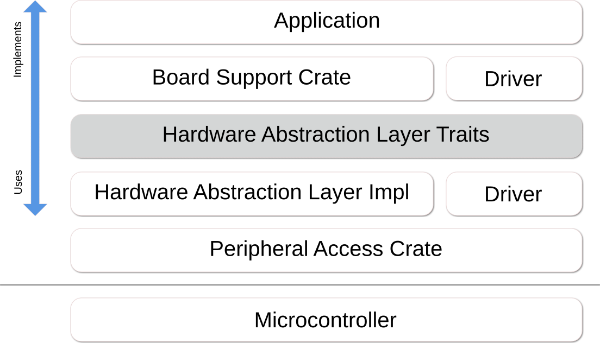

# Переносимость

Во встраиваемых системах переносимость — очень важная тема: каждый производитель и даже каждое семейство одного производителя предлагают разную периферию и возможности, и способы взаимодействия с периферией тоже различаются.

Распространённый способ сгладить эти различия — ввести слой, который называется слоем аппаратной абстракции, или **HAL**.

> Аппаратные абстракции — это наборы программных подпрограмм, которые эмулируют некоторые детали, специфичные для платформы, давая программам прямой доступ к аппаратным ресурсам.
>
> Часто они позволяют программистам писать не зависящие от устройства высокопроизводительные приложения, предоставляя стандартные вызовы операционной системы (OS) для работы с аппаратурой.
>
> *Википедия: [Hardware Abstraction Layer]*

[Hardware Abstraction Layer]: https://en.wikipedia.org/wiki/Hardware_abstraction

Встраиваемые системы в этом отношении немного особенные: у нас обычно нет операционной системы и устанавливаемого пользователем программного обеспечения, а есть образы прошивки, которые собираются целиком, и ряд других ограничений. Поэтому традиционный подход, описанный в Википедии, потенциально может работать, но, вероятно, не является самым продуктивным способом обеспечить переносимость.

Как же это сделать в Rust? На помощь приходит **[embedded-hal]**...

## Что такое [embedded-hal]?

Вкратце, это набор трейтов, которые определяют контракты реализации между **реализациями HAL**, **драйверами** и **приложениями (или прошивками)**. Эти контракты включают как возможности (то есть если трейт реализован для определённого типа, то **реализация HAL** предоставляет определённую возможность), так и методы (то есть если вы можете создать тип, реализующий трейт, то гарантированно доступны методы, указанные в трейте).

Типичная схема слоёв может выглядеть так:

Некоторые трейты, определённые в **[embedded-hal]**:
* GPIO (входные и выходные выводы);
* последовательная передача данных;
* I2C;
* SPI;
* таймеры и отсчёт времени (countdown);
* аналого-цифровое преобразование.

Основная причина, по которой существуют трейты **embedded-hal** и крейты, которые их реализуют и используют, — сдерживание сложности. Если учесть, что приложению может понадобиться реализовать использование периферии в аппаратуре, а также само приложение и, возможно, драйверы для дополнительных аппаратных компонентов, то нетрудно понять, что возможность повторного использования кода очень ограничена. Математически: если **M** — количество реализаций HAL для периферии, а **N** — количество драйверов, то, если заново изобретать колесо для каждого приложения, в итоге получится **M×N** реализаций, тогда как использование *API*, предоставляемого трейтами **[embedded-hal]**, делает сложность реализации близкой к **M+N**. Конечно, есть и дополнительные преимущества, например меньше проб и ошибок благодаря хорошо определённым и готовым к использованию API.

## Пользователи [embedded-hal]

Как сказано выше, у HAL есть три основных пользователя:

### Реализация HAL

Реализация HAL обеспечивает взаимодействие между аппаратурой и пользователями трейтов HAL. Типичная реализация состоит из трёх частей:
* одного или нескольких типов, специфичных для аппаратуры;
* функций, которые создают и инициализируют такой тип, часто предоставляя различные параметры конфигурации (скорость, режим работы, используемые выводы и т. д.);
* одной или нескольких реализаций трейтов **[embedded-hal]** (`impl`) для этого типа.

Такая **реализация HAL** может быть разного вида:
* через низкоуровневый доступ к аппаратуре, например через регистры;
* через операционную систему, например через `sysfs` в Linux;
* через адаптер, например мок-типы для модульного тестирования;
* через драйвер аппаратных адаптеров, например мультиплексора I2C или расширителя GPIO.

### Драйвер

Драйвер реализует набор специфичной функциональности для внутреннего или внешнего компонента, подключённого к периферии, которая реализует трейты [embedded-hal]. Типичные примеры таких драйверов — различные датчики (температуры, магнитометр, акселерометр, освещённости), устройства отображения (матрицы светодиодов, ЖК-дисплеи) и исполнительные механизмы (моторы, передатчики).

Драйвер должен инициализироваться экземпляром типа, который реализует определённый трейт [embedded-hal]; это обеспечивается ограничением трейта (trait bound), и драйвер предоставляет собственный экземпляр типа с набором методов для взаимодействия с управляемым устройством.

### Приложение

Приложение связывает различные части вместе и обеспечивает достижение нужной функциональности. При переносе между разными системами именно эта часть требует наибольших усилий по адаптации, поскольку приложение должно правильно инициализировать реальное оборудование через реализацию HAL, а инициализация разного оборудования отличается, иногда кардинально. Также часто большую роль играет выбор пользователя: компоненты могут физически подключаться к разным выводам, аппаратные шины иногда требуют внешнего оборудования для согласования конфигурации, а при использовании внутренней периферии приходится выбирать между разными компромиссами (например, доступно несколько таймеров с разными возможностями или периферия конфликтует с другой периферией).

[embedded-hal]: https://crates.io/crates/embedded-hal
