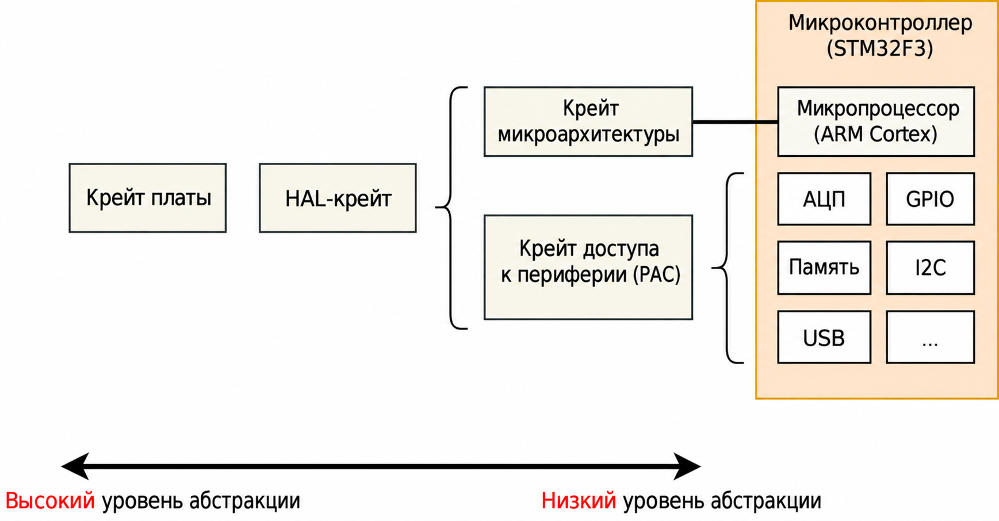

# Регистры, отображённые в память

Встраиваемые системы не могут обойтись только выполнением обычного кода на Rust и перемещением данных в ОЗУ. Если мы хотим передавать информацию в систему или из неё (будь то мигание светодиодом, обнаружение нажатия кнопки или обмен данными с внешней периферией по какой-либо шине), нам придётся заглянуть в мир периферии и её «регистров, отображённых в память».

Скорее всего, код для доступа к периферии вашего микроконтроллера уже написан и существует на одном из следующих уровней:
<p align="center">

</p>

* Крейт микроархитектуры — такой крейт содержит полезные подпрограммы, общие для ядра процессора, которое использует ваш микроконтроллер, а также для периферии, одинаковой для всех микроконтроллеров с таким типом ядра. Например, крейт [cortex-m] предоставляет функции для разрешения и запрета прерываний — они одинаковы для всех микроконтроллеров на базе Cortex-M. Он также даёт доступ к периферии «SysTick», которая есть во всех микроконтроллерах на базе Cortex-M.
* Peripheral Access Crate (PAC) — такой крейт представляет собой тонкую обёртку над регистрами, определёнными для конкретного номера модели микроконтроллера, который вы используете. Например, [tm4c123x] для серии Texas Instruments Tiva-C TM4C123 или [stm32f30x] для серии STM32F30x от ST Microelectronics. Здесь вы будете работать с регистрами напрямую, следуя инструкциям по работе каждой периферии, приведённым в техническом справочном руководстве вашего микроконтроллера.
* HAL-крейт — эти крейты предлагают более удобный API для вашего процессора, часто за счёт реализации общих трейтов, определённых в [embedded-hal]. Например, такой крейт может предлагать структуру `Serial` с конструктором, который принимает подходящий набор выводов GPIO и скорость передачи (baud rate), и функцию вроде `write_byte` для отправки данных. Подробнее о [embedded-hal] см. главу [Переносимость][Portability].
* Крейт платы — эти крейты идут на один шаг дальше HAL-крейтов: они заранее настраивают различную периферию и выводы GPIO под конкретный отладочный комплект или плату, которую вы используете, например [stm32f3-discovery] для платы STM32F3DISCOVERY.

[cortex-m]: https://crates.io/crates/cortex-m
[tm4c123x]: https://crates.io/crates/tm4c123x
[stm32f30x]: https://crates.io/crates/stm32f30x
[embedded-hal]: https://crates.io/crates/embedded-hal
[Portability]: ../portability/index.md
[stm32f3-discovery]: https://crates.io/crates/stm32f3-discovery
[Discovery]: https://r007.github.io/EmbeddedRust-Rus/discovery-mb2/

## Крейт платы

Крейт платы — идеальная отправная точка, если вы только начинаете работать со встраиваемым Rust. Он хорошо скрывает аппаратные детали, которые могут быть сложными при изучении этой темы, и делает типовые задачи простыми, например включение и выключение светодиода. Функциональность, которую он предоставляет, сильно различается для разных плат. Поскольку эта книга стремится оставаться независимой от конкретного оборудования, крейты плат в ней рассматриваться не будут.

Если вы хотите поэкспериментировать с платой STM32F3DISCOVERY, настоятельно рекомендуем посмотреть крейт платы [stm32f3-discovery], который предоставляет функции для мигания светодиодами платы, доступа к её компасу, Bluetooth и многому другому. Книга [Discovery] — отличное введение в использование крейта платы.

Но если вы работаете с системой, для которой ещё нет специального крейта платы, или вам нужна функциональность, которой нет в существующих крейтах, читайте дальше: мы начнём «снизу», с крейтов микроархитектуры.

## Крейт микроархитектуры

Посмотрим на периферию SysTick, которая есть во всех микроконтроллерах на базе Cortex-M. Низкоуровневый API для неё находится в крейте [cortex-m], и использовать его можно так:

```rust,ignore
#![no_std]
#![no_main]
use cortex_m::peripheral::{syst, Peripherals};
use cortex_m_rt::entry;
use panic_halt as _;

#[entry]
fn main() -> ! {
    let peripherals = Peripherals::take().unwrap();
    let mut systick = peripherals.SYST;
    systick.set_clock_source(syst::SystClkSource::Core);
    systick.set_reload(1_000);
    systick.clear_current();
    systick.enable_counter();
    while !systick.has_wrapped() {
        // Цикл ожидания
    }

    loop {}
}
```
Функции структуры `SYST` довольно точно соответствуют функциональности этой периферии, описанной в техническом справочном руководстве ARM. В этом API нет ничего вроде «задержки на X миллисекунд» — такую задержку нам приходится грубо реализовывать самостоятельно, с помощью цикла `while`. Обратите внимание, что обратиться к структуре `SYST` мы можем только после вызова `Peripherals::take()`. Это специальная подпрограмма, которая гарантирует, что во всей программе существует только одна структура `SYST`. Подробнее об этом см. раздел [Периферия][Peripherals].

[Peripherals]: ../peripherals/index.md

## Использование Peripheral Access Crate (PAC)

Далеко же мы уйдём в разработке встраиваемого ПО, если будем ограничиваться только базовой периферией, которая есть в каждом Cortex-M. Рано или поздно нам понадобится писать код, специфичный для конкретного микроконтроллера, который мы используем. В этом примере предположим, что у нас есть Texas Instruments TM4C123 — довольно обычный Cortex-M4 с частотой 80 МГц и 256 КиБ флеш-памяти. Чтобы работать с этим чипом, подключим крейт [tm4c123x].

```rust,ignore
#![no_std]
#![no_main]

use panic_halt as _; // обработчик паники

use cortex_m_rt::entry;
use tm4c123x;

#[entry]
pub fn init() -> (Delay, Leds) {
    let cp = cortex_m::Peripherals::take().unwrap();
    let p = tm4c123x::Peripherals::take().unwrap();

    let pwm = p.PWM0;
    pwm.ctl.write(|w| w.globalsync0().clear_bit());
    // Mode = 1 => режим счёта вверх/вниз
    pwm._2_ctl.write(|w| w.enable().set_bit().mode().set_bit());
    pwm._2_gena.write(|w| w.actcmpau().zero().actcmpad().one());
    // 528 тактов (264 вверх и вниз) = 4 цикла на строку видео (2112 тактов)
    pwm._2_load.write(|w| unsafe { w.load().bits(263) });
    pwm._2_cmpa.write(|w| unsafe { w.compa().bits(64) });
    pwm.enable.write(|w| w.pwm4en().set_bit());
}

```

Мы обратились к периферии `PWM0` точно так же, как раньше обращались к `SYST`, только вызвали `tm4c123x::Peripherals::take()`. Поскольку этот крейт сгенерирован с помощью [svd2rust], функции доступа к полям наших регистров принимают замыкание, а не числовой аргумент. Хотя кода получается много, компилятор Rust может использовать его, чтобы выполнить за нас множество проверок, а затем сгенерировать машинный код, который очень близок к написанному вручную ассемблеру! Если сгенерированный код не может определить, что все возможные аргументы функции доступа допустимы (например, если SVD определяет регистр как 32-битный, но не указывает, что у некоторых из этих 32-битных значений есть особый смысл), функция помечается как `unsafe`. Мы видим это в примере выше, когда задаём подполя `load` и `compa` с помощью функции `bits()`.

### Чтение

Функция `read()` возвращает объект, который даёт доступ только для чтения к различным подполям этого регистра, как они определены в файле SVD производителя для данного чипа. Все функции, доступные для специального типа возврата `R` этого регистра, в этой периферии, на этом чипе, можно найти в [документации tm4c123x][tm4c123x documentation R].

```rust,ignore
if pwm.ctl.read().globalsync0().is_set() {
    // Делаем что-то
}
```

### Запись

Функция `write()` принимает замыкание с одним аргументом. Обычно его называют `w`. Этот аргумент даёт доступ на чтение и запись к различным подполям регистра, как они определены в файле SVD производителя для данного чипа. Снова: все функции, доступные для `w` этого регистра, в этой периферии, на этом чипе, можно найти в [документации tm4c123x][tm4c123x Documentation W]. Обратите внимание, что все подполя, которые мы не задаём, получат для нас значения по умолчанию — всё текущее содержимое регистра будет потеряно.

```rust,ignore
pwm.ctl.write(|w| w.globalsync0().clear_bit());
```

### Изменение

Если мы хотим изменить только одно подполе регистра и оставить остальные подполя без изменений, можно использовать функцию `modify`. Она принимает замыкание с двумя аргументами: один для чтения и один для записи. Обычно их называют `r` и `w` соответственно. Аргумент `r` позволяет проверить текущее содержимое регистра, а аргумент `w` — изменить его.

```rust,ignore
pwm.ctl.modify(|r, w| w.globalsync0().clear_bit());
```

Функция `modify` наглядно показывает мощь замыканий. В C нам пришлось бы прочитать значение во временную переменную, изменить нужные биты и записать значение обратно. При этом легко допустить ошибку:

```C
uint32_t temp = pwm0.ctl.read();
temp |= PWM0_CTL_GLOBALSYNC0;
pwm0.ctl.write(temp);
uint32_t temp2 = pwm0.enable.read();
temp2 |= PWM0_ENABLE_PWM4EN;
pwm0.enable.write(temp); // Ой! Не та переменная!
```

[svd2rust]: https://crates.io/crates/svd2rust
[tm4c123x documentation R]: https://docs.rs/tm4c123x/0.7.0/tm4c123x/pwm0/ctl/struct.R.html
[tm4c123x Documentation W]: https://docs.rs/tm4c123x/0.7.0/tm4c123x/pwm0/ctl/struct.W.html

## Использование HAL-крейта

HAL-крейт для чипа обычно работает, реализуя собственный трейт для сырых структур, которые предоставляет PAC. Часто этот трейт определяет функцию `constrain()` для отдельных периферийных блоков или `split()` для таких вещей, как порты GPIO с несколькими выводами. Эта функция забирает владение базовой сырой структурой периферии и возвращает новый объект с более высокоуровневым API. Такой API может также требовать, например, чтобы функция `new` для последовательного порта принимала заимствование структуры `Clock`, которую можно получить только вызовом функции, настраивающей PLL и устанавливающей все частоты тактирования. Таким образом, на этапе компиляции невозможно создать объект последовательного порта, не настроив сначала частоты тактирования, и невозможно, чтобы объект последовательного порта неверно преобразовал скорость передачи в такты. Некоторые крейты даже определяют специальные трейты для состояний, в которых может находиться каждый вывод GPIO, требуя от пользователя перевести вывод в нужное состояние (например, выбрав подходящий режим альтернативной функции), прежде чем передать его в периферию. И всё это без каких-либо затрат во время выполнения!

Посмотрим на пример:

```rust,ignore
#![no_std]
#![no_main]

use panic_halt as _; // обработчик паники

use cortex_m_rt::entry;
use tm4c123x_hal as hal;
use tm4c123x_hal::prelude::*;
use tm4c123x_hal::serial::{NewlineMode, Serial};
use tm4c123x_hal::sysctl;

#[entry]
fn main() -> ! {
    let p = hal::Peripherals::take().unwrap();
    let cp = hal::CorePeripherals::take().unwrap();

    // Оборачиваем структуру SYSCTL в объект с API более высокого уровня
    let mut sc = p.SYSCTL.constrain();
    // Выбираем настройки генератора
    sc.clock_setup.oscillator = sysctl::Oscillator::Main(
        sysctl::CrystalFrequency::_16mhz,
        sysctl::SystemClock::UsePll(sysctl::PllOutputFrequency::_80_00mhz),
    );
    // Настраиваем PLL с этими параметрами
    let clocks = sc.clock_setup.freeze();

    // Оборачиваем структуру GPIO_PORTA в объект с API более высокого уровня.
    // Обратите внимание, что ему нужно заимствовать `sc.power_control`, чтобы
    // автоматически включить периферию GPIO.
    let mut porta = p.GPIO_PORTA.split(&sc.power_control);

    // Активируем UART.
    let uart = Serial::uart0(
        p.UART0,
        // Выход передачи
        porta
            .pa1
            .into_af_push_pull::<hal::gpio::AF1>(&mut porta.control),
        // Вход приёма
        porta
            .pa0
            .into_af_push_pull::<hal::gpio::AF1>(&mut porta.control),
        // RTS и CTS не нужны
        (),
        (),
        // Скорость передачи
        115200_u32.bps(),
        // Обработка перевода строки на выходе
        NewlineMode::SwapLFtoCRLF,
        // Нам нужны частоты тактирования, чтобы вычислить делители скорости передачи
        &clocks,
        // Нужно, чтобы включить периферию UART
        &sc.power_control,
    );

    loop {
        writeln!(uart, "Hello, World!\r\n").unwrap();
    }
}
```
