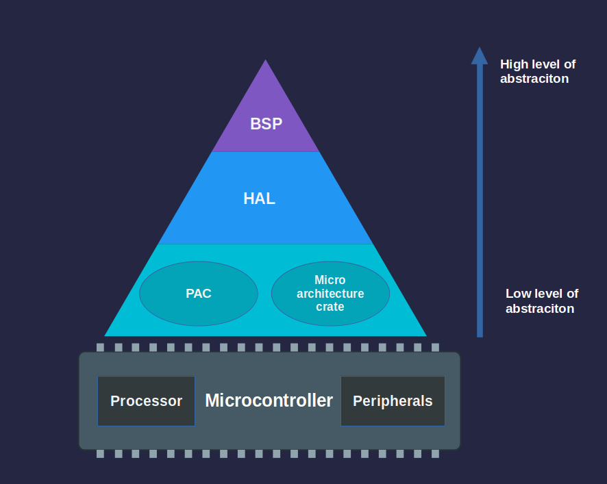

{{#title Слои абстракции в embedded Rust: BSP, HAL и PAC}}

# Слои абстракции

Работая со встраиваемым Rust, вы часто будете сталкиваться с терминами PAC, HAL и BSP. Это разные слои, которые помогают взаимодействовать с железом. Каждый слой даёт свой баланс между гибкостью и простотой использования.

Начнём с самого верхнего уровня абстракции и спустимся до самого нижнего.
 

 

## Board Support Package (BSP)

BSP, который в Rust также называют Board Support Crate, создаётся под конкретные отладочные платы. Он объединяет HAL с настройками конкретной платы и предоставляет готовые интерфейсы для встроенных компонентов, таких как светодиоды, кнопки и датчики. Это позволяет разработчикам сосредоточиться на логике приложения, а не на низкоуровневых деталях железа. Поскольку популярного BSP именно для ESP32 DevKit v1 нет, в этой книге мы не будем использовать этот подход.

---

## Hardware Abstraction Layer (HAL)

HAL находится сразу под уровнем BSP. Если вы работаете с такими платами, как Raspberry Pi Pico или платы на основе ESP32, то в основном будете использовать уровень HAL.

HAL строится поверх PAC и предоставляет более простые интерфейсы высокого уровня для периферии микроконтроллера. Вместо работы с регистрами напрямую HAL предлагает методы и трейты, которые упрощают такие задачи, как настройка таймеров, организация последовательной связи или управление выводами GPIO.

HAL для микроконтроллеров обычно реализуют трейты `embedded-hal` — стандартные платформонезависимые интерфейсы для таких периферийных устройств, как GPIO, SPI, I2C и UART. Благодаря этому проще писать драйверы и библиотеки, которые работают на разном железе, если они используют совместимый HAL.

В этой книге мы будем использовать крейт `esp-hal`. Тот же HAL можно применять и с другими вариантами ESP32. Чтобы перейти на другое семейство ESP32, достаточно поменять feature-флаг в файле `Cargo.toml`.
 

---
> [!Note]
> Слои ниже HAL редко используются напрямую. В большинстве случаев PAC доступен через HAL, а не сам по себе. Если только вы не работаете с чипом, для которого нет HAL, обычно нет необходимости обращаться к нижним слоям напрямую. В этой книге мы сосредоточимся на уровне HAL.

## Peripheral Access Crate (PAC)

PAC — это самый низкий уровень абстракции. Это автоматически сгенерированные крейты, которые дают типобезопасный доступ к периферии микроконтроллера. Обычно их генерируют из файла SVD (System View Description) производителя с помощью таких инструментов, как `svd2rust`. PAC дают структурированный и безопасный способ напрямую работать с регистрами железа.

## Крейт микроархитектуры

Он находится рядом с PAC в иерархии абстракций. Эти крейты привязаны к архитектуре процессорного ядра (например, ARM Cortex или Xtensa), используемого в вашем микроконтроллере. Они дают низкоуровневый доступ к базовым возможностям ядра и общей внутренней периферии.

Для ESP32 это крейты `xtensa-lx` и `xtensa-lx-rt`. Они отвечают за такие операции, как включение и отключение прерываний и доступ к внутренним таймерам. Для микроконтроллеров на ARM Cortex, например из семейств STM32, nRF или RP2040, аналогичные крейты — `cortex-m` и `cortex-m-rt`. Крейты микроархитектуры служат основой, на которой строятся HAL и BSP более высокого уровня, обеспечивая совместимость и переиспользование кода для чипов с одним и тем же ядром.

## Raw MMIO

Raw MMIO (memory-mapped IO, ввод-вывод, отображённый в память) означает прямую работу с регистрами железа через чтение и запись по конкретным адресам памяти. Такой подход повторяет классическое управление регистрами в стиле C и требует использования блоков `unsafe` в Rust из-за потенциальных рисков. Мы не будем его рассматривать: я не встречал, чтобы кто-то использовал этот подход.
