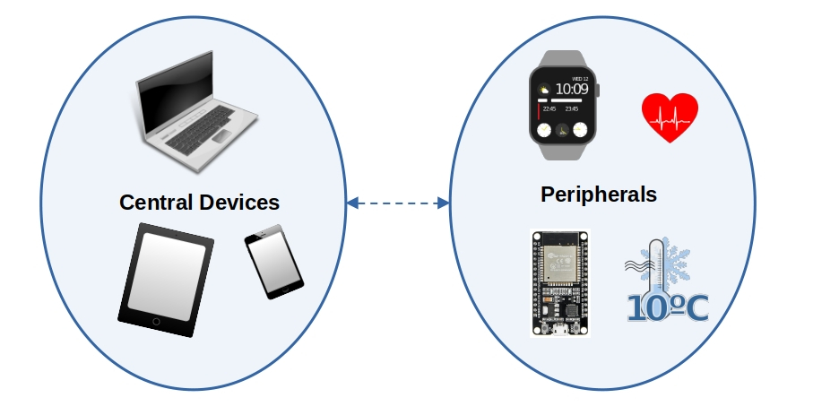

{{#title Объяснение Generic Access Profile (GAP) для BLE на ESP32}}

# Generic Access Profile (GAP)

GAP (Generic Access Profile) — это набор правил, которые определяют, как устройства Bluetooth Low Energy (BLE) обнаруживают друг друга, подключаются и обмениваются данными.

## Типы связи BLE

BLE поддерживает два основных способа связи: **связь с установкой соединения** и **широковещательную связь**.

**Связь с установкой соединения:** два устройства создают прямое соединение и могут отправлять и получать данные в обе стороны. Например, смарт-часы подключаются к телефону и постоянно передают данные, такие как пульс, уведомления и количество шагов.

**Широковещательная связь:** устройство отправляет данные всем ближайшим устройствам без установки прямого соединения. Например, Bluetooth-маячок в магазине рассылает рекламные сообщения всем телефонам в зоне действия.


## Роли устройств

Представьте эти роли так же, как в реальном общении между людьми. Точно так же, как люди общаются по-разному в зависимости от своей роли в разговоре, у устройств Bluetooth Low Energy (BLE) есть свои роли.

**📢 Broadcaster (без установки соединения)**: отправляет информацию (рекламные пакеты), но к нему нельзя подключиться.  
Например, маячок в торговом центре постоянно отправляет скидочные предложения ближайшим смартфонам. Телефоны могут принять предложения, но не могут подключиться к маячку.  

**📡 Observer (без установки соединения)**: слушает рекламные пакеты Bluetooth, но не может подключаться к другим устройствам.  
Например, приложение на смартфоне сканирует маячки, чтобы найти ближайшие магазины, но не подключается к ним.  

**📱 Central (с установкой соединения)**: это устройство ищет другие устройства, подключается к ним или читает их рекламные данные. Обычно у него больше вычислительной мощности и ресурсов. Оно может обслуживать несколько соединений одновременно.  

Например, смартфон одновременно подключён к смарт-часам, фитнес-трекеру и беспроводным наушникам.  

**⌚ Peripheral (с установкой соединения)**: это устройство передаёт рекламные пакеты и принимает запросы на соединение от central-устройств.  
Например, фитнес-трекер рекламирует себя, чтобы смартфон мог найти его и подключиться для синхронизации данных о здоровье.  




## Режимы обнаружения BLE-периферии и флаги рекламы

BLE-периферия может находиться в разных режимах обнаружения, которые влияют на то, как её найдут central-устройства. Эти режимы задаются с помощью флагов рекламы в рекламном пакете.


### Режимы обнаружения  

1. **Non-Discoverable (не обнаруживается)**  
   - Режим по умолчанию, когда реклама не активна или когда установлено соединение.  
   - Устройство нельзя обнаружить и к нему нельзя подключиться.  

2. **Limited-Discoverable (ограниченно обнаруживается)**
   - Обнаруживается **в течение ограниченного времени**, чтобы экономить энергию.  
   - Если соединение не установлено, устройство переходит в режим ожидания.  

3. **General-Discoverable (обнаруживается постоянно)**
   - Реклама идёт **бесконечно**, пока не будет установлено соединение.  

### Флаги рекламы  

Эти флаги показывают режим обнаружения и уровень поддержки BLE. Их объединяют побитовым ИЛИ (`|`):  

| Бит  | Флаг (в крейте [`TrouBLE`](https://github.com/embassy-rs/trouble)) | Описание |
|------|--------------------------------|------------------------------------------------|
| 0    | `AD_FLAG_LE_LIMITED_DISCOVERABLE` | Режим ограниченного обнаружения (временная реклама). |
| 1    | `LE_GENERAL_DISCOVERABLE` | Режим постоянного обнаружения (реклама бесконечно). |
| 2    | `BR_EDR_NOT_SUPPORTED` | Устанавливается, когда устройство **не поддерживает** (или не хочет поддерживать) Bluetooth Classic (BR/EDR). |
| 3    | `SIMUL_LE_BR_CONTROLLER` | Устанавливается, если устройство может одновременно использовать Bluetooth Low Energy (LE) и Bluetooth Classic на уровне контроллера.|
| 4    | `SIMUL_LE_BR_HOST` | Устанавливается, если устройство может одновременно работать с Bluetooth Low Energy (LE) и Bluetooth Classic на уровне хоста. |
| 5-7  | Reserved | Не используется. |

Пример с крейтом Bleps:

```rust
create_advertising_data(&[
   // Флаги
   AdStructure::Flags(LE_GENERAL_DISCOVERABLE | BR_EDR_NOT_SUPPORTED)
   // Другие данные рекламы
]).unwrap()
```

Пример с крейтом Trouble:

```rust
    let mut adv_data = [0; 31];
    let len = AdStructure::encode_slice(
        &[
            // Флаги
            AdStructure::Flags(LE_GENERAL_DISCOVERABLE | BR_EDR_NOT_SUPPORTED),
            // Другие данные рекламы
        ],
        &mut adv_data[..],
    )
    .unwrap();
```

Этот код настраивает периферийное устройство на бесконечную рекламу (LE_GENERAL_DISCOVERABLE) и одновременно сообщает, что оно не поддерживает Bluetooth Classic (BR_EDR_NOT_SUPPORTED).
