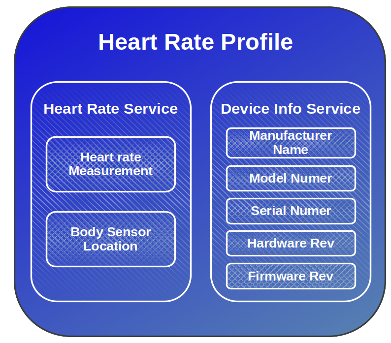
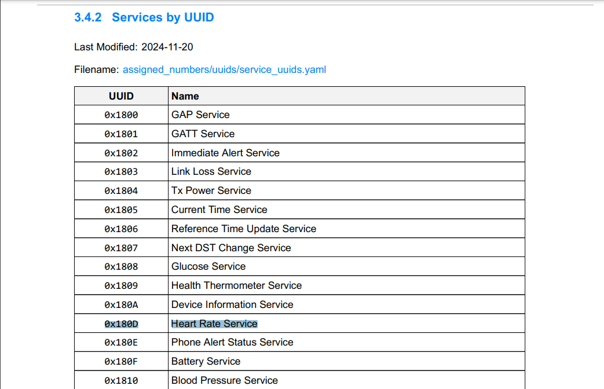
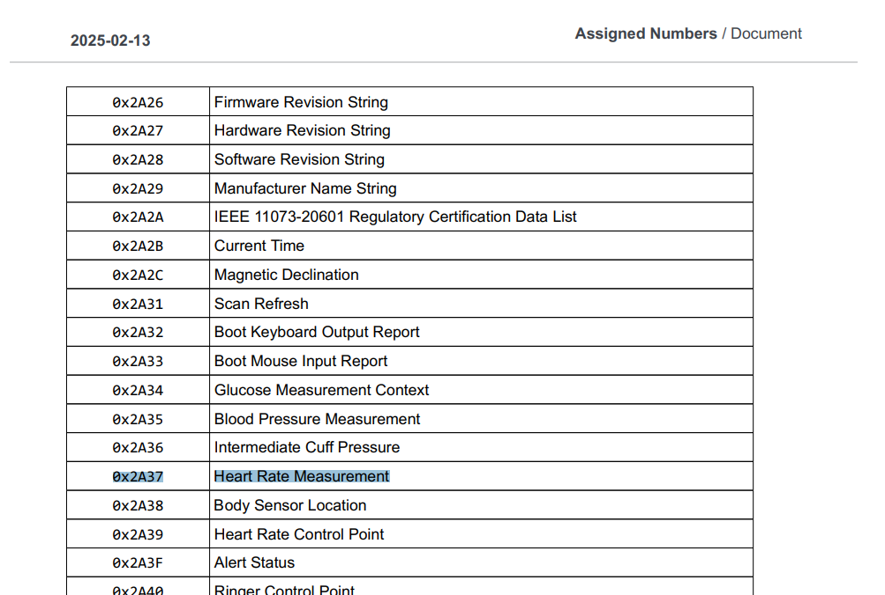

# Протокол атрибутов (ATT) и Generic Attribute Profile (GATT)

В предыдущей главе мы узнали, что слой GAP помогает устройствам Bluetooth LE находить друг друга с помощью рекламы (advertising). После подключения им нужен способ отправлять и получать данные. Здесь вступают в дело слои ATT и GATT: они определяют, как данные структурируются и передаются между устройствами.

## Модель «клиент-сервер»

В GATT есть две роли: сервер и клиент. Сервер хранит данные в виде атрибутов, а клиент обращается к этим данным. Обычно периферийное устройство (например, датчик) выступает сервером, а центральное устройство (например, смартфон) — клиентом.

> [!Note]
> **Central-Peripheral и Server-Client**: роли клиента и сервера в GATT независимы от ролей peripheral и central в Generic Access Profile (GAP). Это значит, что центральное устройство может быть как клиентом, так и сервером, и то же самое относится к периферийному устройству.

Например, в сценарии со смартфоном и фитнес-трекером трекер (периферийное устройство) обычно выступает GATT-сервером: он хранит данные датчиков, например пульс или количество шагов, а смартфон (центральное устройство) выступает GATT-клиентом и читает эти данные, чтобы показать их в приложении.  Однако если смартфону нужно отправить трекеру настройки (например, яркость экрана или будильник), он на время становится сервером, а фитнес-трекер выступает клиентом, чтобы принять эти настройки.

## Протокол атрибутов (ATT) — основа

ATT определяет, как данные хранятся в виде атрибутов; атрибуты — это базовая основа и строительные блоки. У каждого атрибута есть уникальный дескриптор (handle), тип (16-битный идентификатор или 128-битный UUID), права доступа (например, чтение или запись) и данные (само значение). Клиент может читать, записывать данные или подписываться на них.

## Generic Attribute Profile (GATT) — организация данных
GATT дополняет ATT структурой и смыслом данных. Он определяет, как данные группируются и к ним обращаются.  

GATT организует атрибуты в:  

- Характеристика (Characteristic): отдельный фрагмент данных, которым может делиться устройство. Другие устройства могут читать его, записывать в него или получать обновления. Например, характеристика Heart Rate Measurement хранит текущий пульс и может отправлять обновления при его изменении.

- Сервис (Service): набор связанных характеристик, сгруппированных вместе. Например, сервис Heart Rate включает характеристики измерения пульса и расположения датчика на теле.

- Профиль (Profile): набор связанных сервисов (например, Heart Rate Service, Device Information Service).  

На следующем рисунке показаны профиль, сервисы и характеристики датчика пульса:

### UUID
Вернёмся к части UUID в атрибуте. У каждого сервиса и характеристики должен быть уникальный идентификатор. UUID может быть либо стандартным 16-битным UUID, определённым Bluetooth-SIG, либо пользовательским 128-битным UUID.

Список предопределённых UUID можно получить здесь: [https://www.bluetooth.com/specifications/assigned-numbers/](https://www.bluetooth.com/specifications/assigned-numbers/)

Предопределённый UUID для сервиса Heart Rate:

Предопределённый UUID для характеристики Heart Rate Monitor:

**Пользовательский UUID**:
В наших примерах мы будем использовать пользовательские UUID вместо предопределённых. Однако если вы реализуете распространённый сервис, например датчик пульса, лучше использовать предопределённые UUID из официальной документации.

Чтобы сгенерировать пользовательский UUID, можно зайти на [UUID Generator](https://www.uuidgenerator.net/) и создать уникальные UUID для ваших сервисов и характеристик.
