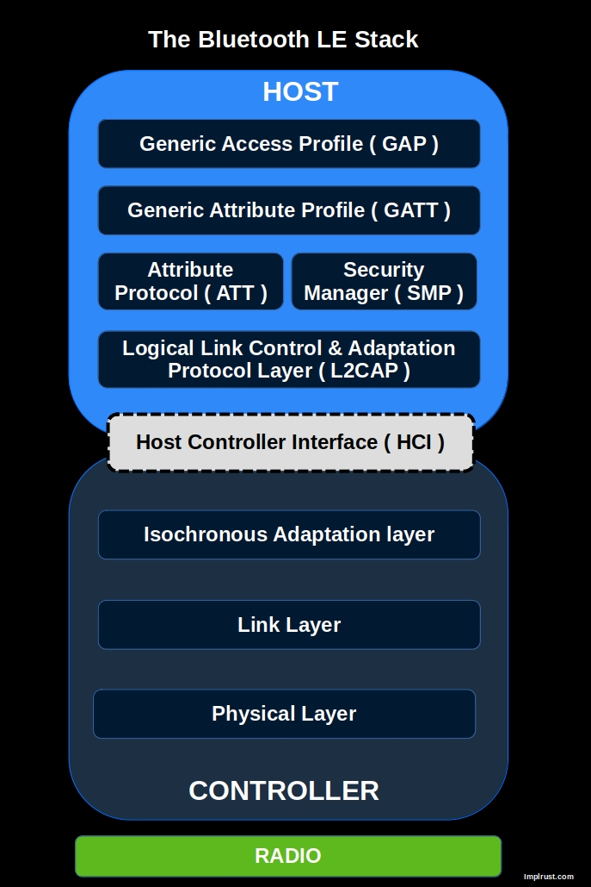

{{#title Понимание Bluetooth Low Energy (BLE) на ESP32 на Rust}}

# BLE

Чтобы работать с Bluetooth Low Energy, нужно понять несколько ключевых концепций. Я постараюсь объяснить просто и расскажу ровно столько, чтобы вы смогли начать, не перегружая вас деталями. Так что держитесь и давайте начнём.

## Стек BLE
На изображении ниже показан стек протоколов Bluetooth Low Energy (BLE). Стек BLE — основа связи между BLE-устройствами. Мы не будем подробно разбирать контроллер (нижние уровни), так как для нашей задачи это не нужно. Однако важно понимать ключевые концепции хост-части, такие как GAP и GATT.

### GAP => Как устройства подключаются и обмениваются данными

GAP (Generic Access Profile) определяет, как BLE-устройства объявляют о себе, подключаются и устанавливают связь. Он описывает роли устройств (например, central и peripheral), параметры соединения и режимы безопасности. GAP отвечает за то, как устройства находят друг друга и инициируют обмен данными.

### GATT => Как устройства обмениваются данными и структурируют их

GATT (Generic Attribute Profile) определяет, как BLE-устройства обмениваются данными. Он организует данные в иерархию сервисов и характеристик, позволяя клиентам (например, приложению на смартфоне) читать и записывать данные, а также подписываться на обновления от BLE-периферии (например, датчика).

## Крейты Rust

Для работы с Bluetooth Low Energy (BLE) есть два основных крейта Rust:

1. [Bleps](https://github.com/bjoernQ/bleps/): легковесный стек BLE-периферии, созданный в первую очередь для тестирования, демонстраций и личных проектов. Он не предназначен для соответствия требованиям сертификации. В официальном репозитории рекомендуется использовать крейт `Trouble`, если вы собираетесь работать с асинхронным кодом.

2. [Trouble (или TrouBLE)](https://embassy.dev/trouble/): реализация BLE Host на Rust с долгосрочной целью пройти сертификацию. В спецификации BLE хост работает как верхний уровень интерфейса хост-контроллера (HCI), а контроллер образует нижний уровень.

## Ссылки
Если хотите глубже разобраться, можете изучить следующие материалы
- [Скачать The Bluetooth Low Energy Primer](https://www.bluetooth.com/bluetooth-resources/the-bluetooth-low-energy-primer/)
- [Основы Bluetooth Low Energy](https://academy.nordicsemi.com/courses/bluetooth-low-energy-fundamentals/)
