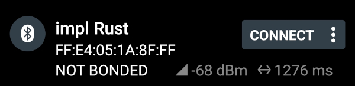
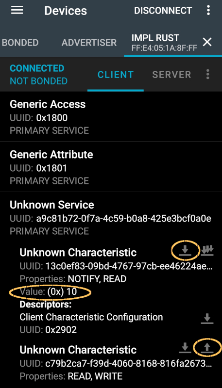
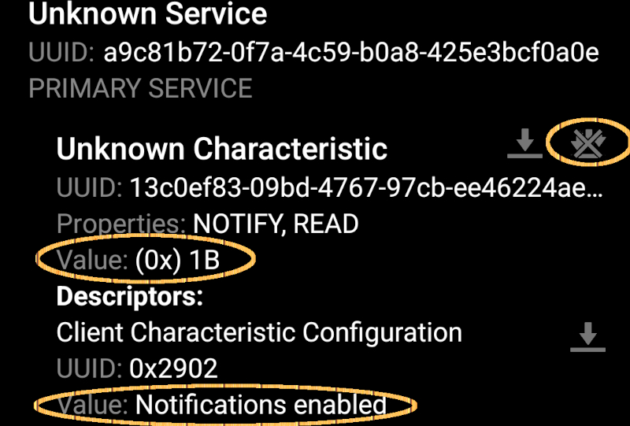

{{#title Подключение к BLE-серверу ESP32 через nRF Connect}}

# Подключение к нашему BLE-серверу через мобильное приложение nRF Connect

Когда прошивка загрузится в ESP32, откройте мобильное приложение nRF Connect. 

Найдите в списке Bluetooth-имя, которое мы задали (у меня оно «implRust»), и подключитесь к нему. 



Приложение покажет поддерживаемые сервисы и характеристики. Нажмите на стрелку вниз под характеристикой, чтобы прочитать данные, и на стрелку вверх, чтобы записать данные. Если вы отправите (то есть запишете) данные, они появятся в системной консоли.





Нажмите на значок с тремя стрелками вниз под характеристикой, чтобы подписаться на уведомления и наблюдать за изменением значения.




## Клонирование существующего проекта
Вы можете клонировать (или посмотреть) созданный мной проект и перейти в папку `bluetooth-low-energy`.

```sh
git clone https://github.com/ImplFerris/esp32-projects
cd esp32-projects/bluetooth-low-energy/
```


## Полный код модуля ble

```rust
use defmt::{info, warn};

use embassy_futures::join::join;
use embassy_futures::select::select;

use embassy_time::Timer;

// BLE:
use trouble_host::prelude::*;

/// Максимальное число подключений
const CONNECTIONS_MAX: usize = 1;

/// Максимальное число каналов L2CAP.
const L2CAP_CHANNELS_MAX: usize = 1;

// Определение GATT-сервера
#[gatt_server]
struct Server {
    sensor_service: SensorService,
}

/// Сервис батареи
#[gatt_service(uuid = "a9c81b72-0f7a-4c59-b0a8-425e3bcf0a0e")]
struct SensorService {
    #[characteristic(uuid = "13c0ef83-09bd-4767-97cb-ee46224ae6db", read, notify)]
    sensor_data: u8,

    #[characteristic(uuid = "c79b2ca7-f39d-4060-8168-816fa26737b7", write, read)]
    sensor_settings: bool,
}

/// Запускает стек BLE.
pub async fn run<C>(controller: C)
where
    C: Controller,
{
    // Фиксированный «случайный» адрес удобен для тестирования. В реальных сценариях можно использовать, например, 6-байтовый MAC-адрес
    // (способ его получения зависит от платформы).
    let address: Address = Address::random([0xff, 0x8f, 0x1a, 0x05, 0xe4, 0xff]);
    info!("Our address = {:?}", address);

    let mut resources: HostResources<DefaultPacketPool, CONNECTIONS_MAX, L2CAP_CHANNELS_MAX> =
        HostResources::new();
    let stack = trouble_host::new(controller, &mut resources).set_random_address(address);
    let Host {
        mut peripheral,
        runner,
        ..
    } = stack.build();

    info!("Starting advertising and GATT service");
    let server = Server::new_with_config(GapConfig::Peripheral(PeripheralConfig {
        name: "implRust",
        appearance: &appearance::power_device::GENERIC_POWER_DEVICE,
    }))
    .unwrap();

    let _ = join(ble_task(runner), async {
        loop {
            match advertise("impl Rust", &mut peripheral, &server).await {
                Ok(conn) => {
                    // запускаем задачи при установлении соединения с central, чтобы они не работали, когда никто не подключён.
                    let a = gatt_events_task(&server, &conn);
                    let b = custom_task(&server, &conn, &stack);
                    // работаем, пока не завершится любая из задач (обычно из-за разрыва соединения),
                    // затем возвращаемся в состояние рекламы.
                    select(a, b).await;
                }
                Err(e) => {
                    let e = defmt::Debug2Format(&e);
                    panic!("[adv] error: {:?}", e);
                }
            }
        }
    })
    .await;
}

/// Фоновая задача, которая должна работать постоянно вместе с остальными задачами BLE.
///
/// ## Альтернатива
///
/// Если бы не требовалось делать эту задачу универсальной, её можно было бы запустить статически, например так:
///
/// ```rust,ignore
///
/// #[embassy_executor::task]
/// async fn ble_task(mut runner: Runner<'static, SoftdeviceController<'static>>) {
///     runner.run().await;
/// }
///
/// spawner.must_spawn(ble_task(runner));
/// ```
async fn ble_task<C: Controller, P: PacketPool>(mut runner: Runner<'_, C, P>) {
    loop {
        if let Err(e) = runner.run().await {
            let e = defmt::Debug2Format(&e);
            panic!("[ble_task] error: {:?}", e);
        }
    }
}

/// Обрабатывает события, пока соединение не закроется.
///
/// Эта функция обрабатывает GATT-события.
/// Так мы обрабатываем запросы на чтение и запись.
async fn gatt_events_task<P: PacketPool>(
    server: &Server<'_>,
    conn: &GattConnection<'_, '_, P>,
) -> Result<(), Error> {
    let sensor_data = server.sensor_service.sensor_data;
    let reason = loop {
        match conn.next().await {
            GattConnectionEvent::Disconnected { reason } => break reason,
            GattConnectionEvent::Gatt { event } => {
                match &event {
                    GattEvent::Read(event) => {
                        if event.handle() == sensor_data.handle {
                            let value = server.get(&sensor_data);
                            info!(
                                "[gatt] Read Event to Sensor Data Characteristic: {:?}",
                                value
                            );
                        }
                    }
                    GattEvent::Write(event) => {
                        if event.handle() == sensor_data.handle {
                            info!(
                                "[gatt] Write Event to Sensor Data Characteristic: {:?}",
                                event.data()
                            );
                        }
                    }
                    _ => {}
                };
                // Этот шаг также выполняется в drop(), но явная запись нужна, чтобы гарантировать отправку ответа.
                // (так гарантируется, что ответ будет отправлен).
                match event.accept() {
                    Ok(reply) => reply.send().await,
                    Err(e) => warn!("[gatt] error sending response: {:?}", e),
                };
            }
            _ => {} // игнорируем прочие события GATT-соединения
        }
    };
    info!("[gatt] disconnected: {:?}", reason);
    Ok(())
}

/// Создаёт advertiser для подключения к BLE Central и ждёт, пока тот подключится.
async fn advertise<'values, 'server, C: Controller>(
    name: &'values str,
    peripheral: &mut Peripheral<'values, C, DefaultPacketPool>,
    server: &'server Server<'values>,
) -> Result<GattConnection<'values, 'server, DefaultPacketPool>, BleHostError<C::Error>> {
    let mut advertiser_data = [0; 31];
    let len = AdStructure::encode_slice(
        &[
            AdStructure::Flags(LE_GENERAL_DISCOVERABLE | BR_EDR_NOT_SUPPORTED),
            AdStructure::CompleteLocalName(name.as_bytes()),
        ],
        &mut advertiser_data[..],
    )?;
    let advertiser = peripheral
        .advertise(
            &Default::default(),
            Advertisement::ConnectableScannableUndirected {
                adv_data: &advertiser_data[..len],
                scan_data: &[],
            },
        )
        .await?;
    info!("[adv] advertising");
    let conn = advertiser.accept().await?.with_attribute_server(server)?;
    info!("[adv] connection established");
    Ok(conn)
}

/// Пример задачи, использующей интерфейс уведомлений BLE.
/// Задача отправляет подключённому central значение счётчика каждые 2 секунды.
/// Также каждые 2 секунды читает значение RSSI.
/// и завершается, когда central закрывает соединение или происходит ошибка.
async fn custom_task<C: Controller, P: PacketPool>(
    server: &Server<'_>,
    conn: &GattConnection<'_, '_, P>,
    stack: &Stack<'_, C, P>,
) {
    let mut tick: u8 = 0;
    let sensor_data = server.sensor_service.sensor_data;
    loop {
        tick = tick.wrapping_add(1);
        info!("[custom_task] notifying connection of tick {}", tick);
        if sensor_data.notify(conn, &tick).await.is_err() {
            info!("[custom_task] error notifying connection");
            break;
        };
        // читаем RSSI (индикатор уровня принятого сигнала) соединения.
        if let Ok(rssi) = conn.raw().rssi(stack).await {
            info!("[custom_task] RSSI: {:?}", rssi);
        } else {
            info!("[custom_task] error getting RSSI");
            break;
        };
        Timer::after_secs(2).await;
    }
}
```
