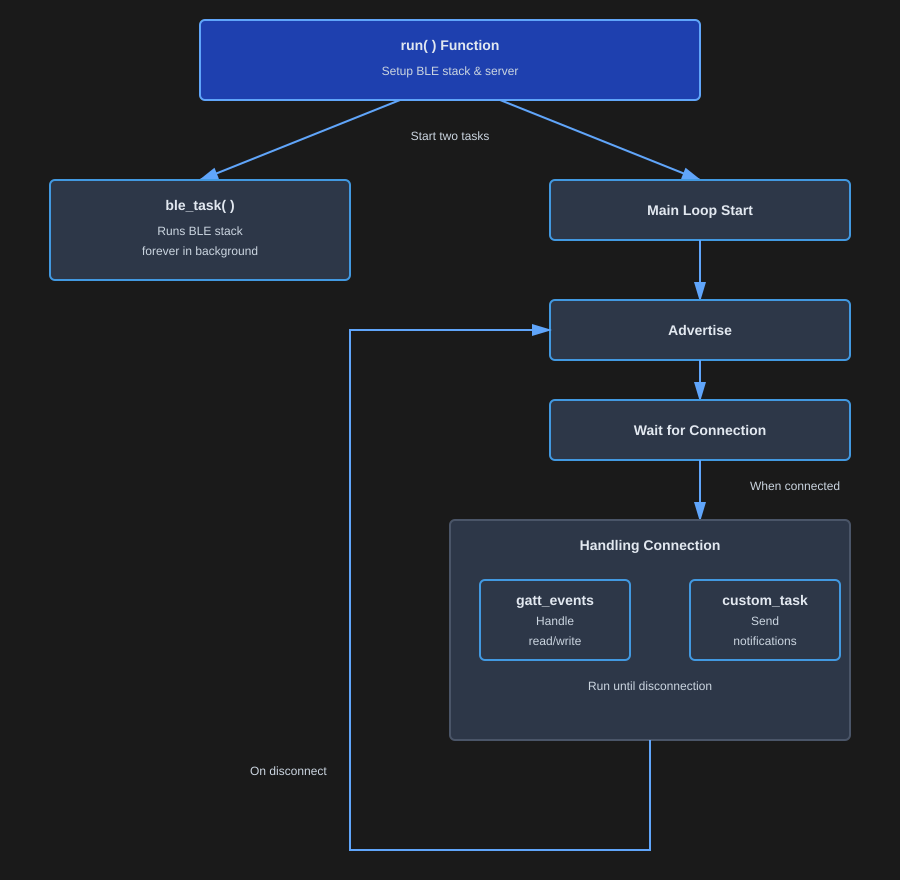
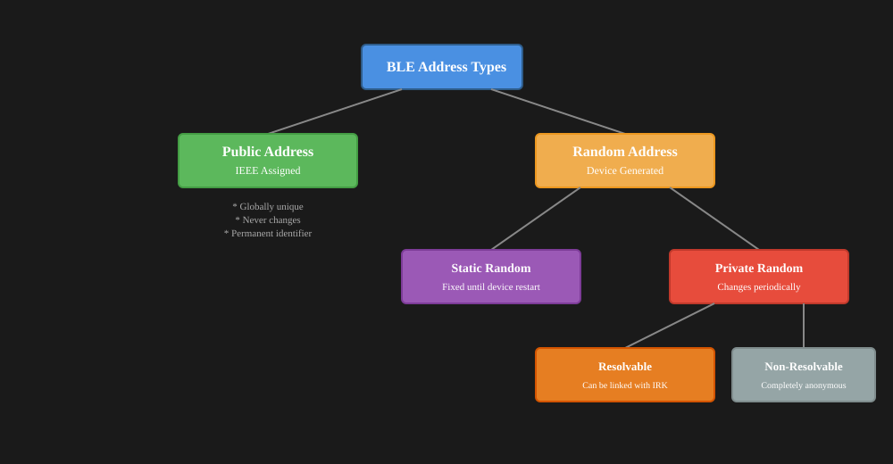

{{#title Создаём BLE-периферию Bluetooth на ESP32 на Rust}}

# Запуск стека BLE

Здесь мы определяем функцию `run`, которая настраивает и запускает стек BLE на нашем ESP32.


## Общая схема работы




```rust
/// Запускает BLE-стек.
pub async fn run<C>(controller: C)
where
    C: Controller,
{
    // Фиксированный «случайный» адрес удобен для тестирования. В реальных сценариях можно использовать, например, 6-байтовый MAC-адрес
    // (способ его получения зависит от платформы).
    let address: Address = Address::random([0xff, 0x8f, 0x1a, 0x05, 0xe4, 0xff]);
    info!("Our address = {:?}", address);

    let mut resources: HostResources<DefaultPacketPool, CONNECTIONS_MAX, L2CAP_CHANNELS_MAX> =
        HostResources::new();
    let stack = trouble_host::new(controller, &mut resources).set_random_address(address);
    let Host {
        mut peripheral,
        runner,
        ..
    } = stack.build();

    info!("Starting advertising and GATT service");
    let server = Server::new_with_config(GapConfig::Peripheral(PeripheralConfig {
        name: "implRust",
        appearance: &appearance::power_device::GENERIC_POWER_DEVICE,
    }))
    .unwrap();

    let _ = join(ble_task(runner), async {
        loop {
            match advertise("impl Rust", &mut peripheral, &server).await {
                Ok(conn) => {
                    // запускаем задачи при установлении соединения с central, чтобы они не работали, когда никто не подключён.
                    let a = gatt_events_task(&server, &conn);
                    let b = custom_task(&server, &conn, &stack);
                    // работаем, пока не завершится любая из задач (обычно из-за разрыва соединения),
                    // затем возвращаемся в состояние рекламы.
                    select(a, b).await;
                }
                Err(e) => {
                    let e = defmt::Debug2Format(&e);
                    panic!("[adv] error: {:?}", e);
                }
            }
        }
    })
    .await;
}
```

Разберём эту функцию по шагам.  Функция принимает один аргумент «controller», который должен реализовывать трейт `Controller` из крейта Trouble.

## Настройка BLE Host

Создадим экземпляр BLE Host.  Для этого сначала нужно определить BLE-адрес. 

### BLE-адрес

У каждого BLE-устройства есть уникальный Bluetooth Device Address — 48-битное число, которое работает как MAC-адрес.



Есть два основных типа BLE-адресов:

**Публичный адрес**: постоянный глобально уникальный код, который производитель присваивает устройству. Он никогда не меняется и регистрируется в IEEE. Каждый адрес может принадлежать только одному устройству, а для получения адреса нужно заплатить.

**Случайный адрес**: такой адрес используется чаще, потому что его не нужно регистрировать в IEEE и можно настроить самостоятельно. 

Случайные адреса можно далее разделить на:

- *Статический*: остаётся неизменным до перезапуска устройства
- *Приватный (динамический)*: меняется со временем, чтобы защищать вашу приватность. Может быть отслеживаемым (с ключом Identity Resolving Key) или полностью анонимным. Случайные адреса помогают защищать приватность, скрывая настоящую личность устройства.

```rust
// Фиксированный «случайный» адрес удобен для тестирования. В реальных сценариях можно использовать, например, 6-байтовый MAC-адрес
// (способ его получения зависит от платформы).
let address: Address = Address::random([0xff, 0x8f, 0x1a, 0x05, 0xe4, 0xff]);
info!("Our address = {:?}", address);
```

### Инициализация BLE Host

Инициализируем BLE Host, передав контроллер и конфигурацию ресурсов. Затем задаём случайный адрес, который будет использовать host. Наконец, вызываем метод build у стека, который возвращает BLE-периферию и runner.

```rust

let mut resources: HostResources<DefaultPacketPool, CONNECTIONS_MAX, L2CAP_CHANNELS_MAX> =
    HostResources::new();
let stack = trouble_host::new(controller, &mut resources).set_random_address(address);
let Host {
    mut peripheral,
    runner,
    ..
} = stack.build();
```

### Инициализация GATT-сервера

Макрос `gatt_server` инициализирует различные компоненты структуры `Server`, включая поддержку метода-конструктора new_with_config.

В этом примере мы настраиваем устройство на работу в роли [Peripheral](../ble/gap.html#роли-устройств) и задаём ему имя «implRust». Вы можете изменить его на любое другое.

```rust
let server = Server::new_with_config(GapConfig::Peripheral(PeripheralConfig {
    name: "implRust",
    appearance: &appearance::power_device::GENERIC_POWER_DEVICE,
}))
.unwrap();
```

## Задачи

После настройки сервера нужно запустить две параллельные задачи: задачу стека BLE и нашу прикладную логику. Метод join позволяет выполнять обе задачи одновременно.

```rust
let _ = join(ble_task(runner), async {
    loop {
        match advertise("impl Rust", &mut peripheral, &server).await {
            Ok(conn) => {
                // запускаем задачи при установлении соединения с central, чтобы они не работали, когда никто не подключён.
                let a = gatt_events_task(&server, &conn);
                let b = custom_task(&server, &conn, &stack);
                // работаем, пока не завершится любая из задач (обычно из-за разрыва соединения),
                // затем возвращаемся в состояние рекламы.
                select(a, b).await;
            }
            Err(e) => {
                let e = defmt::Debug2Format(&e);
                panic!("[adv] error: {:?}", e);
            }
        }
    }
})
.await;
```

Вскоре мы определим и разберём функцию `advertise`. Она возвращает `Result` с GATT-соединением или ошибкой BLE host. Если соединение успешно получено, запускаем две задачи, привязанные к этому соединению:

- gatt_events_task: обрабатывает входящие GATT-запросы (чтение и запись) от подключённого central-устройства
- custom_task: выполняет нашу прикладную логику во время соединения

Функция `select` выполняет обе задачи одновременно и завершается, когда завершается любая из них, обычно при разрыве соединения. После этого цикл возвращается в состояние рекламы, и устройство снова становится обнаруживаемым для новых подключений.

## Задача стека BLE

Эта задача постоянно работает в фоне вместе с другими задачами BLE и поддерживает стек Bluetooth в активном состоянии

```rust
async fn ble_task<C: Controller, P: PacketPool>(mut runner: Runner<'_, C, P>) {
    loop {
        if let Err(e) = runner.run().await {
            let e = defmt::Debug2Format(&e);
            panic!("[ble_task] error: {:?}", e);
        }
    }
}
```
