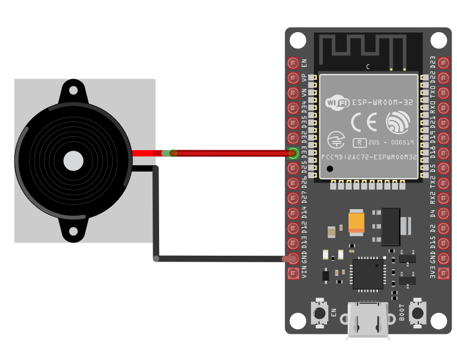

{{#title Подключение пищалки к ESP32: руководство для начинающих}}

# Подключение пищалки к ESP32

У пищалки два вывода: положительный (сигнал) и земля (GND). Положительный вывод обычно отмечен знаком **+** и является более длинным, а отрицательный (земля) — более коротким, как и у светодиода. Однако у некоторых пассивных пищалок допускается подключать любой из выводов к земле или к сигналу, в зависимости от конкретной модели.

Кстати, в своём эксперименте я использовал активную пищалку. Если вы планируете воспроизводить разные звуки, рекомендую пассивную: она даёт лучший тон.

<table style="margin-bottom:20px">
  <thead>
    <tr>
      <th>Вывод ESP32</th>
      <th style="width: 250px; margin: 0 auto;">Провод</th>
      <th>Вывод пищалки</th>
      <th>Примечания</th>
    </tr>
  </thead>
  <tbody>
    <tr>
      <td>GPIO 33</td>
      <td style="text-align: center; vertical-align: middle; padding: 0;">
        

          

          

        

      </td>
      <td>Положительный вывод</td>
      <td>Получает ШИМ-сигналы для воспроизведения звука.</td>
    </tr>
    <tr>
      <td>GND</td>
      <td style="text-align: center; vertical-align: middle; padding: 0;">
        

          

          

        

      </td>
      <td>Вывод земли</td>
      <td>Подключается к земле.</td>
    </tr>
  </tbody>
</table>

