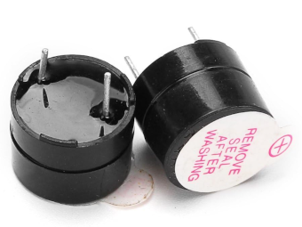

{{#title Активная и пассивная пищалка: объяснение для проектов ESP32}}

# Пищалка (Buzzer)

В этом разделе мы займёмся интересными экспериментами с `buzzer` (пищалкой).

- **Активная или пассивная пищалка**
- **Провода-перемычки**:

## Введение в пищалку

Пищалка (buzzer) — это электронное устройство, которое создаёт звук: писки, сигналы или даже мелодии. Её часто встречают в охранных системах, таймерах и компьютерах, а также используют для подтверждения действий пользователя, например щелчков мышью или нажатий клавиш. Пищалки служат звуковыми индикаторами и сообщают о происходящем слышимым сигналом.

## Активная и пассивная пищалка
### Активная пищалка:
- **Встроенный генератор**: активная пищалка содержит внутренний генератор, который сам создаёт тон при подаче питания. Определить, активная ли у вас пищалка, можно просто: подключите её напрямую к батарейке, и она издаст звук.
- **Проще в использовании**: не нужно заботиться о генерации конкретных частот, так как пищалка делает это внутри.
- **Тон**: обычно выдаёт один тон, то есть сигнал фиксированной частоты.

- **Как определить**: обычно сверху белый корпус, а снизу гладкое чёрное покрытие. При прямом подключении к батарейке она издаёт звук.

### Пассивная пищалка:
- **Нужен внешний сигнал**: пассивная пищалка требует внешнего сигнала, чтобы издавать звук. У неё нет внутреннего генератора, поэтому она полагается на микроконтроллер, который задаёт частоту.
- **Гибкие тона**: вы можете управлять частотой и создавать разные тона, мелодии или сигналы тревоги, меняя входной сигнал.

- **Как определить**: обычно сверху нет покрытия, а внизу — что-то вроде платы (PCB) синего или зелёного цвета.

## Какую выбрать?

### Выбирайте **активную пищалку**, если:
- вам нужен простой фиксированный тон или писк. Она идеально подходит для базовых оповещений, сигналов тревоги или подтверждения ввода пользователя.

### Выбирайте **пассивную пищалку**, если:
- вы хотите воспроизводить разные тона, мелодии или звуковые узоры.

