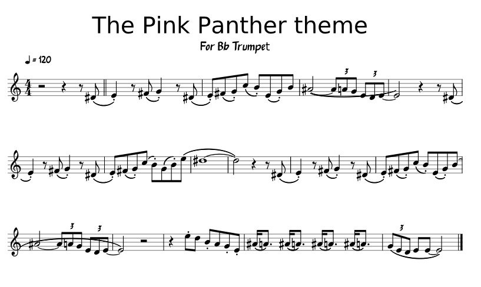

{{#title Ноты, BPM и основы нотной записи: краткое руководство}}

# Введение в ноты и нотную запись

Это краткое руководство по нотам и нотной записи. Оно не охватывает всё, но даёт быструю справку по ключевым понятиям.

### Нотный лист
Ноты для мелодии записаны по следующему нотному листу. Подробнее можно посмотреть по [ссылке на MuseScore](https://musescore.com/benedictsong/the-pink-panther).

В музыке длительность нот задаётся следующими типами, которые определяют, сколько времени звучит каждая нота:

- **Целая нота**: самая длинная длительность, звучит 4 доли.
- **Половинная нота**: звучит 2 доли.
- **Четвертная нота**: звучит 1 долю.
- **Восьмая нота**: звучит полдоли, или 1/8 длительности целой ноты.
- **Шестнадцатая нота**: звучит четверть доли, или 1/16 длительности целой ноты.

### Нота с точкой
Нота с точкой — это нота, рядом с которой стоит точка. Точка увеличивает длительность ноты на половину её исходного значения. Например:

- **Половинная нота с точкой**: звучит 3 доли (2 + 1).
- **Четвертная нота с точкой**: звучит 1,5 доли (1 + 0,5).

### Темп и BPM (ударов в минуту)
Темп — это скорость, с которой исполняется музыкальное произведение. Обычно он измеряется в **ударах в минуту** (BPM, beats per minute), то есть показывает, сколько долей укладывается в одну минуту.
