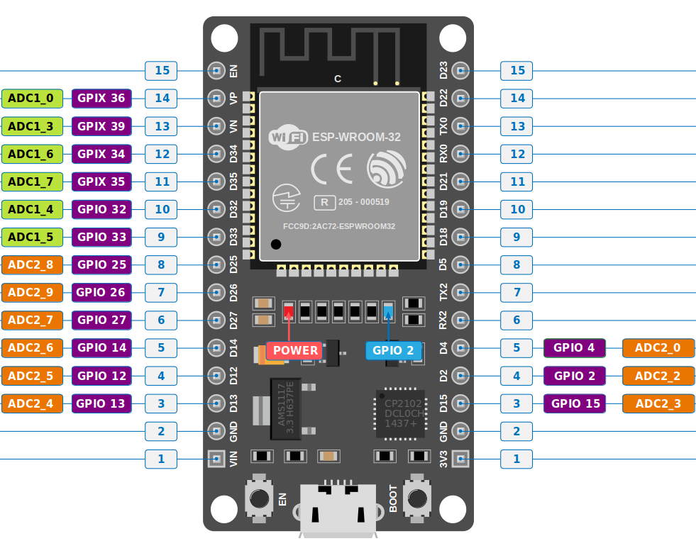

{{#title Аналого-цифровой преобразователь (ADC) в ESP32}}

# Аналого-цифровой преобразователь (ADC) в ESP32

Теперь, когда мы понимаем, как работает АЦП, посмотрим на АЦП оригинального ESP32 и научимся использовать его с Rust.

Оригинальный ESP32 имеет два 12-битных SAR-АЦП и поддерживает до 18 каналов АЦП. Используемая нами плата ESP32 DevKit V1 выводит 15 из них.

## Выводы АЦП на ESP32 DevKit V1

Первый АЦП, называемый **ADC1**, имеет 8 каналов, привязанных к GPIO32–GPIO39. Второй АЦП, **ADC2**, имеет 10 каналов, привязанных к GPIO0, GPIO2, GPIO4, GPIO12–GPIO15 и GPIO25–GPIO27.

> [!NOTE]
> **ADC2 и Wi-Fi**
>
> При использовании ADC2 есть важное ограничение: аппаратная часть Wi-Fi использует ADC2, поэтому ADC2 нельзя использовать, пока активен Wi-Fi. Если в вашем проекте одновременно используются Wi-Fi и АЦП, используйте выводы ADC1.

На следующей диаграмме показаны выводы АЦП, доступные на ESP32 DevKit V1:

[](../images/ESP32-DevKit-V1-Pinout-Diagram-adc-pins.png)


## Vref и ослабление (Attenuation)

У оригинального ESP32 опорное напряжение АЦП составляет примерно `1,1 В`, а не `3,3 В` и не напряжение питания. Как мы видели ранее, АЦП использует опорное напряжение, чтобы определить цифровое значение. Но что делать, если нужно измерить напряжение выше этого?

ESP32 может уменьшить входное напряжение до того, как оно попадёт на АЦП. Это уменьшение называется **ослаблением** (attenuation). Оно позволяет АЦП измерять более широкий диапазон входного напряжения.

Оригинальный ESP32 предоставляет четыре настройки ослабления:

| Ослабление | Измеряемый диапазон входного напряжения |
| --- | ---: |
| 0 дБ | 100 мВ ~ 950 мВ |
| 2,5 дБ | 100 мВ ~ 1250 мВ |
| 6 дБ | 150 мВ ~ 1750 мВ |
| 11 дБ | 150 мВ ~ 2450 мВ |

У АЦП ESP32 есть и другие ограничения, важные при необходимости точных измерений напряжения: изменение опорного напряжения, шум и калибровка. Здесь мы не будем подробно их разбирать. Подробнее см. [документацию ESP-IDF по ADC](https://docs.espressif.com/projects/esp-idf/en/v4.4/esp32/api-reference/peripherals/adc.html).

## Настройка АЦП в Rust

В `esp-hal` АЦП настраивается через `AdcConfig`. Ослабление для вывода АЦП выбирается при его включении.

Например:

```rust
let adc_pin = peripherals.GPIO4;

let mut adc2_config = AdcConfig::new();
let mut pin = adc2_config.enable_pin(adc_pin, Attenuation::_11dB);

let mut adc2 = Adc::new(peripherals.ADC2, adc2_config);
```

Здесь мы настраиваем GPIO4 как вход ADC2 и выбираем ослабление 11 дБ.

## Чтение значения АЦП

Когда АЦП настроен, можно считать значение с вывода:

```rust
let adc_value: u16 = nb::block!(adc2.read_oneshot(&mut pin)).unwrap();
esp_println::println!("{}", adc_value);
```

АЦП возвращает цифровое значение, а не напряжение. Поскольку АЦП оригинального ESP32 — 12-битный, он может выдавать значения от 0 до 4095.
