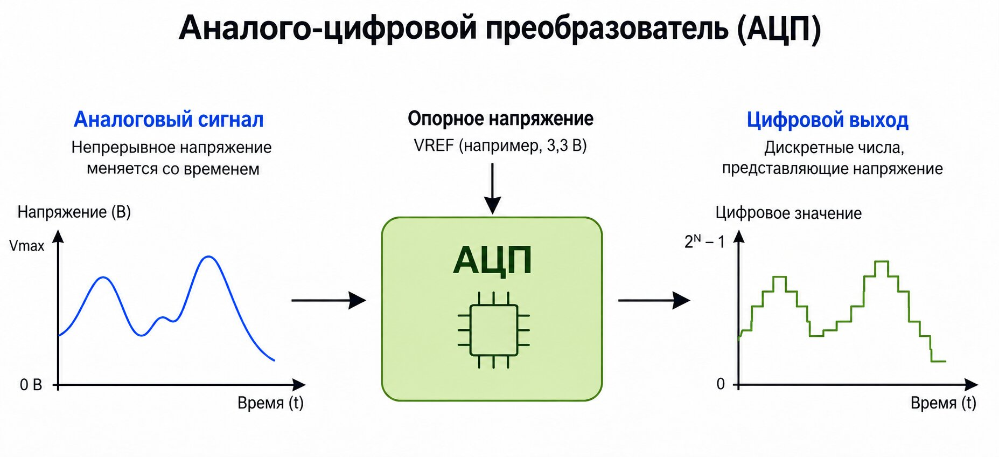

{{#title Что такое АЦП (ADC): объяснение для ESP32 | impl Rust для ESP32}}

# АЦП (аналого-цифровой преобразователь, ADC)

При работе со встраиваемыми системами часто нужно взаимодействовать с физическим миром через датчики. Датчики и связанные с ними схемы могут преобразовывать физические величины, такие как температура, давление, свет, звук и ускорение, в электрические сигналы, чаще всего в напряжение. Эти сигналы могут непрерывно меняться, тогда как микроконтроллер обрабатывает цифровые данные. Так как же соединить аналоговый мир с цифровым?

> [!TIP]
> **Аналоговый и цифровой сигналы:** если вы не уверены, что означают слова «аналоговый» и «цифровой», у SparkFun есть хорошая статья, объясняющая разницу. Её можно прочитать [здесь](https://learn.sparkfun.com/tutorials/analog-vs-digital/all).

Один из подходов — использовать аналого-цифровой преобразователь (Analog-to-Digital Converter, ADC). АЦП преобразует аналоговое напряжение в цифровое число.

    
    
Иллюстрация АЦП

Например, предположим, что датчик выдаёт напряжение от 0 В до 3,3 В. АЦП может преобразовать это напряжение в число, которое сможет прочитать наша программа на Rust. Позже мы будем использовать АЦП с такими датчиками, как LDR, для измерения освещённости, и с термистором для измерения температуры.

## Как АЦП измеряет напряжение?

Чтобы преобразовать аналоговое напряжение в цифровое число, АЦП нужно известное напряжение в качестве опорного. Оно называется **опорным напряжением**, или `Vref`.

АЦП сравнивает входное напряжение с опорным и определяет, в какой части опорного диапазона находится входное напряжение. Затем он выдаёт цифровое число, которое представляет входное напряжение.

Разные типы АЦП используют для этого разные методы. Подробности зависят от типа АЦП и выходят за рамки этой книги.

> [!TIP]
> Если хотите узнать больше о том, как компараторы используют опорное напряжение (Vref), чтобы АЦП мог определить входное напряжение, посмотрите это видео: [Comparators: The Building Blocks of Analog to Digital Converters (ADC)](https://youtu.be/CQapmDx5oV0)

Например, предположим, что опорное напряжение равно `3,3 В`, а входное напряжение — `1,5 В`. Входное напряжение составляет примерно 45% от опорного.

При работе с ESP32 есть ещё одна важная деталь. Мы рассмотрим её позже в этой главе. Пока этого достаточно, чтобы понять работу АЦП в упрощённом виде.

## Как представляются значения?

АЦП не даёт нам процент от входного напряжения. Вместо этого он выдаёт цифровое число в фиксированном диапазоне. Размер этого диапазона зависит от **разрешения АЦП** (ADC resolution), которое выражается в битах.

Например, 8-битный АЦП имеет 256 (то есть `2^8`) возможных цифровых значений. Они лежат в диапазоне от 0 до 255.

Аналогично:

* 10-битный АЦП выдаёт значения от 0 до 1023 (1024 возможных значения).
* 12-битный АЦП выдаёт значения от 0 до 4095 (4096 возможных значений).

Оригинальный ESP32 имеет 12-битные АЦП. Можно также настроить АЦП на использование меньшего количества битов.

## Как АЦП представляет разные напряжения?

Входное напряжение может непрерывно меняться, но АЦП способен выдавать только фиксированное количество цифровых значений. Это значит, что близкие входные напряжения могут представляться одним и тем же цифровым значением.

Процесс сопоставления непрерывного напряжения с одним из доступных цифровых значений называется **квантованием** (quantization).

Например, предположим, что 12-битный АЦП имеет входной диапазон от `0 В` до `3,3 В`. Он может выдавать 4096 различных значений, от 0 до 4095.

Теперь представьте два входных напряжения, очень близких друг к другу, например `1,500 В` и `1,501 В`. АЦП может выдать одинаковое цифровое значение для обоих, потому что для представления всего диапазона напряжений доступно лишь конечное число значений.

Это означает, что цифровое значение — приближение реального входного напряжения. Разница между реальным напряжением и напряжением, которое представляет цифровое значение, называется **погрешностью квантования** (quantization error).

АЦП с более высоким разрешением имеет больше доступных значений, поэтому он точнее представляет входное напряжение и уменьшает погрешность квантования.
