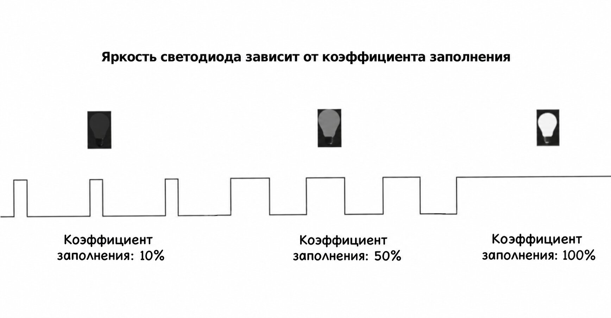

{{#title ШИМ (PWM) для начинающих: ESP32 и embedded Rust}}

# Широтно-импульсная модуляция (PWM)

В этом разделе мы разберёмся, что такое ШИМ (PWM) и зачем он нужен.

## Цифровые и аналоговые сигналы
В цифровой схеме сигналы бывают либо высокими (например, 5 В или 3,3 В), либо низкими (0 В), и промежуточных значений нет. Благодаря этим двум различным состояниям цифровые сигналы идеально подходят для компьютеров и цифровых устройств: их легко хранить, считывать и передавать без потери точности.   

Аналоговые сигналы, напротив, могут плавно изменяться в пределах диапазона, принимая любое значение между низким и высоким напряжением. Такое плавное изменение важно для задач, требующих тонкой настройки, например для регулировки громкости звука или яркости света.

Устройствам вроде сервоприводов и светодиодов (для эффекта плавного изменения яркости) часто нужно постепенное и точное управление напряжением, которое аналоговые сигналы обеспечивают благодаря непрерывному диапазону.

Микроконтроллеры используют ШИМ, чтобы преодолеть этот разрыв.

## Что такое ШИМ?
ШИМ (PWM — Pulse Width Modulation, широтно-импульсная модуляция) создаёт аналогоподобный сигнал, быстро переключая цифровой сигнал между включённым и выключенным состоянием. Среднее выходное напряжение можно регулировать, меняя длительность высокого уровня импульса, то есть коэффициент заполнения (duty cycle). Так можно имитировать непрерывный аналоговый уровень. 
 
 

## Коэффициент заполнения

**Коэффициент заполнения** (duty cycle) — это процент времени, в течение которого сигнал находится во включённом состоянии за один полный цикл.

Например:
- Коэффициент заполнения 100% означает, что сигнал всегда включён.
- Коэффициент заполнения 50% означает, что сигнал половину времени включён, а половину выключен.
- Коэффициент заполнения 0% означает, что сигнал всегда выключен.

Ниже показана интерактивная симуляция. С помощью ползунков измените коэффициент заполнения и частоту и посмотрите, как меняются ширина импульса и яркость светодиода. Верхняя часть квадратного сигнала означает, что сигнал в высоком состоянии (включён), нижняя часть — что он в низком состоянии (выключен).

<canvas id="pwmCanvas" width="800" height="200"></canvas>

  

  

  

  <label for="dutyCycle">Коэффициент заполнения (%): </label>
  <input type="range" id="dutyCycle" min="0" max="100" value="50">
  50%

  <label for="frequency">Частота (Гц): </label>
  <input type="range" id="frequency" min="1" max="50" value="10">
  <!-- x Hz -->

Если менять коэффициент заполнения в симуляции от «низкого» к «высокому» и обратно, вы заметите, что светодиод словно плавно меняет яркость. Это и есть эффект диммирования.

## Период и частота
Период — это общее время, за которое завершается один цикл «включено — выключено». 

Частота ШИМ-сигнала — это количество циклов, которые он совершает за одну секунду, измеряется в герцах (Гц). Частота обратно пропорциональна периоду. Поэтому более высокая частота означает более короткий период и более быстрое переключение между высоким и низким уровнями.

\\[
\text{Frequency (Hz)} = \\frac{1}{\text{Period (s)}}
\\]

Если период равен 1 секунде, то частота будет 1 Гц.

\\[
1 \text{Hz} = \\frac{1 \text{ cycle}}{1 \text{ second}} = \\frac{1}{1 \text{ s}}
\\]

Например, если период равен 20 мс (0,02 с), частота будет 50 Гц.

\\[
\text{Frequency} = \\frac{1}{20 \text{ ms}} = \\frac{1}{0.02 \text{ s}} = 50 \text{ Hz}
\\]

**Расчёт количества циклов по частоте**

Формула для расчёта количества циклов:  
\\[
\text{Cycle Count} = \text{Frequency (Hz)} \\times \text{Total Time (seconds)}
\\]

Если ШИМ-сигнал имеет частоту 50 Гц, это значит, что он совершает 50 циклов за одну секунду.

В следующей главе мы подробно разберём ШИМ и таймер.

