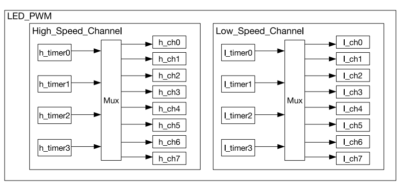

{{#title Контроллер ШИМ ESP32 (LEDC): подробное объяснение}}

# Контроллер ШИМ для светодиодов (LEDC)

В ESP32 есть контроллер ШИМ для светодиодов (LED PWM Controller, LEDC), который формирует сигналы ШИМ для управления светодиодами, например для эффекта плавного изменения яркости. Однако его возможности не ограничиваются светодиодами: его можно использовать и для других задач. Если вы не знакомы с ШИМ (PWM), рекомендую сначала прочитать введение в ШИМ [здесь](./index.md).

LEDC включает 16 независимых генераторов ШИМ и поддерживает максимальное разрешение коэффициента заполнения 20 бит. Шестнадцать каналов ШИМ делятся на два типа: 8 высокоскоростных каналов и 8 низкоскоростных.

> [!Note]
> **Высокоскоростные и низкоскоростные каналы**: высокоскоростные каналы используют аппаратную логику, которая автоматически меняет коэффициент заполнения ШИМ без рывков, обеспечивая плавную работу. Низкоскоростные каналы, напротив, полагаются на программное управление и меняют коэффициент заполнения вручную.

Контроллер ШИМ может автоматически постепенно увеличивать или уменьшать коэффициент заполнения, обеспечивая плавное затухание и нарастание яркости без участия процессора.

## Источник тактирования (Clock Source)
Источник тактирования в микроконтроллере — это что-то вроде сердцебиения системы. Он задаёт регулярные «тики», благодаря которым микроконтроллер отслеживает время и координирует свои задачи. В ESP32 для управления таймерами можно использовать разные источники тактирования.

Изображение взято из технического справочного руководства ESP32

Доступно четыре высокоскоростных модуля тактирования, которые можно назначить высокоскоростным каналам. Высокоскоростные таймеры ESP32 могут тактироваться от таких источников, как REF_TICK или APB_CLK. В библиотеке esp-hal эти таймеры представлены перечислением `timer::Number`, которое включает `Timer0`, `Timer1`, `Timer2` и `Timer3`.

Также доступно четыре низкоскоростных модуля тактирования, которые можно назначить низкоскоростным каналам. Эти таймеры могут тактироваться от REF_TICK или SLOW_CLOCK. Источником SLOW_CLOCK может быть либо APB_CLK (80 МГц), либо внутренний генератор 8 МГц; выбор между ними задаётся настройкой LEDC_APB_CLK_SEL.

В esp-hal также определены два перечисления: одно для источника тактирования высокоскоростных таймеров (`HSClockSource`) и другое для низкоскоростных (`LSClockSource`). Сейчас в каждом из них есть только один вариант: `APBClk`.

Подробнее см. главу LED PWM Controller (LEDC) в [техническом справочном руководстве ESP32](https://www.espressif.com/sites/default/files/documentation/esp32_technical_reference_manual_en.pdf#ledpwm).

## Расчёт разрешения ШИМ

В ESP-HAL при настройке объекта таймера нужно указать и разрешение коэффициента заполнения, и частоту. Поэтому важно понимать, как по заданной частоте вычислить разрешение и как по заданному разрешению определить частоту.

Эти формулы взяты из технического справочного руководства ESP32, но имена переменных упрощены.

### Формула частоты ШИМ-сигнала

Частоту ШИМ-сигнала \\( f_{\text{pwm}} \\) можно вычислить по формуле:

\\[
f_{\text{pwm}} = \frac{f_{\text{LEDC\_CLK}}}{\text{clock_divider} \cdot 2^{\text{res_bits}}}
\\]

Где:
- \\( f_{\text{LEDC\_CLK}} \\) — частота источника тактирования для таймера ШИМ (например, APB_CLK, RC_FAST_CLK, REF_TICK).
- \\( \text{clock_divider} \\) — коэффициент деления для источника тактирования.
- \\( \text{res_bits} \\) — разрешение коэффициента заполнения в битах.

### Формула разрешения ШИМ
Это формула, выведенная из предыдущей, для расчёта нужного разрешения коэффициента заполнения.
\\[
\text{res_bits} = \log_2 \left( \frac{f_{\text{LEDC\_CLK}}}{f_{\text{pwm}} \cdot \text{clock_divider}} \right)
\\]

Эта формула даёт разрешение в битах, то есть количество дискретных уровней, доступных для коэффициента заполнения ШИМ-сигнала.

### Расчёт максимального разрешения

**Максимальное разрешение** достигается, когда делитель тактирования (\\( \text{clock_divider} \\)) равен 1, то есть деление тактового сигнала не применяется. Оно вычисляется так:

\\[
\text{Highest Resolution} = \log_2 \left( \frac{f_{\text{LEDC\_CLK}}}{f_{\text{pwm}} \cdot 1} \right)
\\]

Этот расчёт даёт максимальное количество битов, которое можно использовать для коэффициента заполнения при заданной частоте тактирования и частоте ШИМ-сигнала.

#### Пример:

Для ШИМ-сигнала 1 кГц при APB_CLK 80 МГц:

\\[
\text{Highest Resolution} = \log_2 \left( \frac{80,000,000}{1,000 \cdot 1} \right) = \log_2(80,000) \approx 16
\\]

Таким образом, максимальное разрешение для ШИМ-сигнала 1 кГц при тактировании 80 МГц составляет **16 бит**.

### Расчёт минимального разрешения
Согласно даташиту, коэффициент деления находится в диапазоне от 1 до 1023. **Минимальное разрешение** рассчитывается при максимальном значении делителя тактирования. В этом случае делитель равен \\( 1023 + \frac{255}{256} \\). Минимальное разрешение вычисляется так:

\\[
\text{Lowest Resolution} = \log_2 \left( \frac{f_{\text{LEDC\_CLK}}}{f_{\text{pwm}} \cdot \left( 1023 + \frac{255}{256} \right)} \right)
\\]

Этот расчёт даёт минимальное количество битов, необходимое для управления коэффициентом заполнения на заданной частоте ШИМ-сигнала.

#### Пример:

Для того же ШИМ-сигнала 1 кГц при APB_CLK 80 МГц:

\\[
\text{Lowest Resolution} = \log_2 \left( \frac{80,000,000}{1,000 \cdot 1023.996} \right) = \log_2 \left( \frac{80,000,000}{1,023,996} \right) \approx 6.28
\\]

Таким образом, минимальное разрешение для ШИМ-сигнала 1 кГц при тактировании 80 МГц составляет **7 бит**.

### Часто используемые частоты ШИМ и разрешения

Эта таблица из даташита кратко показывает максимальное и минимальное разрешения для распространённых частот ШИМ с разными источниками тактирования:

| **Источник тактирования** | **Частота ШИМ** | **Максимальное разрешение (бит)** | **Минимальное разрешение (бит)** |
|------------------|-------------------|-------------------------------|------------------------------|
| **APB_CLK (80 МГц)** | 1 кГц            | 16                            | 7                            |
| **APB_CLK (80 МГц)** | 5 кГц            | 13                            | 4                            |
| **APB_CLK (80 МГц)** | 10 кГц           | 12                            | 3                            |
| **RC_FAST_CLK (8 МГц)** | 1 кГц          | 12                            | 3                            |
| **RC_FAST_CLK (8 МГц)** | 2 кГц          | 11                            | 2                            |
| **REF_TICK (1 МГц)** | 1 кГц            | 9                             | 1                            |

