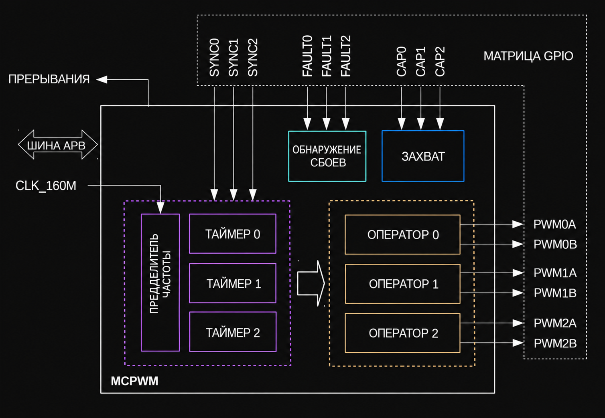

{{#title ESP32 MCPWM: управление моторами и ШИМ}}

# Модулятор ШИМ для управления моторами (MCPWM)

В ESP32 есть два периферийных блока ШИМ: [контроллер для светодиодов](./led-pwm-controller.md) и MCPWM. В этой главе мы познакомимся с MCPWM.

MCPWM предназначен для управления моторами и мощностью. В ESP32 есть два блока MCPWM: MCPWM0 и MCPWM1. На схеме ниже показан обзор одного модуля MCPWM.



Каждый MCPWM содержит предделитель (делитель тактовой частоты), три таймера, три оператора, обработчик ошибок (fault handler) и модуль захвата (capture).

## Предделитель (Prescaler)
Предделитель используется для уменьшения базовой тактовой частоты перед тем, как она будет применена к ШИМ-сигналу. MCPWM работает от тактового сигнала частотой 160 МГц, то есть тикает 160 миллионов раз в секунду. Этот сигнал служит базовой частотой для модуля MCPWM. Однако предделитель делит эту базовую частоту, фактически уменьшая частоту, которую использует ШИМ-сигнал.

Чтобы вычислить длительность одного такта, возьмём обратную величину частоты:

\\[
\text{Period} = \frac{1}{160 \times 10^6}  \text{ s} = 0.00000000625  \text{ s} = 6.25 \text{ ns}
\\]

Это значит, что каждый такт длится 6,25 наносекунды (нс).

Регистр PWM_CLK_PRESCALE (8 бит) в ESP32 позволяет настроить базовую частоту, разделив её. Когда предделитель применён к базовой частоте, она фактически уменьшается. Результирующий период ШИМ вычисляется по формуле:

\\[
\text{PWM Clock Period} = 6.25 \text{ns} \times (\text{Prescaler Value} + 1)
\\]

**Пример:**

Допустим, вы установили значение предделителя 159.

\\[
\text{PWM Clock Period} = 6.25 \text{ ns} \times (159 + 1) = 6.25   \text{ ns} \times 160 = 1000 \text{ ns}
\\]

Чтобы вычислить частоту ШИМ, возьмём обратную величину периода:

\\[
\text{PWM Frequency} = \frac{1}{\text{PWM Clock Period}} = \frac{1}{1000 \text{ ns}} = 1  \text{ MHz}
\\]

Таким образом, при значении предделителя 159 ШИМ-сигнал будет иметь период 1000 нс и частоту 1 МГц.

При максимальном значении предделителя 255 (так как это 8-битное значение) можно получить частоту ШИМ:

\\[
\text{PWM Frequency} = \frac{1}{6.25 \text{ ns} \times (255 + 1)} = \frac{1}{1600 \text{ ns}} = 625 \text{ KHz}
\\]


### В esp-hal

Структура `PeripheralClockConfig` в esp-hal отвечает за конфигурацию тактирования MCPWM. Она предлагает две функции инициализации: с предделителем или с частотой.

```rust
// Эта функция автоматически вычисляет предделитель для получения 1 МГц
let clock_cfg = PeripheralClockConfig::with_frequency(1.MHz()).unwrap();
```

## Таймер (Timer)
Таймер отвечает за подсчёт до заданного значения (называемого «периодом»), после чего он сбрасывается и начинает считать заново. Это помогает контролировать временные параметры или частоту выходного сигнала. У каждого таймера есть 8-битный предделитель тактовой частоты.

У таймера 16-битный счётчик, который может работать в трёх режимах. В esp-hal они представлены перечислением `PwmWorkingMode`:
- **PwmWorkingMode::Increase**: счёт вверх — таймер начинает с нуля и считает вверх до значения периода, после чего сбрасывается.
- **PwmWorkingMode::Decrease**: счёт вниз — таймер начинает со значения периода и считает вниз до нуля, после чего сбрасывается.
- **PwmWorkingMode::UpDown**: счёт вверх-вниз — таймер попеременно считает то вверх, то вниз, создавая симметричный цикл.

### В esp-hal

В esp-hal есть структура `TimerClockConfig`, которую можно инициализировать через экземпляр конфигурации тактирования. Нужно вызвать функцию `timer_clock_with_frequency` (или `timer_clock_with_prescaler`) с аргументами:
1. Количество тактов в периоде
2. Режим работы ШИМ
3. Целевая частота

**Пример:**

Чтобы получить частоту 50 Гц (20 мс, или 0,02 с) при базовой тактовой частоте 1 МГц (предполагаем, что `clock_cfg` инициализирован на 1 МГц), нужно вычислить количество тактов для периода 0,02 с (20 мс) при 1 МГц. Расчёт:

\\[
\text{Counts} = 1,000,000 \text{ Hz} \times 0.02 \text{ s} = 20,000
\\]

Теперь можно вызвать функцию для инициализации таймера ШИМ:

```rust
let timer_clock_cfg = clock_cfg
    .timer_clock_with_frequency(19_999, PwmWorkingMode::Increase, 50.Hz())
    .unwrap();
```

Мы передаём 19 999, а не 20 000, потому что функция внутренне прибавляет к нему 1, и в итоге получается 20 000.

## Оператор (Operator)
Оператор ШИМ формирует нужную выходную форму сигнала, используя временные ориентиры от таймера ШИМ. У каждого оператора ШИМ два выхода, PWMxA и PWMxB, и для них можно настроить мёртвое время (dead-time) как для нарастающего, так и для спадающего фронта.

Мы настроили периферию MCPWM0 и выбрали operator0 для использования выхода PWMxA:
```rust
let mut mcpwm = McPwm::new(peripherals.MCPWM0, clock_cfg);
let mut pwm_pin = mcpwm
.operator0
.with_pin_a(peripherals.GPIO33, PwmPinConfig::UP_ACTIVE_HIGH);
```

Здесь `UP_ACTIVE_HIGH` задаёт действие ШИМ, а `SYNC_ON_ZERO` — метод обновления ШИМ. Что это значит? Выходной сигнал будет установлен в высокий уровень, когда значение счётчика таймера меньше значения временной метки (timestamp). Затем новая временная метка будет применена, когда таймер достигнет нуля.

### Функция set_timestamp в esp-hal

Функция `set_timestamp` задаёт момент, в который ШИМ-сигнал должен измениться. Когда таймер достигает переданного в функцию значения, сигнал обновляется в соответствии с настроенным `PwmUpdateMethod`. В нашем примере в операторе настроен `UP_ACTIVE_HIGH`, поэтому выход остаётся в высоком уровне, пока таймер не достигнет значения временной метки. Как только метка достигнута, сигнал переходит в низкий уровень до конца цикла ШИМ.

Например, если установить значение временной метки 500, сигнал останется в высоком уровне, пока счётчик таймера не достигнет 500. Когда он достигнет 500, сигнал будет в низком уровне для оставшихся 19 500 тактов (20 000 − 500).

```rust
pwm_pin.set_timestamp(500);
```

## LEDC или MCPWM

LEDC (LED Controller) создан для управления светодиодами, но его также можно использовать для общих задач ШИМ. Поэтому он идеально подходит для простых задач, таких как регулировка яркости светодиода или простое управление мотором.

MCPWM (Motor Control PWM) создан специально для управления моторами и имеет продвинутые функции, такие как вставка мёртвого времени и обработка ошибок, поэтому лучше подходит для точного и сложного управления моторами.

Типичные сценарии использования периферии MCPWM согласно справочному документу API:
- Цифровое управление моторами, например коллекторными и бесколлекторными двигателями постоянного тока, RC-сервоприводами
- Цифровое преобразование энергии на основе импульсных источников (switch mode)
- Силовой ЦАП (Power DAC), где коэффициент заполнения соответствует аналоговому значению ЦАП
- Вычисление длительности внешнего импульса и преобразование её в другие аналоговые величины, например в скорость или расстояние
- Генерация сигналов Space Vector PWM (SVPWM) для векторного управления (Field Oriented Control, FOC)

Для управления любительским сервоприводом вроде SG90 LEDC прост и достаточен, но MCPWM тоже можно использовать.

## Ссылки

- [Справочник API MCPWM](https://docs.espressif.com/projects/esp-idf/en/v4.4/esp32/api-reference/peripherals/mcpwm.html), актуальный [справочник API](https://docs.espressif.com/projects/esp-idf/en/stable/esp32/api-reference/peripherals/mcpwm.html)
- Подробнее см. на странице 417 [технического справочного руководства ESP32](https://www.espressif.com/sites/default/files/documentation/esp32_technical_reference_manual_en.pdf#mcpwm)
- [ESP32 MCPWM как генератор SPWM](https://yopiediy.xyz/esp32-mcpwm-as-spwm-generator/)
