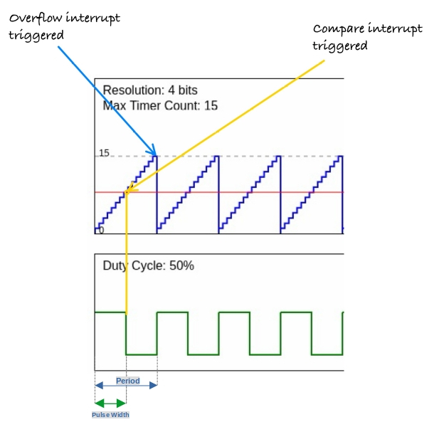

{{#title Таймеры ШИМ и коэффициент заполнения во встраиваемых системах}}

# ШИМ в деталях

## Работа таймера
Таймер играет ключевую роль в генераторе ШИМ. Он считает от нуля до заданного максимального значения (хранящегося в регистре), затем сбрасывается и начинает цикл заново. Этот подсчёт определяет длительность одного полного цикла, которая называется периодом.

## Значение сравнения (Compare Value)
Аппаратная часть таймера сравнивает его текущее значение с значением сравнения (хранящимся в регистре). Пока счётчик меньше значения сравнения, сигнал остаётся высоким; когда счётчик превышает значение сравнения, сигнал переходит в низкий уровень.

## Разрешение ШИМ (PWM Resolution)
В ШИМ (широтно-импульсной модуляции) разрешение — это то, насколько точно можно управлять коэффициентом заполнения. Оно определяется количеством битов, которые используются в регистре сравнения ШИМ.

Таймер считает от 0 до максимального значения, которое зависит от разрешения. Чем выше разрешение, тем точнее можно настраивать коэффициент заполнения.

Для системы с **n** битами разрешения таймер может считать от 0 до \\(2^n - 1\\), что даёт \\(2^n\\) возможных уровней коэффициента заполнения.

Например:
- 8-битное разрешение позволяет таймеру считать от 0 до 255, то есть даёт 256 возможных уровней коэффициента заполнения.
- 10-битное разрешение позволяет таймеру считать от 0 до 1023, то есть даёт 1024 возможных уровня коэффициента заполнения.

Более высокое разрешение обеспечивает более точное управление коэффициентом заполнения, но при этом таймеру нужно считать больше значений в пределах того же периода, что может снизить частоту или потребовать больше вычислительной мощности. По сути, разрешение определяет, сколько различных значений коэффициента заполнения можно задать: чем больше битов, тем тоньше настройка.

## Симуляция

В этой симуляции вы можете менять разрешение ШИМ в битах и коэффициент заполнения. Изменение разрешения в битах увеличивает максимальное значение счётчика, но остаётся в пределах периода (на коэффициент заполнения оно не влияет). Изменение коэффициента заполнения соответственно меняет состояния «включено» и «выключено», но тоже остаётся в пределах периода.
 
  

    

      <label for="resolution">Разрешение ШИМ (биты): </label>
      <input type="range" id="resolution" min="4" max="20" value="8">
      <input type="number" id="resolutionNumber" min="4" max="20" value="8">
    

    

      <label for="dutyCycle">Коэффициент заполнения (%): </label>
      <input type="range" id="dutyCycle" min="0" max="100" value="75">
      <input type="number" id="dutyCycleNumber" min="0" max="100" value="75">
    

  

 

    <canvas id="timerCanvas" width="800" height="200"></canvas>
    <canvas id="pwmCanvas" width="800" height="150"></canvas>
  

## Связь между коэффициентом заполнения, частотой и разрешением

Эта диаграмма иллюстрирует связь между коэффициентом заполнения, частотой, периодом, шириной импульса и разрешением. На первый взгляд она может показаться сложной, но если разобрать её по частям, всё становится яснее.

В этом примере разрешение таймера равно 4 битам, то есть таймер считает от 0 до 15. Когда таймер достигает максимального значения, срабатывает прерывание переполнения (синяя стрелка), и счётчик сбрасывается в 0. Время, которое таймеру нужно, чтобы досчитать от 0 до максимума, называется «периодом».

Коэффициент заполнения задан равным 50%, то есть сигнал остаётся в высоком состоянии половину периода. На каждом шаге счёта таймер сравнивает текущее значение счётчика со значением сравнения для коэффициента заполнения. Когда значение счётчика превышает это значение сравнения (жёлтая стрелка), сигнал переходит из высокого состояния в низкое. Это вызывает прерывание сравнения, которое сигнализирует о смене состояния.

Время, в течение которого сигнал находится в высоком состоянии, называется шириной импульса.

  
