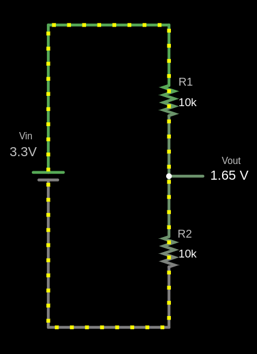

{{#title Делитель напряжения: объяснение для встраиваемого Rust и проектов на ESP32}}

# Делитель напряжения

**Делитель напряжения** — это простая схема, которая уменьшает входное напряжение \\( V_{in} \\) до меньшего выходного напряжения \\( V_{out} \\) с помощью двух последовательно соединённых резисторов. Резистор, подключённый к входному напряжению \\( V_{in} \\), называется \\( R_{1} \\), а второй резистор — \\( R_{2} \\). Выходное напряжение \\( V_{out} \\) снимается с точки соединения \\( R_{1} \\) и \\( R_{2} \\) и составляет долю от \\( V_{in} \\).

## Схема



Выходное напряжение (V<sub>out</sub>) рассчитывается по формуле:

\\[
V_{out} = V_{in} \times \frac{R_2}{R_1 + R_2}
\\]

### Пример расчёта \\( V_{out} \\)

Дано:
- \\( V_{in} = 3.3V \\)
- \\( R_1 = 10 k\Omega \\)
- \\( R_2 = 10 k\Omega \\)

Подставим значения:

\\[
V_{out} = 3.3V \times \frac{10 k\Omega}{10 k\Omega + 10 k\Omega} = 3.3V \times \frac{10}{20} = 3.3V \times 0.5 = 1.65V
\\]


Выходное напряжение \\( V_{out} \\) равно 1,65 В.


```rust,editable
fn main() {
    // Код можно редактировать
    // Можно менять значения и запускать программу
    let vin: f64 = 3.3;
    let r1: f64 = 10000.0;
    let r2: f64 = 10000.0;

    let vout = vin * (r2 / (r1 + r2));

    println!("The output voltage Vout is: {:.2} V", vout);
}
```

## Применение

Делители напряжения используются в таких устройствах, как потенциометры: там сопротивление меняется при повороте ручки, регулируя выходное напряжение. Их также применяют для измерения резистивных датчиков, например датчиков света и термисторов. На такой делитель подаётся известное напряжение, а микроконтроллер считывает напряжение в средней точке, чтобы определить значение датчика, например температуру.

## Симулятор делителя напряжения
<style>
canvas {
    border: 1px solid #ccc;
    margin-top: 20px;
    background:white;
}
</style>
<label for="vin">Входное напряжение (V<sub>in</sub>):</label>
<input type="number" id="vin" step="0.01" value="3.3" oninput="updateAndCalculate()"><br><br>

<label for="r1">Резистор R1 (Ом):</label>
<input type="number" id="r1" step="1" value="10000" oninput="updateAndCalculate()"><br><br>

<label for="r2">Резистор R2 (Ом):</label>
<input type="number" id="r2" step="1" value="10000" oninput="updateAndCalculate()"><br><br>

<p class="formula" id="formula">
    Формула: V<sub>out</sub> = V<sub>in</sub> × (R<sub>2</sub> / (R<sub>1</sub> + R<sub>2</sub>))
</p>
<p class="formula" id="filledFormula">
    Подставленная формула: V<sub>out</sub> = 3.3 × (10000 / (10000 + 10000))
</p>
<p id="result">Выходное напряжение (Vout): 1.65 V</p>

<canvas id="circuitCanvas" width="600" height="400"></canvas>


## Симулятор на сайте Falstad

Для создания схемы я использовал сайт [https://www.falstad.com/circuit/](https://www.falstad.com/circuit/). Это отличный инструмент для рисования схем. Вы можете скачать созданный мной файл [`voltage-divider.circuitjs.txt`](./voltage-divider.circuitjs.txt) и импортировать его, чтобы поэкспериментировать со схемой.


<script>
    function updateAndCalculate() {
        updateFormula();
        calculateVoltage();
        drawCircuit();
    }

    function updateFormula() {
        const vin = parseFloat(document.getElementById('vin').value) || 0;
        const r1 = parseFloat(document.getElementById('r1').value) || 0;
        const r2 = parseFloat(document.getElementById('r2').value) || 0;

        document.getElementById('filledFormula').textContent = 
            `Подставленная формула: Vout = ${vin} × (${r2} / (${r1} + ${r2}))`;
    }

    function calculateVoltage() {
        const vin = parseFloat(document.getElementById('vin').value);
        const r1 = parseFloat(document.getElementById('r1').value);
        const r2 = parseFloat(document.getElementById('r2').value);

        if (isNaN(vin) || isNaN(r1) || isNaN(r2) || r1 <= 0 || r2 <= 0) {
            document.getElementById('result').textContent = 
                "Пожалуйста, введите корректные положительные числа во все поля.";
            return;
        }

        const vout = vin * (r2 / (r1 + r2));
        document.getElementById('result').textContent = 
            `Выходное напряжение (Vout): ${vout.toFixed(2)} В`;
    }

    function drawZigZagResistor(ctx, x, y, width, height) {
        const segments = 6;
        const step = height / segments;
        const segmentWidth = width / 2;

        ctx.beginPath();
        ctx.moveTo(x, y);

        for (let i = 0; i < segments; i++) {
            const offset = (i % 2 === 0) ? segmentWidth : -segmentWidth;
            ctx.lineTo(x + offset, y + step * (i + 1));
        }

        const finalOffset = (segments % 2 === 0) ? segmentWidth : -segmentWidth;
        ctx.lineTo(x + 1, y + height + 4);
        ctx.lineWidth = 2;
        ctx.stroke();
    }

    function drawGroundSymbol(ctx, x, y) {
        const lineSpacing = 5;
        const topLineWidth = 20;

        ctx.beginPath();
        ctx.moveTo(x - topLineWidth / 2, y);
        ctx.lineTo(x + topLineWidth / 2, y);
        ctx.stroke();

        const middleLineWidth = topLineWidth * 0.6;
        ctx.beginPath();
        ctx.moveTo(x - middleLineWidth / 2, y + lineSpacing);
        ctx.lineTo(x + middleLineWidth / 2, y + lineSpacing);
        ctx.stroke();

        const bottomLineWidth = middleLineWidth * 0.6;
        ctx.beginPath();
        ctx.moveTo(x - bottomLineWidth / 2, y + 2 * lineSpacing);
        ctx.lineTo(x + bottomLineWidth / 2, y + 2 * lineSpacing);
        ctx.stroke();
    }

    function drawCircuit() {
        const canvas = document.getElementById('circuitCanvas');
        const ctx = canvas.getContext('2d');
        const vin = parseFloat(document.getElementById('vin').value) || 0;
        const r1 = parseFloat(document.getElementById('r1').value) || 0;
        const r2 = parseFloat(document.getElementById('r2').value) || 0;
        const vout = vin * (r2 / (r1 + r2)) || 0;

        ctx.clearRect(0, 0, canvas.width, canvas.height);

        ctx.fillStyle = 'black';
        ctx.font = '16px Arial';
        ctx.fillText(`V_in: ${vin.toFixed(2)} В`, 35, 94);
        ctx.beginPath();
        ctx.moveTo(100, 100);
        ctx.lineTo(150, 100);
        ctx.stroke();

        ctx.moveTo(130, 100);
        ctx.lineTo(170, 100);
        ctx.stroke();

        ctx.beginPath();
        ctx.moveTo(170, 100);
        ctx.lineTo(170, 130);
        ctx.stroke();

        ctx.fillText(`R1: ${r1} Ом`, 200, 155);
        drawZigZagResistor(ctx, 170, 130, 23, 40);

        ctx.beginPath();
        ctx.moveTo(170, 175);
        ctx.lineTo(170, 230);
        ctx.stroke();

        ctx.fillText(`R2: ${r2} Ом`, 200, 256);
        drawZigZagResistor(ctx, 170, 230, 20, 40);

        ctx.beginPath();
        ctx.moveTo(170, 275);
        ctx.lineTo(170, 300);
        ctx.stroke();
        ctx.fillText('Земля', 160, 330);

        drawGroundSymbol(ctx, 170, 300);

        ctx.beginPath();
        ctx.moveTo(170, 200);
        ctx.lineTo(270, 200);
        ctx.stroke();
        ctx.fillText(`V_out: ${vout.toFixed(2)} В`, 280, 203);
    }

    updateAndCalculate();
</script>
