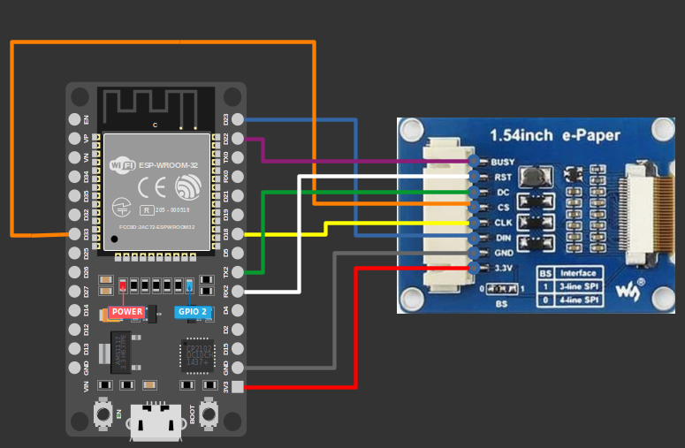

{{#title Подключение дисплея Waveshare e-Ink к ESP32 по SPI}}

# Схема подключения

## Распиновка e-Paper дисплея

- **VCC**: питание (3,3 В или 5 В) для дисплея.  
- **GND**: земля  
- **DIN (MOSI)**: линия данных SPI для отправки информации от микроконтроллера на дисплей.  
- **CLK (SCK)**: синхронизирует передачу данных по SPI.  
- **CS (Chip Select, активный низкий уровень)**: включает или отключает обмен по SPI. При низком уровне дисплей активен.  
- **DC (Data/Command Select)**: определяет, что передаётся: данные пикселей (высокий уровень) или команда (низкий уровень).  
- **RST (Reset, активный низкий уровень)**: сбрасывает дисплей при подаче низкого уровня, а затем высокого. Необходим для инициализации.  
- **BUSY**: показывает, занят ли дисплей обработкой (высокий уровень) или готов принимать новые команды (низкий уровень).  

## Подключение e-Paper дисплея к ESP32

 
<table style="margin-bottom:20px">
  <thead>
    <tr>
      <th>Вывод e-Paper</th>
      <th style="width: 250px; margin: 0 auto;">Провод</th>
      <th>Вывод ESP32</th>
    </tr>
  </thead>
  <tbody>
    <tr>
      <td>VCC</td>
      <td style="text-align: center; vertical-align: middle; padding: 0;">
        

          

          

        

      </td>
      <td>3.3V</td>
    </tr>
    <tr>
      <td>GND</td>
      <td style="text-align: center; vertical-align: middle; padding: 0;">
        

          

          

        

      </td>
      <td>GND</td>
    </tr>
    <tr>
      <td>DIN (MOSI)</td>
      <td style="text-align: center; vertical-align: middle; padding: 0;">
        

          

          

        

      </td>
      <td>GPIO23</td>
    </tr>
    <tr>
      <td>CLK (SCK)</td>
      <td style="text-align: center; vertical-align: middle; padding: 0;">
        

          

          

        

      </td>
      <td>GPIO18</td>
    </tr>
    <tr>
      <td>CS</td>
      <td style="text-align: center; vertical-align: middle; padding: 0;">
        

          

          

        

      </td>
      <td>GPIO33</td>
    </tr>
    <tr>
      <td>DC</td>
      <td style="text-align: center; vertical-align: middle; padding: 0;">
        

          

          

        

      </td>
      <td>GPIO17 (TX2 на DevKit)</td>
    </tr>
    <tr>
      <td>RST</td>
      <td style="text-align: center; vertical-align: middle; padding: 0;">
        

          

          

        

      </td>
      <td>GPIO16 (Rx2 на DevKit)</td>
    </tr>
    <tr>
      <td>BUSY</td>
      <td style="text-align: center; vertical-align: middle; padding: 0;">
        

          

          

        

      </td>
      <td>GPIO22</td>
    </tr>
  </tbody>
</table>

