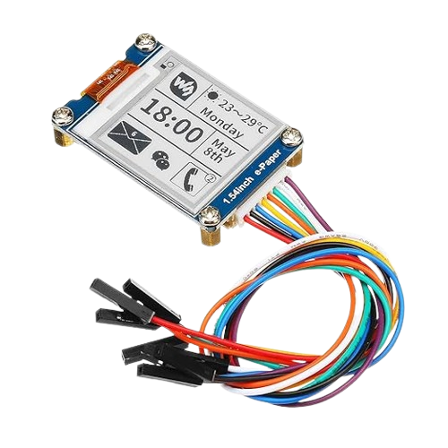

{{#title Начало работы с e-Ink дисплеями на ESP32 на Rust}}

# Модуль e-Ink (электронной бумаги)

e-Ink, он же e-Paper (или электронная бумага), — один из самых интересных модулей дисплеев, с которыми я сталкивался. Вы записываете текст или изображения на дисплей с помощью микроконтроллера, затем отключаете его, — и дисплей продолжает показывать то, что вы отправили, без источника питания. Серьёзно: никаких проводов, никаких батареек! Да, вы не ослышались. Это похоже на магию.

## Где используются e-Ink дисплеи?
Вы, возможно, уже видели e-Ink дисплей и даже не заметили этого. Присмотритесь: наверняка вы найдёте их повсюду вокруг!

Технология e-Ink чаще всего используется в электронных книгах, например Amazon Kindle, где бумажноподобный экран обеспечивает комфортное чтение и длительную работу от батареи. В розничных магазинах бумажные ценники заменяют e-Ink дисплеями, что делает обновление гораздо эффективнее. Также e-Ink можно встретить в расписаниях на автобусных остановках, табло в аэропортах, табличках на дверях комнат, устройствах умного дома, внутренних цифровых вывесках, меню и табличках в палатах и отделениях ухода за пациентами.

## Знакомство с железом
Существует много вариантов, которые отличаются размером дисплея и поддерживаемыми цветами. Одни дисплеи чёрно-белые, другие поддерживают трёхцветный или многоцветный режим.

Мы будем использовать 1,54-дюймовый модуль e-Ink от Waveshare, который работает по интерфейсу SPI. Разрешение дисплея — 200 x 200, он выводит изображения в чёрно-белом режиме.

Для этого проекта рекомендуем купить 1,54-дюймовый чёрно-белый модуль (v2.1). Эта версия самая дешёвая, поэтому доступна всем, а к тому же обеспечивает более высокую скорость обновления по сравнению с цветными вариантами. Следовать инструкциям будет легче, если использовать именно этот вариант.

Впрочем, вы можете выбрать любой размер или цвет дисплея: основные концепции останутся похожими.

## Ресурсы

- [Даташит 1.5inch e-Paper V2](https://files.waveshare.com/upload/e/e5/1.54inch_e-paper_V2_Datasheet.pdf)
- [Руководство по модулю 1.54inch e-Paper](https://www.waveshare.com/wiki/1.54inch_e-Paper_Module_Manual)
