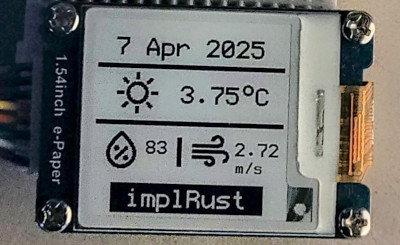

{{#title Метеостанция на ESP32 с Wi-Fi и e-Ink дисплеем на Rust}}

# Начинается самое интересное

В функции `main` выполним обычные шаги настройки: инициализируем стек Wi-Fi, SPI-устройство и создадим экземпляр `Dashboard`, который мы определили ранее.

```rust
#[esp_rtos::main]
async fn main(spawner: Spawner) -> ! {
    // generator version: 1.0.0

    let config = esp_hal::Config::default().with_cpu_clock(CpuClock::max());
    let peripherals = esp_hal::init(config);

    esp_alloc::heap_allocator!(#[unsafe(link_section = ".dram2_uninit")] size: 98767);

    let timg0 = TimerGroup::new(peripherals.TIMG0);
    esp_rtos::start(timg0.timer0);

    info!("Embassy initialized!");

    let radio_init = &*lib::mk_static!(
        esp_radio::Controller<'static>,
        esp_radio::init().expect("Failed to initialize Wi-Fi/BLE controller")
    );
    let rng = Rng::new();

    let stack = lib::wifi::start_wifi(radio_init, peripherals.WIFI, rng, &spawner).await;

    let spi_bus = Spi::new(
        peripherals.SPI2,
        spi::master::Config::default()
            .with_frequency(Rate::from_mhz(4))
            .with_mode(spi::Mode::_0),
    )
    .unwrap()
    //CLK
    .with_sck(peripherals.GPIO18)
    //DIN
    .with_mosi(peripherals.GPIO23);

    let cs = Output::new(peripherals.GPIO33, Level::Low, OutputConfig::default());
    let mut spi_dev = ExclusiveDevice::new(spi_bus, cs, Delay).unwrap();

    // Инициализируем дисплей
    let busy_in = Input::new(
        peripherals.GPIO22,
        InputConfig::default().with_pull(Pull::None),
    );
    let dc = Output::new(peripherals.GPIO17, Level::Low, OutputConfig::default());
    let reset = Output::new(peripherals.GPIO16, Level::Low, OutputConfig::default());
    let epd = Epd1in54::new(&mut spi_dev, busy_in, dc, reset, &mut Delay, None).unwrap();

    let tls_seed = rng.random() as u64 | ((rng.random() as u64) << 32);

    let mut app = Dashboard::new(stack, epd, spi_dev);
    app.start(tls_seed).await;

    loop {
        Timer::after(Duration::from_secs(1)).await;
    }
}
```


## Клонирование существующего проекта

Вы также можете клонировать (или посмотреть) созданный мной проект и перейти в папку `wifi-webfetch`.

```sh
git clone https://github.com/ImplFerris/esp32-epaper-weather/
cd esp32-epaper-weather
```

### Как запустить?

При прошивке программы в ESP32 нужно передать имя Wi-Fi сети (SSID), пароль Wi-Fi и ключ API Open Weather как переменные окружения.

```sh
SSID=YOUR_WIFI_NAME PASSWORD=YOUR_WIFI_PASSWORD API_KEY=OPEN_WEATHER_KEY  cargo run --release
```

Если всё прошло успешно, e-paper дисплей ненадолго мигнёт, очищаясь и отрисовывая содержимое, и вы увидите данные о погоде.


