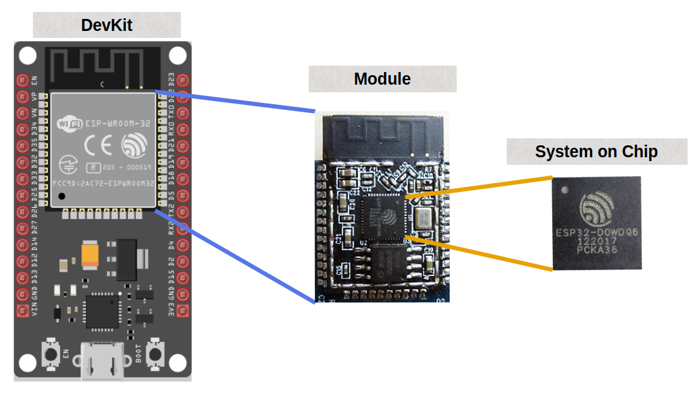

{{#title Варианты ESP32 для начинающих: SoC, модуль и отладочная плата}}

# Семейство ESP32

Если вы новичок и ищете, какой ESP32 купить, вас может сбить с толку обилие вариантов. В этом разделе мы разберёмся с ними.

Семейство ESP32 — это серия недорогих маломощных систем на кристалле (System on Chip, SoC) от компании Espressif. ESP32 стал преемником ESP8266 и с тех пор разросся во множество вариантов.

## Варианты SoC

Семейство ESP32 включает следующие часто используемые варианты SoC:

- ESP32
- ESP32 серии S (ESP32-S2, ESP32-S3)
- ESP32 серии C (ESP32-C3, ESP32-C6, ESP32-C5)
- ESP32 серии H (ESP32-H2)
- ESP32-P серии (ESP32-P4)

Если вы выбираете модель для конкретного проекта или разрабатываете продукт, используйте таблицы сравнения выше, чтобы найти наиболее подходящий вариант. Полный список моделей и их характеристик есть на [странице сравнения продуктов](https://products.espressif.com/#/product-comparison) на сайте Espressif.

Для простого обзора самых распространённых моделей ESP32 и их основных возможностей посмотрите [эту таблицу](https://done.land/components/microcontroller/families/esp/esp32/) на сайте Done.land.

## System on Chip (SoC) vs модуль vs отладочная плата (Devkit)

ESP32 бывает в трёх формах: **System on Chip (SoC)**, **модуль** и **отладочная плата (Devkit)**. Каждая из них служит своей цели и подходит для разных этапов разработки или интеграции.

### System on Chip (SoC)

SoC — это ядро и самая базовая форма ESP32. System on Chip объединяет основные компоненты электронной системы или компьютера в одной интегральной схеме (IC). SoC ESP32, как правило, включает такие компоненты:

- CPU (процессор)
- ROM и SRAM
- Периферия
- Беспроводная связь (зависит от модели)

**Применение**:  
SoC в первую очередь предназначены для встраивания в собственные аппаратные разработки. Они подходят производителям, которые хотят добавить функциональность ESP32 в свои продукты. Однако при использовании SoC напрямую в собственной разработке вы сами отвечаете за RF-дизайн и соответствие нормативным требованиям готового продукта.

---

### Модуль

Модули строятся на базе SoC и предлагают более удобное готовое решение. Распространённые примеры модулей ESP32 — популярные серии **WROOM** и **WROVER**. Например, **ESP32-WROOM-32** широко используется и узнаётся по металлическому корпусу квадратной формы на многих отладочных платах.

#### **Почему стоит выбрать модуль?**
- **Соответствие нормативам:** Многие модули ESP32 уже протестированы и сертифицированы для определённых конфигураций. Использование сертифицированного модуля может упростить соответствие нормативам, но это не делает весь продукт автоматически сертифицированным.
- **Встроенные компоненты:** Модули включают многие компоненты, необходимые для работы ESP32, например флеш-память, кварцевый генератор и RF-компоненты. В зависимости от модуля в нём может быть и печатная антенна.
- **Экранирование:** Многие модули имеют металлический RF-экран над радиочастотными и другими компонентами.

**Применение**:  
Модули предназначены для интеграции в собственные печатные платы и идеально подходят для приложений, которым нужно меньше внешних компонентов и меньше усилий по сравнению с работой с голым SoC.

---

### Отладочная плата (Devkit)

Отладочные платы упрощают работу с модулями ESP32 при прототипировании и разработке. Они включают дополнительные компоненты, которые облегчают работу с ESP32 как новичкам, так и опытным разработчикам.

#### **Ключевые особенности отладочных плат**:
- **Интерфейс USB:** Удобный способ питать плату и загружать в неё программы.
- **Стабилизаторы напряжения:** Обеспечивают подходящее напряжение питания для ESP32.
- **Выводы:** Делают выводы ESP32 доступными для подключения внешних компонентов, таких как датчики и дисплеи.
- **Кнопки Boot и Reset:** Позволяют управлять работой модуля.

**Применение**:  
Отладочные платы идеально подходят для быстрого прототипирования и экспериментов. Популярные примеры — **ESP32 DevKit v1** и **ESP32-S3-DevkitC**, которыми широко пользуются разработчики и энтузиасты.

---
## Почему ESP32 DevKit v1?

**Признаюсь:** когда я впервые захотел попробовать ESP32, я не знал о множестве вариантов. Я искал на сайте интернет-магазина, и большинство результатов показывали ESP32-WROOM-32 от разных производителей. Я просто взял один из них. Позже я узнал, что есть и другие варианты. Однако на момент написания книги большинство из них либо были нелегко доступны там, где я живу, либо стоили дороже этого. Этот вариант остаётся одним из самых популярных.

Поэтому в этой книге мы не будем усложнять и выберем популярную и доступную плату «**ESP32 DevKit V1**», которая отлично подходит для разработки и обучения.

## Как найти?

Если вы будете искать на сайте интернет-магазина, скорее всего, найдёте её под названием вроде «ESP32 Development Board (ESP-WROOM-32)». Ищите плату с модулем ESP32-WROOM-32 и 30-контактной разводкой, как показано ниже.

Сравнить характеристики и выводы платы можно по этой картинке.

### Характеристики
ESP32 — это двухъядерный 32-битный процессор с поддержкой Wi-Fi и Bluetooth, отлично подходящий для беспроводных IoT-приложений.

Ниже перечислены базовые характеристики ESP32-WROOM-32, которые используются на этой отладочной плате:
- Процессор: Xtensa 32-bit LX6
- Количество ядер: 2
- Тактовая частота: 240 МГц
- Флеш-память: 4 МБ
- ROM: 448 КБ (постоянная память с программами, необходимыми для работы ESP32)
- SRAM: 520 КБ (для хранения данных и инструкций)
- АЦП: два 12-битных SAR ADC, 18 каналов
- UART: 3
- SPI: 4
- I2C: 2
- Wi-Fi: IEEE 802.11 b/g/n/e/i (802.11n до 150 Мбит/с)
- Bluetooth: v4.2 BR/EDR и Bluetooth Low Energy (BLE)
- Рабочее напряжение: 2,3–3,6 В
- Deep Sleep: 100 мкА

## Ссылки
- [Гид по выбору ESP32](https://eitherway.io/posts/esp32-buyers-guide/)
- [Сравнение серий чипов](https://docs.espressif.com/projects/esp-idf/en/v5.0/esp32s3/hw-reference/chip-series-comparison.html)
