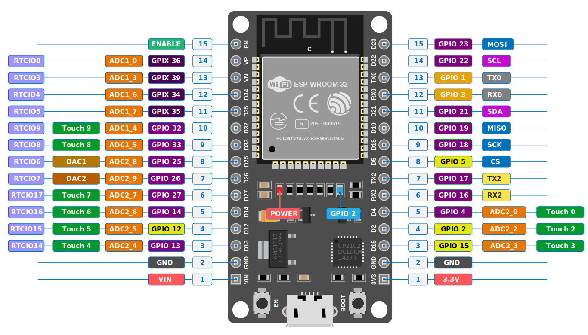

{{#title Схема выводов ESP32 DevKit V1 для начинающих}}

# Распиновка ESP32

Лицензия: [CC-BY-SA 4.0](https://creativecommons.org/licenses/by-sa/4.0/deed.en)

Приведённая схема выводов основана на оригинальной схеме, созданной сайтом CircuitState. Там же есть подробные описания каждого вывода. Посмотреть их можно [здесь](https://www.circuitstate.com/pinouts/doit-esp32-devkit-v1-wifi-development-board-pinout-diagram-and-reference/).

Отказ от ответственности: эта книга не связана с CircuitState и не аффилирована с ним. Я включил эту схему, потому что нашёл её полезной во время своих исследований.

## Ключевые моменты

- **GPIO только для входа:** выводы GPIO 34, 35, 36 и 39 работают только на вход и не могут использоваться как выходы. На схеме эти выводы обозначены префиксом «GPIX» и отмечены «X», что означает, что выход недоступен. По возможности используйте выводы, выделенные на схеме фиолетовым цветом.

- **Прошивка и отладка:** GPIO 1 (Tx) и GPIO 3 (Rx) предназначены для прошивки и отладки.

- **Выводы АЦП:** выводы с обозначением `ADC1_[номер]` относятся к ADC1, а выводы с обозначением `ADC2_[номер]` — к ADC2.
