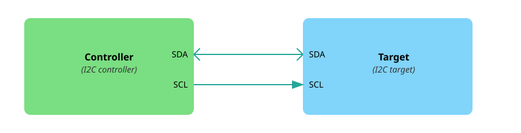

{{#title Что такое I2C: объяснение для встраиваемых систем и ESP32}}

# Inter-Integrated Circuit (I2C)

В этом разделе мы узнаем, что такое I2C, и научимся использовать шины I2C ESP32.

##  Что такое I2C?
I2C расшифровывается как Inter-Integrated Circuit (межмикросхемная шина), также пишется I²C. Это один из популярных способов обмена данными, которые микроконтроллеры используют для связи с датчиками, дисплеями (например, OLED) и другими микросхемами. Это последовательный, полудуплексный и синхронный интерфейс. Разберём, что это значит.

- Последовательный (serial) означает, что данные передаются по одному биту за раз по одной линии. Представьте однополосный мост, по которому машины (биты данных) проезжают одна за другой.

- Полудуплексный (half-duplex) означает, что данные идут только в одном направлении за раз. Представьте рацию: говорит только один человек, пока другой слушает, а потом они меняются ролями.

- Синхронный (synchronous) означает, что оба устройства опираются на общий сигнал тактирования, чтобы согласовывать обмен. Представьте, что два человека перебрасываются мячом, но только тогда, когда судья свистит. Этот свисток работает как сигнал тактирования, который поддерживает синхронность по времени.

## Контроллер и целевое устройство

I2C использует модель «контроллер — целевое устройство». Контроллер (раньше его называли master, «ведущий») — это устройство, которое инициирует обмен и формирует сигнал тактирования. Целевое устройство (раньше его называли slave, «ведомый») отвечает на команды контроллера.

<em>Рисунок: один контроллер и одно целевое устройство</em>

В типичных встраиваемых проектах микроконтроллер (например, ESP32) выступает в роли контроллера, а подключённые устройства, такие как дисплеи (например, OLED) или датчики, — в роли целевых устройств.

I2C позволяет легко подключить много устройств к одной паре проводов. К одному контроллеру можно подключить несколько целевых устройств — это самая распространённая схема. I2C также поддерживает несколько контроллеров на одной шине, так что более одного контроллера может обмениваться данными с одним или несколькими целевыми устройствами.

## Шина I2C

Шина I2C использует всего две линии, общие для всех подключённых устройств:

- SCL (Serial Clock Line, линия тактирования): передаёт сигнал тактирования от контроллера. Иногда устройства обозначают её как SCK.

- SDA (Serial Data Line, линия данных): передаёт данные в обоих направлениях. Иногда устройства обозначают её как SDI.

<em>Рисунок: один контроллер и несколько целевых устройств</em>

Все подключённые устройства используют одни и те же два провода. Контроллер выбирает, с каким целевым устройством общаться, отправляя его уникальный адрес.

## Адреса I2C

У каждого целевого устройства I2C есть 7-битный или 10-битный адрес. Чаще всего используется 7-битный, который даёт до 128 возможных адресов.

Многие устройства имеют фиксированный адрес, заданный производителем, но другие позволяют настраивать младшие биты адреса с помощью выводов или перемычек. Например, датчик может использовать выводы A0 и A1, чтобы менять адрес, и тогда на одной шине можно использовать несколько одинаковых микросхем.

Когда контроллер хочет связаться с целевым устройством, он начинает с условия START, затем отправляет адрес устройства и бит чтения/записи. Соответствующее устройство отвечает сигналом ACK (подтверждение), и обмен продолжается.

## Режимы скорости

I2C поддерживает разные режимы скорости в зависимости от того, насколько быстро нужно передавать данные. Стандартный режим работает до 100 кбит/с, быстрый режим (fast mode) — до 400 кбит/с, а Fast Mode Plus позволяет до 1 Мбит/с. Для ещё более быстрой связи режим High-Speed поддерживает до 3,4 Мбит/с. Есть и сверхбыстрый режим Ultra-Fast (5 Мбит/с). Скорость, которую можно использовать, зависит от того, какие режимы одновременно поддерживаются интерфейсом I2C микроконтроллера и подключёнными целевыми устройствами.

## Зачем I2C?

I2C идеально подходит, когда нужно подключить несколько устройств всего двумя проводами. Он хорошо подходит для задач, где скорость не критична, а простота проводки важна.

Хорошая новость: во встраиваемом Rust не нужно реализовывать протокол I2C самостоятельно. Крейт embedded-hal определяет общие трейты I2C, а HAL для вашего чипа берёт на себя низкоуровневые детали. В следующем разделе мы разберём это подробнее.

## Ресурсы

- [Основы протокола связи I2C](https://www.circuitbasics.com/basics-of-the-i2c-communication-protocol/): читайте, если хотите глубже понять, как контроллер обменивается данными с целевым устройством.
