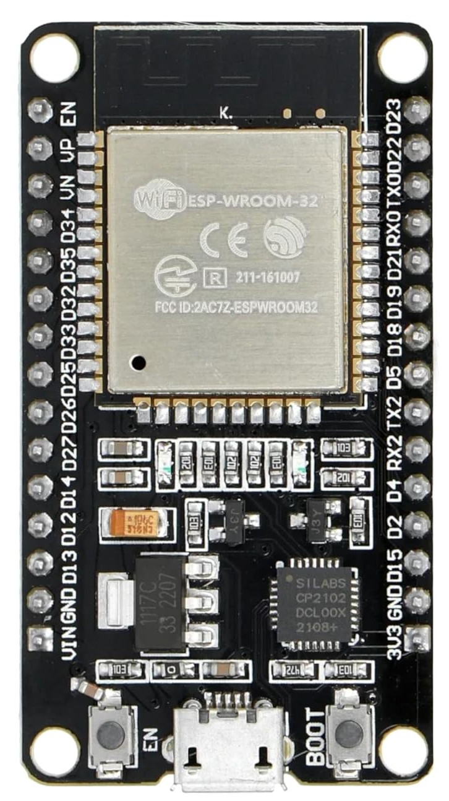
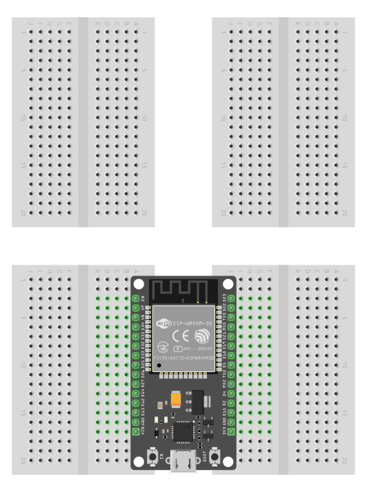

{{#title Изучаем встраиваемый Rust на ESP32: IoT-проекты | impl Rust для ESP32}}

# Введение

В этой книге мы используем плату ESP32 DevKit v1 и язык Rust, чтобы собирать простые и интересные проекты. ESP32 — популярный микроконтроллер для IoT-приложений, и мы идём практическим путём: учимся, делая. Вы научитесь включать светодиод, когда в комнате темнеет, с помощью LDR; использовать ультразвуковой датчик, чтобы определить, что что-то находится рядом; управлять светодиодом по Wi-Fi; выводить изображения и текст на OLED-дисплей; проигрывать мелодии и звуковые сигналы на пищалке; управлять сервоприводом и многое другое.

Мы будем использовать среду `no_std` языка Rust. Программировать ESP32 можно и в среде std, но я считаю, что лучше начинать с no_std: так вы сможете применять ту же логику и при работе с другими микроконтроллерами.

## Предварительные требования
Если вы ещё не читали ["The Rust on ESP Book"](https://docs.espressif.com/projects/rust/book/), настоятельно рекомендую начать с неё. Эта книга тоже затронет настройку среды разработки и базовые понятия, но не будет углубляться в них, чтобы не повторять то, что уже подробно объяснено в официальной книге.

Также рекомендую прочитать ["The Embedded Rust book"](https://docs.rust-embedded.org/book/intro/index.html) — вводную книгу об использовании Rust во встраиваемых системах на «голом железе» (Bare Metal).

## Знакомство с железом
Мы будем использовать одну из отладочных плат — «ESP32 DevKit V1», которая имеет встроенные модули Wi-Fi и Bluetooth, а также интегрированный радиочастотный модуль

## Техническая документация
Подробные технические сведения, спецификации и рекомендации можно найти в официальных даташитах:
- [Даташит ESP32](https://www.espressif.com/sites/default/files/documentation/esp32_datasheet_en.pdf)
- [Technical Reference Manual](https://www.espressif.com/sites/default/files/documentation/esp32_technical_reference_manual_en.pdf)
- [Даташит ESP32-WROOM-32](https://www.espressif.com/sites/default/files/documentation/esp32-wroom-32_datasheet_en.pdf)

## Макетная плата
Плата ESP32 DevKit немного шире обычной. Если вы используете стандартную макетную плату, на ней может не хватить места, как было у меня. Чтобы решить эту проблему, я купил две мини-макетки, поставил ESP32 между ними и соединил каждую сторону.

На изображении в нижней части показано, как я подключил ESP32 к двум макетным платам. Верхняя часть просто показывает макетные платы до того, как к ним что-либо подключено.

## Лицензия

Книга «impl Rust для ESP32» (этот проект) распространяется по следующим лицензиям:

* Примеры кода и самостоятельные Cargo-проекты, содержащиеся в книге, распространяются на условиях как [MIT License], так и [Apache License v2.0].
* Текст книги распространяется на условиях лицензии Creative Commons [CC-BY-SA v4.0].

[MIT License]: https://opensource.org/licenses/MIT
[Apache License v2.0]: http://www.apache.org/licenses/LICENSE-2.0
[CC-BY-SA v4.0]: https://creativecommons.org/licenses/by-sa/4.0/legalcode

## Поддержите проект

Вы можете поддержать книгу, поставив звезду проекту на [GitHub](https://github.com/r007/EmbeddedRust-Rus/tree/main/esp32-book) или поделившись книгой с другими 😊

### Отказ от ответственности:
Эксперименты и проекты из этой книги работали у меня, но результаты могут отличаться. Я не несу ответственности за любые проблемы или повреждения, которые могут возникнуть во время ваших экспериментов. Пожалуйста, действуйте осторожно и соблюдайте необходимые меры безопасности.
