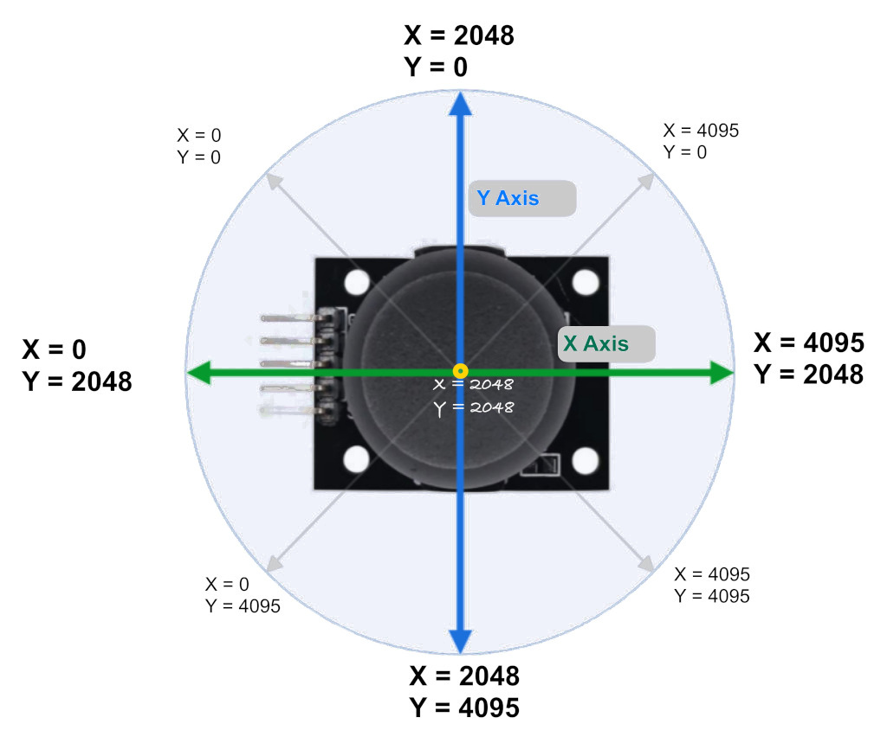

{{#title Движение джойстика и значения АЦП по осям X и Y на ESP32}}

# Движение джойстика и соответствующие значения АЦП

Когда вы двигаете джойстик по оси X или Y, он выдаёт аналоговый сигнал, напряжение которого меняется от 0 до 3,3 В (или до 5 В, если подключить его к питанию 5 В). Когда джойстик находится в центральном (нейтральном) положении, выходное напряжение примерно равно 1,65 В, то есть половине VCC (в нашем случае VCC равен 3,3 В).

> [!Note]
> Причина, по которой в центре напряжение 1,65 В, в том, что потенциометр работает как делитель напряжения. Когда потенциометр перемещается, его сопротивление меняется, и делитель выдаёт соответствующее напряжение. См. <a href="../core-concepts/voltage-divider.html">раздел о делителе напряжения</a>.

У джойстика всего 5 выводов, и мы вскоре разберём, за что отвечает каждый из них. Два из них передают положение по осям X и Y, их нужно подключить к выводам АЦП микроконтроллера.

Как вы, возможно, уже знаете, ESP32 имеет 12-битный АЦП, который преобразует аналоговые сигналы (разности напряжений) в цифровые значения. Поскольку АЦП 12-битный, аналоговые значения будут представлены цифровыми значениями от 0 до 4095. Если вы не знакомы с АЦП, см. [раздел об АЦП](../core-concepts/adc/index.md), который мы рассматривали ранее.

**Примечание:**

Значения АЦП на изображении — лишь приблизительные ориентиры, они не будут точными. Например, я получил около 1850 по X и Y в центральном положении. Когда я двигал ручку к стороне с распиновкой, X падал до 0, а в противоположную сторону — до 4095. То же самое относится и к оси Y. Поэтому вам, возможно, придётся откалибровать свой джойстик.
