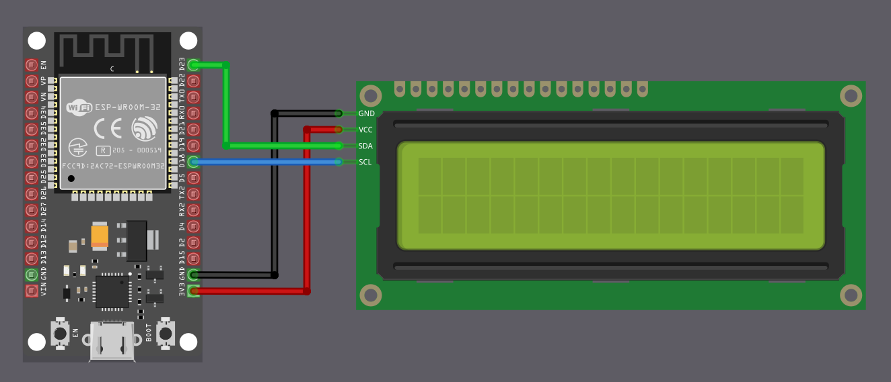
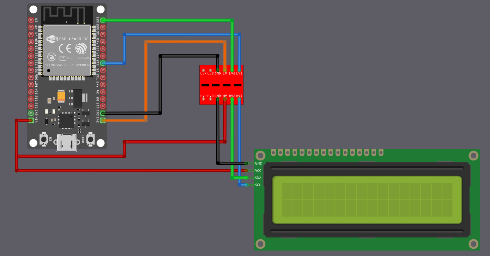

{{#title Подключение ЖК-дисплея LCD1602 к ESP32}}

# Подключение ЖК-дисплея (LCD1602) к ESP32

Мы подключим символьный дисплей LCD1602 с адаптером I2C к ESP32. С точки зрения проводки схема выглядит простой, потому что нужны всего четыре соединения: питание, земля, SDA и SCL. Однако, несмотря на небольшое количество проводов, есть важная деталь по напряжению, которую нужно правильно учесть до подключения.

## Проблема совместимости напряжений

Допустимое напряжение на выводах GPIO ESP32 составляет 3,6 В. Если напряжение на выводе GPIO превышает 3,6 В, оно выходит за безопасный рабочий диапазон и может повредить микросхему.

Большинство модулей LCD1602 с адаптером I2C рассчитаны на работу от 5 В. Адаптер I2C обычно имеет подтягивающие резисторы, подключённые к напряжению питания. При питании от 5 В это означает, что в состоянии покоя линии SDA и SCL находятся на уровне 5 В.

Если SDA и SCL такого модуля подключить напрямую к ESP32, выводы GPIO ESP32 окажутся под напряжением 5 В. Именно эту проблему нам и нужно решить.

## Распространённый обходной путь, который вы увидите в интернете

Многие онлайн-руководства предлагают питать LCD1602 и его адаптер I2C от 5 В и подключать SDA и SCL напрямую к ESP32. Я сам проверял такую схему, и она работает. Однако с электрической точки зрения это небезопасно, а длительная эксплуатация может повредить выводы GPIO ESP32.

Поэтому, хотя такой способ и работает, его нельзя считать безопасным или рекомендовать.

> [!Note]
> Эта тема часто обсуждается в сообществе ESP32. Одни пользователи сообщают, что входы 5 В в любительских проектах, похоже, работают, а другие указывают, что такое поведение не описано в документации Espressif и на него не стоит полагаться, особенно в коммерческих или долговременных разработках. Одно из связанных обсуждений можно найти здесь:
> [https://www.reddit.com/r/esp32/comments/1j5p0lb/can_the_espwroom32_read_5v_io_inputs/](https://www.reddit.com/r/esp32/comments/1j5p0lb/can_the_espwroom32_read_5v_io_inputs/)

## Простой, но достаточно безопасный подход: питание всего 3,3 В

Для демонстраций, экспериментов и учебных проектов самый простой и безопасный способ — питать ЖК-модуль LCD1602 с I2C от источника 3,3 В на ESP32, а не от 5 В.

Когда адаптер питается от 3,3 В, его подтягивающие резисторы I2C подтягивают SDA и SCL к 3,3 В, а не к 5 В. Это сразу устраняет проблему совместимости напряжений, и SDA и SCL можно подключить напрямую к ESP32.

Платой за это будут более тусклый контраст и подсветка дисплея. При питании от 3,3 В дисплей обычно всё ещё читаем при обычном комнатном освещении, чего достаточно для экспериментов и базовой проверки.

Такой подход не требует дополнительных компонентов и не нагружает выводы GPIO ESP32.

<table>
  <thead>
    <tr>
      <th style="width: 250px;">Вывод ЖК-дисплея</th>
      <th style="width: 250px; text-align: center;">Провод</th>
      <th>Вывод ESP32</th>
      <th>Примечания</th>
    </tr>
  </thead>
  <tbody>
    <tr>
      <td>GND</td>
      <td style="text-align: center; vertical-align: middle; padding: 0;">
        

          

          

        

      </td>
      <td>GND</td>
      <td>Земля</td>
    </tr>
    <tr>
      <td>VCC</td>
      <td style="text-align: center; vertical-align: middle; padding: 0;">
        

          

          

        

      </td>
      <td>3.3</td>
      <td>Питание 3,3 В</td>
    </tr>
    <tr>
      <td>SCL</td>
      <td style="text-align: center; vertical-align: middle; padding: 0;">
        

          

          

        

      </td>
      <td>GPIO 18</td>
      <td>Подключает сигнал тактирования (SCL) для связи I2C.</td>
    </tr>
    <tr>
      <td>SDA</td>
      <td style="text-align: center; vertical-align: middle; padding: 0;">
        

          

          

        

      </td>
      <td>GPIO 23</td>
      <td>Подключает сигнал данных (SDA) для связи I2C.</td>
    </tr>
  </tbody>
</table>
 

## Лучший подход: использование преобразователя уровней

Если нужна полная яркость подсветки или если ваш ЖК-модуль не работает надёжно при 3,3 В, его необходимо питать от 5 В. Но тогда нужно защитить ESP32 от сигналов 5 В.

Решение — двунаправленный преобразователь логических уровней (также называемый level shifter). Этот небольшой модуль преобразует сигналы между 3,3 В и 5 В в обоих направлениях.

ESP32 подключается к стороне 3,3 В преобразователя, а ЖК-дисплей — к стороне 5 В. Преобразователь гарантирует, что ESP32 всегда видит только сигналы 3,3 В, а ЖК-дисплей получает сигналы 5 В, которые ему нужны.

Это электрически правильный и безопасный способ, но он добавляет несколько проводов и требует дополнительного модуля.

 

Схема может показаться немного запутанной на первый взгляд, но идея проста, если разобрать её по частям.

<h3>Подключение питания (сначала подключите эти провода)</h3>

Сначала подключите выход 3,3 В ESP32 к выводу, помеченному LV (Low Voltage, низкое напряжение), на преобразователе. Это задаёт логический уровень для стороны ESP32. Затем подключите питание 5 В ESP32 (то есть VIN на плате ESP32 DevKit V1) к выводу, помеченному HV (High Voltage, высокое напряжение), на преобразователе. Вывод VCC ЖК-дисплея тоже питается от того же источника 5 В.

Земля должна быть общей, поэтому соедините вместе землю ESP32, землю преобразователя и землю ЖК-дисплея.

<table>
  <thead>
    <tr>
      <th style="width: 180px;">Откуда</th>
      <th style="width: 120px;">Вывод</th>
      <th style="width: 160px; text-align: center;">Провод</th>
      <th style="width: 180px;">Куда</th>
      <th style="width: 120px;">Вывод</th>
      <th>Назначение</th>
    </tr>
  </thead>
  <tbody>
    <tr>
      <td>ESP32</td>
      <td>GND</td>
      <td style="text-align: center; padding: 0;">
        

          

          

        

      </td>
      <td>Преобразователь уровней</td>
      <td>GND</td>
      <td>Общая земля</td>
    </tr>
    <tr>
      <td>Преобразователь уровней</td>
      <td>GND</td>
      <td style="text-align: center; padding: 0;">
        

          

          

        

      </td>
      <td>ЖК-дисплей</td>
      <td>GND</td>
      <td>Общая земля</td>
    </tr>
    <tr>
      <td>ESP32</td>
      <td>3.3V</td>
      <td style="text-align: center; padding: 0;">
        

          

          

        

      </td>
      <td>Преобразователь уровней</td>
      <td>LV</td>
      <td>Опорный логический уровень низкого напряжения</td>
    </tr>
    <tr>
      <td>ESP32</td>
      <td>VIN / 5V</td>
      <td style="text-align: center; padding: 0;">
        

          

          

        

      </td>
      <td>Преобразователь уровней</td>
      <td>HV</td>
      <td>Опорный логический уровень высокого напряжения</td>
    </tr>
    <tr>
      <td>ESP32</td>
      <td>VIN / 5V</td>
      <td style="text-align: center; padding: 0;">
        

          

          

        

      </td>
      <td>ЖК-дисплей</td>
      <td>VCC</td>
      <td>Питание 5 В для ЖК-дисплея</td>
    </tr>
  </tbody>
</table>

<h3>Подключение данных (связь I2C)</h3>

Теперь подключим линии сигналов I2C. Выводы GPIO ESP32 всегда должны подключаться к выводам преобразователя, помеченным LVx, а выводы I2C ЖК-дисплея — к соответствующим выводам, помеченным HVx.

В этом примере вывод SDA ESP32 подключается к LV1, а вывод SDA ЖК-дисплея — к HV1. Вывод SCL ESP32 подключается к LV2, а вывод SCL ЖК-дисплея — к HV2. Конкретные номера GPIO для SDA и SCL зависят от вашей платы ESP32 и конфигурации программы.

<table>
  <thead>
    <tr>
      <th style="width: 180px;">Откуда</th>
      <th style="width: 120px;">Вывод</th>
      <th style="width: 160px; text-align: center;">Провод</th>
      <th style="width: 180px;">Куда</th>
      <th style="width: 120px;">Вывод</th>
      <th>Назначение</th>
    </tr>
  </thead>
  <tbody>
    <tr>
      <td>ESP32</td>
      <td>GPIO 23 (SDA)</td>
      <td style="text-align: center; padding: 0;">
        

          

          

        

      </td>
      <td>Преобразователь уровней</td>
      <td>LV1</td>
      <td>SDA (данные), сторона ESP32</td>
    </tr>
    <tr>
      <td>Преобразователь уровней</td>
      <td>HV1</td>
      <td style="text-align: center; padding: 0;">
        

          

          

        

      </td>
      <td>ЖК-дисплей</td>
      <td>SDA</td>
      <td>SDA (данные), сторона ЖК-дисплея</td>
    </tr>
    <tr>
      <td>ESP32</td>
      <td>GPIO 18 (SCL)</td>
      <td style="text-align: center; padding: 0;">
        

          

          

        

      </td>
      <td>Преобразователь уровней</td>
      <td>LV2</td>
      <td>SCL (тактирование), сторона ESP32</td>
    </tr>
    <tr>
      <td>Преобразователь уровней</td>
      <td>HV2</td>
      <td style="text-align: center; padding: 0;">
        

          

          

        

      </td>
      <td>ЖК-дисплей</td>
      <td>SCL</td>
      <td>SCL (тактирование), сторона ЖК-дисплея</td>
    </tr>
  </tbody>
</table>

### Как это работает
Проще говоря, когда ESP32 обменивается данными по линии I2C, сторона LVx работает на 3,3 В, а преобразователь выдаёт сигнал 5 В на соответствующей стороне HVx для ЖК-дисплея. Когда ЖК-дисплей обменивается данными на 5 В, преобразователь переводит этот сигнал обратно, так что ESP32 всегда видит на стороне LVx только 3,3 В. Таким образом, оба устройства работают на требуемом им напряжении, не перегружая выводы GPIO ESP32.
