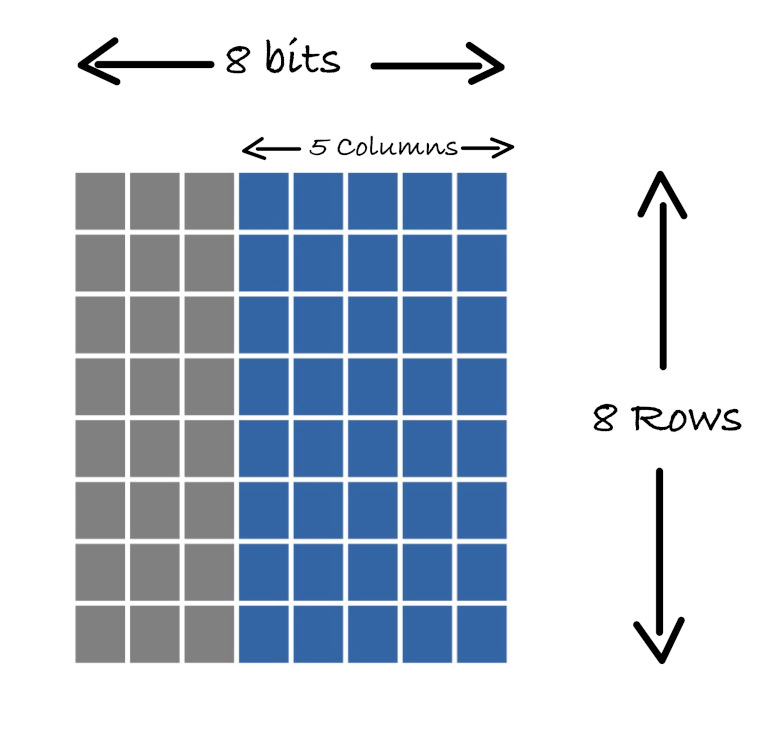

# Пользовательские символы

Помимо поддерживаемых символов, вы можете создавать собственные, например смайлики или символы сердца. В модуле есть 64 байта памяти знакогенератора (CGRAM), что позволяет создать до 8 пользовательских символов.
 
Каждый символ — это сетка 8x8, где каждая строка представлена одним 8-битным значением (`u8`). Получается 8 байт на символ (8 строк × 1 байт на строку). Поэтому при общем объёме 64 байта можно сохранить не более 8 пользовательских символов (8 символов × 8 байт = 64 байта).

Примечание: как вы помните, в нашем ЖК-модуле каждый символ представлен сеткой 5x8. Но ведь мы говорили, что для символов нужна сетка 8x8? Да, всё верно: нужна память 8 x 8 (8 байт), но в каждой строке используются только 5 бит. Три старших бита в каждой строке остаются нулевыми.

