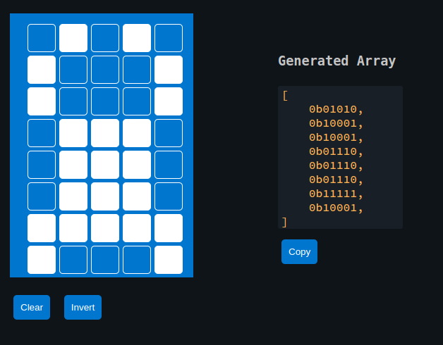

{{#title Как вывести пользовательский символ на ЖК-дисплей I2C на Rust}}

# Ferris на ЖК-дисплее

Давайте создадим Ferris (мою попытку изобразить краба; если у вас есть более удачный дизайн, присылайте pull request) одним символом. На самом деле для отображения одного символа можно объединить 4 или 6 соседних сеток. Творческий подход на ваше усмотрение, вы можете улучшить его как угодно.

Для создания этого символа мы воспользуемся генератором пользовательских символов с предыдущей страницы. Он даст нам байтовый массив, который можно использовать.



Обратите внимание: предыдущий крейт hd44780-driver (на момент написания главы) не поддерживает пользовательские символы. Для этого можно использовать крейт liquid_crystal, который позволяет работать с пользовательскими символами.

## Создание проекта с помощью esp-generate
Мы включим поддержку async (Embassy) для этого проекта. Чтобы создать проект, используйте команду `esp-generate`. Выполните:

```sh
esp-generate --chip esp32 lcd-custom
```

Откроется экран с вопросом о выборе опций.

- Сначала выберите опцию «Enable unstable HAL features.». Только после этого вы сможете выбрать поддержку фреймворка Embassy.
- Выберите опцию «Adds embassy framework support.»

Сохраните настройки, нажав на клавиатуре «s».

## Обновляем Cargo.toml

```toml
liquid_crystal = "0.2.0"
```

## Импорты

Сначала добавим необходимые импорты:

```rust
// I2C
use esp_hal::i2c::master::Config as I2cConfig; // для удобства импортируем под псевдонимом
use esp_hal::i2c::master::I2c;
use esp_hal::time::Rate;

// Драйвер HD44780
use liquid_crystal::prelude::*;
use liquid_crystal::LiquidCrystal;
use liquid_crystal::I2C;
```

### Инициализация I2C

```rust
let i2c_bus = I2c::new(
        peripherals.I2C0,
        // I2cConfig — псевдоним esp_hal::i2c::master::I2c::Config
        I2cConfig::default().with_frequency(Rate::from_khz(400)),
    )
    .unwrap()
    .with_scl(peripherals.GPIO18)
    .with_sda(peripherals.GPIO23)
    .into_async();
```

### Инициализация интерфейса ЖК-дисплея

```rust
let mut i2c_interface = I2C::new(i2c_bus, 0x27);
let mut lcd = LiquidCrystal::new(&mut i2c_interface, Bus4Bits, LCD16X2);
lcd.begin(&mut Delay);
```

### Байтовый массив нашего сгенерированного символа

```rust
const FERRIS: [u8; 8] = [
    0b01010, 0b10001, 0b10001, 0b01110, 0b01110, 0b01110, 0b11111, 0b10001,
];
// Определяем символ
lcd.custom_char(&mut Delay, &FERRIS, 0);
```

### Вывод символа

Вывод символа прост: нужно использовать перечисление `CustomChar` и передать индекс пользовательского символа. Мы определили только один пользовательский символ, он находится в позиции 0.

```rust
lcd.write(&mut Delay, CustomChar(0));
// обычный текст
lcd.write(&mut Delay, Text(" implRust!"));
```

## Клонирование существующего проекта

Вы также можете клонировать (или посмотреть) созданный мной проект и перейти в папку `lcd-custom`.

```sh
git clone https://github.com/ImplFerris/esp32-projects
cd esp32-projects/lcd-custom/
```

## Полный код 

```rust
#![no_std]
#![no_main]
#![deny(
    clippy::mem_forget,
    reason = "mem::forget is generally not safe to do with esp_hal types, especially those \
    holding buffers for the duration of a data transfer."
)]

use defmt::info;
use embassy_executor::Spawner;
use embassy_time::Delay;
use embassy_time::{Duration, Timer};
use esp_hal::clock::CpuClock;
use esp_hal::timer::timg::TimerGroup;
use esp_println as _;

// I2C
use esp_hal::i2c::master::Config as I2cConfig; // для удобства импортируем под псевдонимом
use esp_hal::i2c::master::I2c;
use esp_hal::time::Rate;

// Драйвер HD44780
use liquid_crystal::I2C;
use liquid_crystal::LiquidCrystal;
use liquid_crystal::prelude::*;

#[panic_handler]
fn panic(_: &core::panic::PanicInfo) -> ! {
    loop {}
}

// Создаёт дескриптор приложения по умолчанию, который требуется загрузчику esp-idf.
// Подробнее см.: <https://docs.espressif.com/projects/esp-idf/en/stable/esp32/api-reference/system/app_image_format.html#application-description>
esp_bootloader_esp_idf::esp_app_desc!();

const FERRIS: [u8; 8] = [
    0b01010, 0b10001, 0b10001, 0b01110, 0b01110, 0b01110, 0b11111, 0b10001,
];

#[esp_rtos::main]
async fn main(spawner: Spawner) -> ! {
    // generator version: 1.0.0

    let config = esp_hal::Config::default().with_cpu_clock(CpuClock::max());
    let peripherals = esp_hal::init(config);

    let timg0 = TimerGroup::new(peripherals.TIMG0);
    esp_rtos::start(timg0.timer0);

    info!("Embassy initialized!");

    let _ = spawner;

    let i2c_bus = I2c::new(
        peripherals.I2C0,
        // I2cConfig — псевдоним esp_hal::i2c::master::I2c::Config
        I2cConfig::default().with_frequency(Rate::from_khz(400)),
    )
    .unwrap()
    .with_scl(peripherals.GPIO18)
    .with_sda(peripherals.GPIO23)
    .into_async();

    let mut i2c_interface = I2C::new(i2c_bus, 0x27);
    let mut lcd = LiquidCrystal::new(&mut i2c_interface, Bus4Bits, LCD16X2);
    lcd.begin(&mut Delay);

    // Определяем символ
    lcd.custom_char(&mut Delay, &FERRIS, 0);

    lcd.write(&mut Delay, CustomChar(0));
    lcd.write(&mut Delay, Text(" implRust!"));

    loop {
        info!("Hello world!");
        Timer::after(Duration::from_secs(1)).await;
    }
}
````
