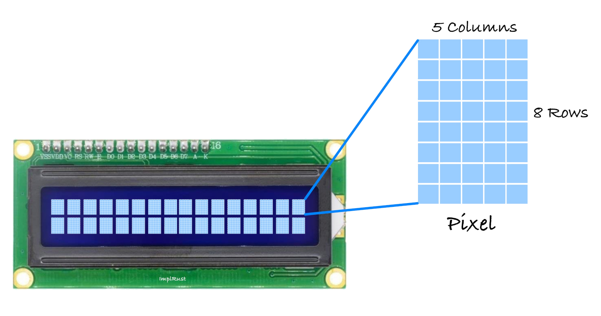
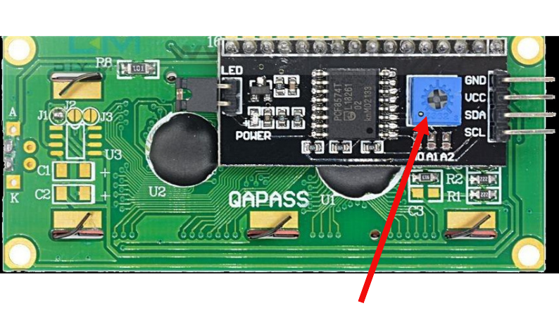

{{#title Как работают ЖК-дисплеи LCD1602 с ESP32 и Rust}}

# Как это работает?

Жидкокристаллический дисплей (LCD) использует жидкие кристаллы для управления светом. Когда подаётся электричество, кристаллы меняют ориентацию: они либо пропускают свет, либо блокируют его, формируя изображения или текст. Подсветка освещает экран, а цветные субпиксели (красный, зелёный и синий) смешиваются, образуя различные цвета. Кристаллы также могут стать непрозрачными в определённых областях, блокируя подсветку и создавая тёмные участки для отображения символов.

## ЖК-дисплей 16x2 и матрица пикселей 5x8
ЖК-дисплей 16x2 имеет 2 строки и 16 столбцов, поэтому может отобразить 32 символа. Каждый символ состоит из сетки пикселей 5x8: 5 столбцов и 8 строк пикселей формируют форму символа. Эта сетка используется для отображения текста и простых символов на экране.

## Вывод текста и пользовательских символов на ЖК-дисплее 16x2
Рисовать пиксели вручную не нужно: это делает микросхема HD44780, которая автоматически сопоставляет ASCII-символы с сеткой 5x8.

Однако если вы хотите создать пользовательские символы или значки, нужно самостоятельно задать шаблон 5x8. Этот шаблон сохраняется в памяти ЖК-дисплея, и после его определения вы можете использовать пользовательский символ. Имейте в виду: одновременно можно сохранить не более 8 пользовательских символов.

## Режим передачи данных
ЖК-модуль (LCM, Liquid Crystal Module) поддерживает два режима передачи данных: 8-битный и 4-битный. В 8-битном режиме данные передаются целым байтом по всем линиям данных. В 4-битном режиме используются только старшие биты данных, и данные передаются по полубайтам (nibble). Хотя 8-битный режим быстрее, у него есть недостаток: он требует много проводов, что быстро исчерпывает выводы GPIO микроконтроллера. Чтобы минимизировать количество проводов, мы будем использовать 4-битный режим.

## Регулировка контраста
Когда вы включаете ЖК-дисплей, вы должны увидеть точечную матрицу. Если после запуска программы текст нечёткий, просто подкрутите потенциометр на интерфейсной плате I2C, чтобы настроить контраст.

## Ссылки:
- [Символьный ЖК-дисплей 16x2 с точечной матрицей](http://www.efton.sk/curious/lcd1602.htm)
