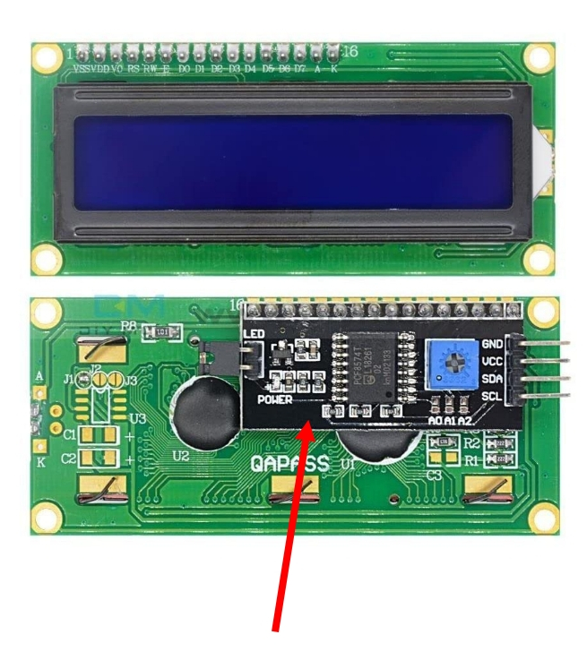

{{#title LCD1602 с I2C-дисплеем на ESP32 на embedded Rust}}

# ЖК-дисплей (LCD)

В этом разделе мы будем использовать символьные ЖК-дисплеи (LCD, Liquid Crystal Display) на основе совместимого с Hitachi HD44780 контроллера. Такие дисплеи можно увидеть в принтерах, цифровых часах, микроволновках, стиральных машинах, кондиционерах и других бытовых приборах. Они также используются в копировальных аппаратах, факсах и маршрутизаторах.

Такой дисплей может выводить ASCII-символы и до 8 пользовательских символов.

## Варианты
Бывают разные варианты, например 16x2 (16 столбцов, 2 строки) и 20x4 (20 столбцов, 4 строки), а также отличающиеся цветом подсветки (синяя, жёлтая или зелёная). У моего дисплея белые символы на синей подсветке. Однако можно выбрать любой вариант, это почти не повлияет на код. У большинства таких вариантов 16 выводов.

### Варианты с I2C
Некоторые варианты оснащены адаптером-переходником I2C, поэтому для связи можно использовать I2C. Главное преимущество варианта с I2C — меньшее количество соединений. Мы будем использовать ЖК-дисплей с адаптером I2C.

Если вас интересуют ЖК-дисплеи с параллельным интерфейсом, см. [раздел о LCD](https://pico.implrust.com/lcd-display) в версии этой книги для Pico. Однако имейте в виду, что параллельный интерфейс требует больше выводов GPIO (зато такие дисплеи дешевле).
 

Поэтому при покупке ЖК-модуля убедитесь, что у него всего четыре вывода и есть адаптер I2C, как показано на изображении.

## Аппаратные требования

Нам понадобится ЖК-дисплей LCD1602. Рекомендуется модуль 16x2 с адаптером I2C, чтобы вы могли следовать инструкциям без изменений, хотя дисплеи других размеров работают так же.

### Преобразователь уровней

Выводы GPIO ESP32 допускают напряжение до 3,6 В, а это значит, что они небезопасны при сигналах 5 В. Подача более высокого напряжения, например 5 В, на эти выводы может повредить плату. Многие LCD1602 с адаптером I2C рассчитаны на работу от 5 В, и при прямом подключении к ESP32 возникает несогласованность напряжений.

Чтобы безопасно соединить ESP32 и ЖК-дисплей, нужно устранить эту разницу напряжений. Для этого используется преобразователь уровней. Двунаправленный преобразователь логических уровней для I2C позволяет устройствам на 3,3 В и 5 В безопасно обмениваться данными и защищает выводы GPIO ESP32. Такие модули недороги и часто продаются под названием «4 Channel (I2C) 3.3V-5V Bi-Directional Logic Level Converter».

Кроме того, можно питать ЖК-дисплей напряжением 3,3 В. Это решает проблему напряжения, но подсветка и контраст дисплея будут заметно тусклее.

## Даташиты
- Даташит HD44780 можно найти на [Sparkfun](https://www.sparkfun.com/datasheets/LCD/HD44780.pdf) или на [сайте MIT](https://academy.cba.mit.edu/classes/output_devices/44780.pdf)
- [LCD Driver Data Book](https://www.crystalfontz.com/controllers/datasheet-viewer.php?id=433)
- [Даташит модуля LCD 1602A](https://www.openhacks.com/uploadsproductos/eone-1602a1.pdf)
