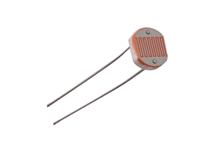

{{#title Датчик света LDR с ESP32 и embedded Rust}}

# LDR (фоторезистор)

В этом разделе мы будем использовать LDR (Light Dependent Resistor, он же светозависимый резистор или фоторезистор) с ESP32. LDR меняет своё сопротивление в зависимости от количества света, падающего на него. Чем ярче свет, тем меньше сопротивление, и чем темнее, тем оно больше. Поэтому LDR идеально подходит для таких задач, как измерение освещённости, автоматическое освещение или контроль уровня окружающего света.

## Необходимые компоненты:
- LDR (светозависимый резистор)
- Резистор (обычно 10 кОм), нужен для создания делителя напряжения
- Провода-перемычки (как обычно)

## Предварительные требования

Чтобы работать с этим, нужно разобраться, что такое делитель напряжения и как он работает. Также нужно понимать, что такое АЦП и как он функционирует.
- [Раздел о делителе напряжения](../core-concepts/voltage-divider.md)
- [АЦП](../core-concepts/adc/index.md)
