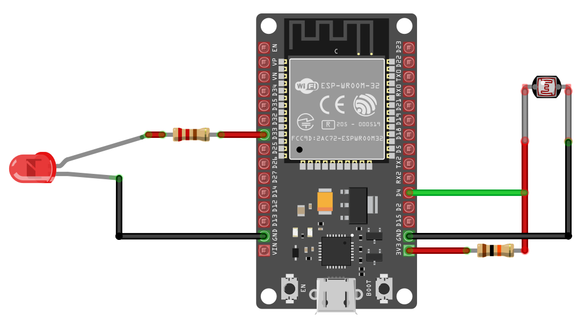

{{#title Включаем светодиод при слабом свете: LDR и ESP32}}

# Включаем светодиод (или лампу) при слабом свете с ESP32

В этом упражнении мы будем управлять светодиодом в зависимости от уровня окружающего освещения. Цель — автоматически включать светодиод при слабом свете.

Попробовать это можно в закрытой комнате: включайте и выключайте свет. Когда вы выключаете свет, светодиод должен включиться, если в комнате достаточно темно, и погаснуть, когда свет снова включат. Также можно изменить порог чувствительности или закрыть датчик света (LDR) рукой или каким-нибудь предметом, чтобы имитировать разный уровень освещённости.

Примечание: возможно, порог АЦП придётся подстроить под освещение вашей комнаты и конкретный LDR.

## Аппаратные требования

- **Светодиод** — любой стандартный светодиод (цвет на ваш выбор).
- **LDR (светозависимый резистор)** — используется для определения интенсивности света.
- **Резисторы**
  - **330 Ом** — для светодиода, чтобы ограничить ток и не допустить повреждения. (Может потребоваться подбор в зависимости от светодиода.)
  - **10 кОм** — для LDR, образующий делитель напряжения в схеме.
- **Провода-перемычки** — для соединения компонентов на макетной плате или с микроконтроллером.

## Схема подключения светодиода и LDR к ESP32

**Подключение LDR к ESP32**:

1. **Один вывод LDR** подключён к земле.
2. **Другой вывод LDR** подключён к **GPIO 4 (ADC2)** (то есть D4 на DevKit).
3. **Резистор** подключён последовательно с LDR, образуя делитель напряжения между LDR и **3V3**.

**Подключение светодиода к ESP32**:

Это обычная схема, которую мы уже делали раньше. Катод (короткую ножку) светодиода нужно подключить к земле. Затем анод (длинную ножку) через резистор 330 Ом подключить к GPIO 33 (то есть D33 на DevKit).
