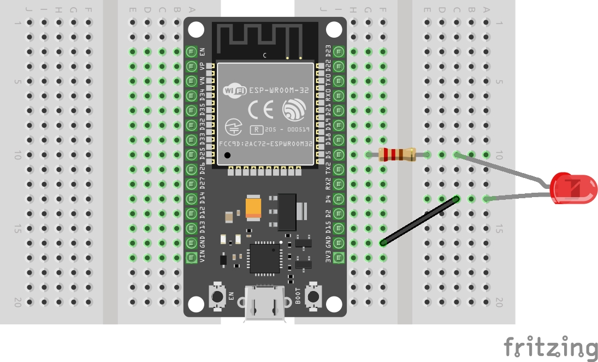

{{#title Плавное затухание внешнего светодиода на ESP32 с ШИМ в embedded Rust}}

# Использование внешнего светодиода

Тот же эффект затухания можно сделать и с внешним светодиодом.

## Аппаратные требования

- Внешний светодиод
- Резистор (330 Ом)
- Провода-перемычки (необязательно)
- Макетная плата (необязательно). Возможно, понадобятся две макетные платы, чтобы уместить ESP32 DevKit, так как он довольно широкий. Я купил две маленькие макетки и поставил по одной стороне ESP32 на каждую.


## Схема
- Подключите анод (более длинная ножка) внешнего светодиода к GPIO 5 ESP32 через резистор 330 Ом.
- Подключите катод (более короткая ножка) светодиода к выводу земли (GND) ESP32.
<br/><br/>



## Изменения в коде

В коде нужно лишь поменять номер GPIO с 2 на 5.

```rust
let led = peripherals.GPIO5;
```

## Высокоскоростной канал

Менять одну строку — не интересно. На этот раз используем высокоскоростной канал. Для этого нужно передать структуру `HighSpeed` и обновить источник тактирования, использовав перечисление `HSClockSource`.

```rust
let ledc = Ledc::new(peripherals.LEDC);

let mut hstimer0 = ledc.timer::<HighSpeed>(timer::Number::Timer0);
hstimer0
    .configure(timer::config::Config {
        duty: timer::config::Duty::Duty5Bit,
        clock_source: timer::HSClockSource::APBClk,
        frequency: Rate::from_khz(24),
    })
    .unwrap();
```


## Клонирование существующего проекта
Вы также можете клонировать (или посмотреть) созданный мной проект и перейти в папку `led-highfader`.

```sh
git clone https://github.com/ImplFerris/esp32-projects
cd esp32-projects/led-highfader
```

## Полный код

```rust
#![no_std]
#![no_main]
#![deny(
    clippy::mem_forget,
    reason = "mem::forget is generally not safe to do with esp_hal types, especially those \
    holding buffers for the duration of a data transfer."
)]

use esp_hal::clock::CpuClock;
use esp_hal::gpio::DriveMode;
use esp_hal::main;
use esp_hal::time::Rate;

// Для LEDC
use esp_hal::ledc::channel::ChannelIFace;
use esp_hal::ledc::timer::TimerIFace;
use esp_hal::ledc::{HighSpeed, Ledc, channel, timer};

#[panic_handler]
fn panic(_: &core::panic::PanicInfo) -> ! {
    loop {}
}

// Создаёт дескриптор приложения по умолчанию, который требуется загрузчику esp-idf.
// Подробнее см.: <https://docs.espressif.com/projects/esp-idf/en/stable/esp32/api-reference/system/app_image_format.html#application-description>
esp_bootloader_esp_idf::esp_app_desc!();

#[main]
fn main() -> ! {
    // generator version: 1.0.0

    let config = esp_hal::Config::default().with_cpu_clock(CpuClock::max());
    let peripherals = esp_hal::init(config);

    // let led = peripherals.GPIO2;
    let led = peripherals.GPIO5;

    let ledc = Ledc::new(peripherals.LEDC);

    let mut hstimer0 = ledc.timer::<HighSpeed>(timer::Number::Timer0);
    hstimer0
        .configure(timer::config::Config {
            duty: timer::config::Duty::Duty5Bit,
            clock_source: timer::HSClockSource::APBClk,
            frequency: Rate::from_khz(24),
        })
        .unwrap();

    let mut channel0 = ledc.channel(channel::Number::Channel0, led);
    channel0
        .configure(channel::config::Config {
            timer: &hstimer0,
            duty_pct: 10,
            drive_mode: DriveMode::PushPull,
        })
        .unwrap();

    loop {
        channel0.start_duty_fade(0, 100, 1000).unwrap();
        while channel0.is_duty_fade_running() {}
        channel0.start_duty_fade(100, 0, 1000).unwrap();
        while channel0.is_duty_fade_running() {}
    }
}
```
