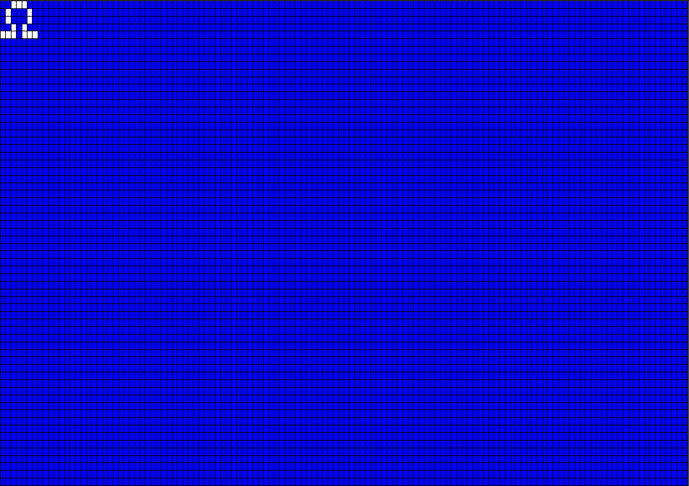

{{#title Вывод сырого изображения 1BPP на OLED-дисплей с ESP32}}

# Вывод сырого изображения на OLED-дисплей с ESP32

В этом упражнении мы выведем сырое изображение, используя только байтовые массивы. Создадим символ Ом (Ω) в формате 1BPP (1 бит на пиксель).

## Изображение 1BPP
Формат 1BPP (1 бит на пиксель) использует один бит для каждого пикселя. Он может представлять только два цвета, обычно чёрный и белый. Если значение бита 0, обычно это полностью чёрный пиксель. Если значение бита 1, обычно это полностью белый пиксель.

Символ Ом мы создадим на сетке 8x5 пикселей в формате 1bpp. Я выделил единицы в байтовом массиве, чтобы показать, как они включают пиксели и формируют символ Ом.

Ширину 8 я выбрал, чтобы пример оставался простым: ширину в 8 пикселей легко представить одним байтом (8 бит). Но если увеличить ширину, она уже не поместится в один байт, и её придётся распределить по нескольким элементам байтового массива. Я объясню это в следующих главах. Пока оставим всё просто.

## Символ Ом на OLED-дисплее (128x64)
Покажу, как выглядит символ Ом, помещённый на OLED-дисплей (разрешение 128x64) в позицию нуля (x = 0, y = 0).

Это увеличенная иллюстрация. Когда вы увидите символ на реальном модуле, он будет маленьким.

## Ссылки
- [Документация ImageRaw из embedded-graphics](https://docs.rs/embedded-graphics/latest/embedded_graphics/image/struct.ImageRaw.html) 
- [Image2Bytes](https://implferris.github.io/image2bytes/): конвертация изображения в шестнадцатеричный байтовый массив
